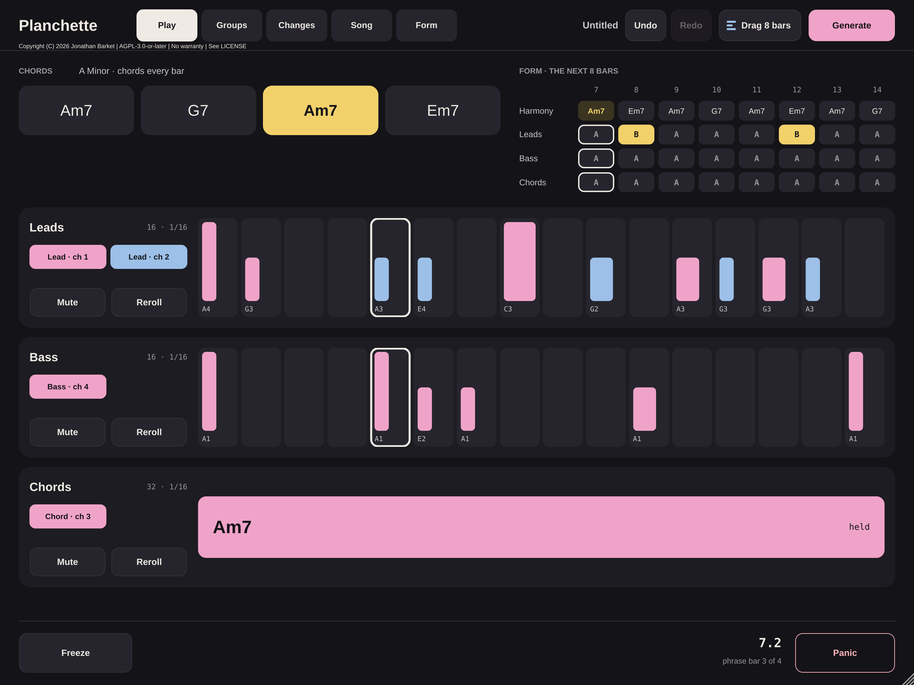

# Planchette

A generative hocketing MIDI plugin: one rhythm per group, voices taking turns playing it, every line
built on a harmony the song makes for itself, and everything a pure function of seed, settings and bar.
AUv3 on iPad (AUM, Loopy Pro, Drambo) and VST3 / AU in Ableton Live, from one codebase.

- **[SPEC.md](SPEC.md)**: the design (v0.6). Start there.
- **`engine/`**: the pure C++17 engine (no JUCE, no dependencies): seeds, pitch, harmony, rhythm, deal, the change
  matrix, MIDI rules, and the Player a plugin drives one audio block at a time.
  The change matrix (§7) replays from bar 0, so any bar is the same bar whenever you land on it.
- **`tests/`**: the spec's claims as checks, jump safety (any slice of a render equals the whole), the MIDI rules,
  and a golden render of the default song (64 bars) that must match byte for byte on every platform.
- **`tools/render.cpp`**: `planchette_render [seed-hex] [bars] [--mid out.mid]` prints a seed's events, or writes a MIDI
  file (one track per channel) to listen to in a DAW.
- **`tools/spec_arith.py`**: `python3 tools/spec_arith.py` prints every worked value SPEC §16 and §17 quote. It's
  a plain-Python port of §2.6 (no dependencies); its first line reproduces the golden file's header, which is how it's
  checked against the engine.

- **`plugin/`**: the JUCE plugin (VST3, AU on Mac, Standalone), a thin layer over the engine's Player, and
  `hosttest.cpp`, a host in miniature that loads the built plugin, presses Play, and checks its MIDI against the
  engine note for note.

  `snapshot.cpp` draws the editor while playing to a PNG, so the UI can be seen without a DAW.



## Try it in Live

Each push builds the plugin on Mac (universal: Apple silicon and Intel), Windows and Linux. The **plugin** workflow
validates each build with pluginval and the host test, then keeps it as a download: open the workflow run on GitHub
and grab `Planchette-macOS` or `Planchette-Windows`.

1. Put `Planchette.vst3` in your VST3 folder (Mac `~/Library/Audio/Plug-Ins/VST3/`, Windows
   `C:\Program Files\Common Files\VST3\`). On a Mac the download is unsigned: run
   `xattr -dr com.apple.quarantine ~/Library/Audio/Plug-Ins/VST3/Planchette.vst3` once, or macOS won't load it.
2. In Live, put Planchette on a MIDI track as an instrument. It makes no sound; it makes MIDI.
3. For one track per voice (SPEC §6.4): set Planchette's **MIDI to** to Port and pick the IAC Driver (Mac) or
   loopMIDI (Windows). Make four MIDI tracks taking input from that port, on channels 1–4, monitoring In, each with an
   instrument. Don't let Planchette's own track take input from the same port.
4. Press Play. Generate rolls a new seed. The default song: two leads trading one line (ch 1–2), sustained chords (ch 3),
   and a bass on the chord roots and fifths (ch 4), over a four-chord progression with an AAAB turnaround.

## Build and test

```sh
cmake -S . -B build -DCMAKE_BUILD_TYPE=Release
cmake --build build
ctest --test-dir build --output-on-failure
./build/planchette_render 0123456789abcdef 16 --mid planchette.mid

# the plugin (fetches JUCE 8.0.4)
cmake -S . -B build-plugin -DCMAKE_BUILD_TYPE=Release -DHOCKET_PLUGIN=ON
cmake --build build-plugin --target PlanchettePlugin_VST3 PlanchetteHostTest
```

### The iPad (AUv3)

On a Mac with Xcode (an Apple developer team for signing; a free account works for your own iPad):

```sh
cmake -S . -B build-ios -G Xcode -DCMAKE_SYSTEM_NAME=iOS -DHOCKET_PLUGIN=ON \
  -DCMAKE_XCODE_ATTRIBUTE_DEVELOPMENT_TEAM=<your team id>
open build-ios/planchette.xcodeproj
```

Run the `PlanchettePlugin_Standalone` scheme on the iPad: installing the app installs the AUv3 inside it. In AUM it's
under MIDI processors (it's a MIDI effect there, not an instrument), and its MIDI routes to the hardware by channel.
Not built or tried yet: it needs the Mac.

How varied are the songs one setup makes? `./build/planchette_variance [count] [bars] [setup|plain|walk|back|knobs]` renders
a setup through `count` Generates: a test song (F Phrygian, five matrix rows), the same with no rows, or the two
long-form starters. It reports:

- distinct progressions, rhythms and lines;
- how the features spread;
- song-against-song overlap, and how much the matrix moves a song within itself;
- rhythm drift (Toussaint's swap distance);
- Yang & Lerch's nine features, each compared three ways: home stretches, away stretches, and other songs.

`knobs` (`./build/planchette_variance 500 64 knobs`) asks how much each of SPEC §4.6's knobs (probability, ratchets,
fills) changes a song: each Generate with one knob on, against itself with it off.

A golden file only changes on purpose: `HOCKET_UPDATE_GOLDEN=1 ./build/planchette_tests` rewrites it, and a change to it
means every song changed (SPEC §2.4: bump `kEngineVersion`, keep the old path).

## Licence, third-party components and trademarks

Copyright (C) 2026 Jonathan Barket.

Planchette is licensed under **AGPL-3.0-or-later**; see [LICENSE](LICENSE) for the full terms.
The engine has no third-party dependencies. The plugin builds on JUCE 8.0.4 under its AGPLv3 option.
JUCE bundles the Steinberg VST3 SDK (used under GPLv3), Apple's AudioUnitSDK (Apache 2.0), and other
components listed in [JUCE 8.0.4's LICENSE.md](https://github.com/juce-framework/JUCE/blob/8.0.4/LICENSE.md).
Those components retain their own licences and notices.

VST is a registered trademark of Steinberg Media Technologies GmbH.
Apple, iPad, Mac, macOS and Xcode are trademarks of Apple Inc., registered in the U.S. and other countries and regions.
All other product and company names are trademarks of their respective owners; Planchette is not affiliated with
or endorsed by any of them.
