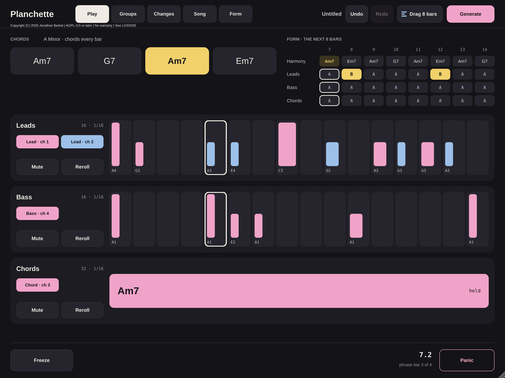
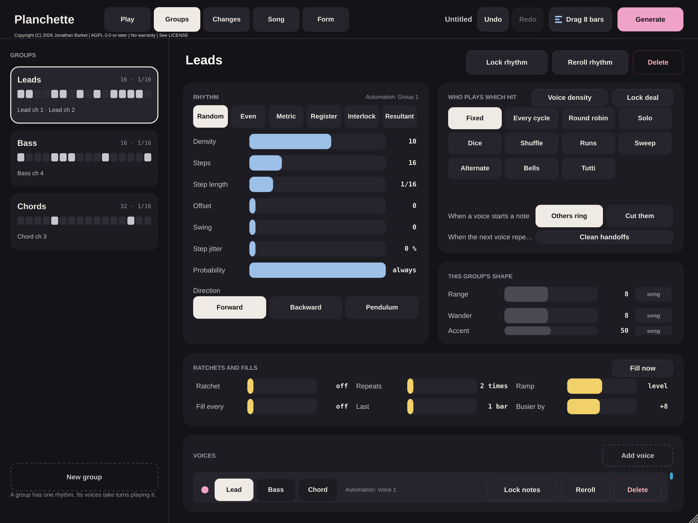
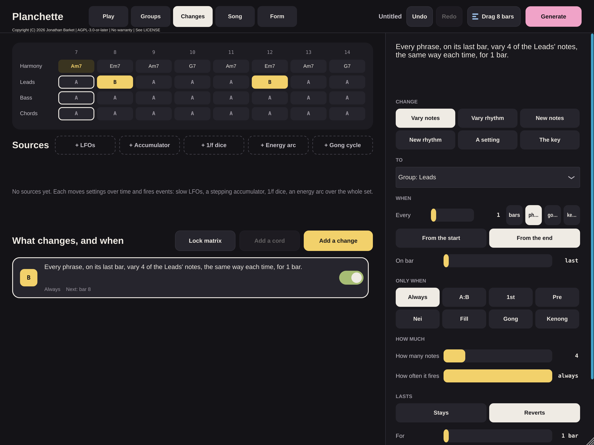
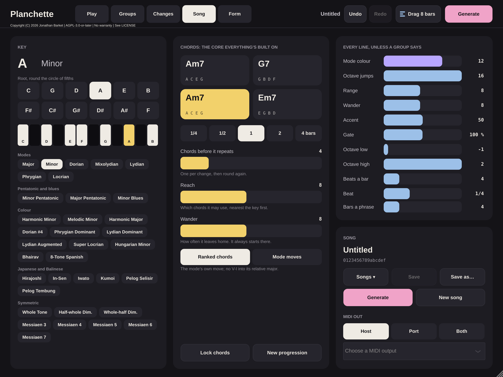

# Planchette: a generative hocketing MIDI plugin (spec v0.6)

A generative MIDI plugin: AUv3 on iPad (AUM, Loopy Pro, Drambo…) and VST3 / AU in Ableton Live, from
one codebase (§6).

## Changes from v0.5

| § | Change | Why |
|---|---|---|
| 16 | **Generator slots.** Rhythm (per group) and Notes (per Lead or Bass voice) each hold one generator, chosen and swapped, never stacked. Today's behaviour is each slot's default, word for word. A harmony slot waits for a second harmony generator | a generator can replace random rhythm creation with Euclidean rhythm creation |
| 16.4–16.7 | The first generators: Euclidean (its own Pulses), Metric (Barlow), Register (shift register / Turing Machine / Benjolin, with an inverted end), 1/f Wander, Pedal; later Additive, Interlock, Kotekan, Resultant | a choice of rhythm and pitch generators |
| 16.2 | A swap keeps the slot's frame: accents, gates, velocity, swing, deal, pool, octaves | a generator replaces one thing, not the slot |
| 17 | **Modulation.** Sources make triggers and levels; cords patch them to destinations; the change matrix is the first source | events can modulate selected attributes |
| 17.2 | One address for every parameter, generator parameters included | so the matrix and every other source can move a generator's knobs |
| 17.9 | Defined: a stored Step of 0 and a Start past the end; what Reset does to `step`'s amount; which bars are the dice's clocks | source boundary behaviour |
| 17.5 | Defined: a trigger cord that does nothing is still an item; FILL's state is after the expiries; A:B's clamp; an unknown condition never passes; the editor's next act reads the replay | condition boundary behaviour |
| 18.4 | **Tihai**: the group's own phrase three times with two gaps, landing accented on the sam, start + 3N + 2g = sam; every so many phrases or gongs, or Tihai now as a destination | three statements with two gaps land on the boundary |
| 18.3 | **Irama**: a group's notes per chord (1, 2, 4, 8, 16), its step worked out from the harmony; a destination, and a new level is played only from the next gong | density changes take effect at gong boundaries |
| 18.2 | **The colotomic clock**: a gong cycle and its kenong strokes, which rows count (Every gongs, kenongs), a Gong cycle source fires, and GONG and KENONG conditions read | large changes land on gongs and smaller changes on kenongs |
| 18.1 | **The form string**: A B A′ C…, each letter a seed-and-parameter snapshot played from its own bar 0, so a letter returns exactly; a Form screen, and editing a letter from every screen | a saved seed and parameter snapshot returns exactly |
| 9.2, 17.6 | Defined: Freeze takes hold on a bar line and plays the state of the bar before it; the song's own clocks run on; a jump, Stop or Play lets go and switches it off | Freeze follows bar-line state |
| 17.4, 17.6 | Defined: how levels at two scopes read v, which letter the strip shows when two layers overlap, and that an As-given delta of 0 pushes no layer | layer composition behaviour |
| 17.5 | Conditions (A:B, 1ST, PRE, NEI, FILL) as gates on rows and cords | the vocabulary is the one Elektron’s sequencers use for trig conditions, so it is already familiar |
| 2.4 | Generator and source names, and their algorithms, are frozen once released | a song names its generators |
| 3.2, 16.5 | Pedal becomes a Notes generator (a voice's line measured from the tonic), not a switch; a v0.5 song's Pedal reads as it | one choice among the line's generators |
| 15 | The pedal and voice-leading questions are answered (§16.5, §3.4a) | both are built |
| 5.8 | **Density from the voices.** A group setting: each member has its own Density, a position inside the group's, and the line's density and the deal's weights are worked out from them. Off by default | each voice has its own density control |
| 1.2, 4.3 | A voice can override Accent and Gate %: how hard and how long its own notes are. Which hits are accented, and each hit's gate class, stay the group's | so two members of one line can be played apart from a strip each |
| 12.2 | **Voice slots**: 16 of them, as the 8 group slots; the group slots gain Accent, Gate %, Probability and Reroll; a control with a host parameter reports its touches, so a host's learn mode picks it up | controls can be mapped through the host |
| 9.3 | **Live changes.** A change that moves only what can't disturb a clock or a seed (Density, a member's Density, Probability, Ratchet, Fill, Accent, Gate %, Mute, Solo member, Weight, Range, Wander, Octave Low/High) is heard from the next step, not the next bar line. Everything else, and the matrix, stays on bar lines | a knob is heard when it is turned, not a bar later |

**How it's played.** The iPad sits above the hardware (Syntakt, Digitone II), running Planchette inside AUM.

- AUM owns the clock and transport. It sends MIDI clock to the Elektrons and gives Planchette the tempo and position.
- Drums run on the Elektron sequencers.
- Melodic lines: Planchette sends them to the MIDI channels you set up, and AUM routes them to the hardware.

You set Planchette up first, then leave it alone:

- the change matrix (§7) evolves the music and gives it phrase structure (turnarounds, AABA forms) on bar lines;
- your hands stay on the hardware: filters, delay throws, preset changes;
- the live surface has only a handful of controls (§9).

**Design pillars:**

- **No chord input.** Planchette makes its own harmony from Root, Scale and a seed (§4.5), and every line is built on it.
- **One shared core.** The harmony is the song's spine. Lines take their notes from the current chord, and Wander
  takes them away from it.
- **Any number of voices, in groups.** A group has one rhythm, and its members take turns playing it.
- **Deterministic.** The same settings and the same seed give the same performance, bar for bar (§2).
- **Stable knobs.** Turning a knob up by one changes one thing; turning it back gives the same result back.
- **Generators are choices; modulators move them.** How a rhythm, a line or the harmony is made is one generator per
  slot (§16), swapped, never stacked. The change matrix and the other modulation sources (§17) move its knobs and
  everything else over time.

## 1. Model

```
Song
 ├─ Master seed (64-bit), bar length (beats, default 4; tempo comes from the host), phrase length (bars, default 4)
 ├─ Global: Root, Scale, Range, Wander, Octave Low/High, Accent, Gate %
 ├─ Harmony: seed, Changes every, Length, Range, Wander                                            (§4.5)
 ├─ Group[]                        (every voice is in exactly one group; a group of 1 = "free")
 │   ├─ Rhythm: seed, generator (§16), Density, Steps (1–64), Beat division, Offset, Direction, Swing, Step Jitter
 │   ├─ Deal mode, Density from voices (§5.8), Overlap mode, Span, Handoff, Solo select (CC / note),
 │   │   Automation slot (none | 1–8)
 │   ├─ Overrides (optional): Range, Wander, Accent, Gate %
 │   └─ Voice[]
 │       ├─ Type: Lead | Bass | Chord
 │       ├─ MIDI channel, Octave transpose (−3…+3), Weight (0–16), Density (0–16, §5.8), Mute,
 │       │   Automation slot (none | 1–16)
 │       ├─ Chord only: Chord size, Voicing, Articulation
 │       ├─ Pitch seed; Lead and Bass: Notes generator (§16)
 │       └─ Overrides (optional): Range, Wander, Accent, Gate %, Octave Low/High
 ├─ Change matrix: Row[] (§7): the first modulation source
 └─ Modulation: Source[], Cord[] (§17)
```

### 1.1 The split

| Belongs to | What | Why |
|---|---|---|
| Group | rhythm: hits, accents, gate classes, step count | one rhythm per group means the hocket always sounds like one line, and it's something you can draw |
| Voice | pitch: its own note array, octave jumps, channel, timbre; and, if it overrides them, how hard and how long its notes are (Accent, Gate %, §4.3) | each member gets a different shuffle of the scale |

### 1.2 Overrides

Range, Wander, Accent, Gate % and Octave Low/High resolve Voice → Group → Global: the first level that sets a value
wins. An overridden value shows as such in the UI and can be cleared back to "inherit".

### 1.3 Voice types

| Type | Polyphony | What changes |
|---|---|---|
| Lead | mono | the baseline. Default octave transpose +1 |
| Bass | mono | the same engine as Lead. Defaults: octave transpose −1, and a group override of Range 3 and Wander 4 when the type is first set |
| Chord | poly | voices the song's harmony (§4.5), sustained by default (§3.4). Default octave transpose +1 |

## 2. Determinism and seeds

### 2.1 The rule

Every random decision in Planchette is drawn from a stream seeded by `hash(masterSeed, path…)` (§2.6). There is no
system RNG, no wall-clock time, and nothing depends on the order things happen in at runtime.

- A path names the decision: for example `("group", groupID, "hits")` or `("matrix", rowID, barIndex)`.
- IDs are stored in the song, so the same file behaves the same on any device.

**Same Song file + same live inputs → the same MIDI, bar for bar.** "Live inputs" means Solo switches, rerolls you
trigger by hand, and Freeze (§9). With none of those, a song plays out the same every time.

**Any bar can be worked out on demand.** The state at bar N is the saved setup plus the change matrix replayed from
bar 0 to N, which is only integer maths per row per bar. So when the host jumps (an Ableton loop brace, scrubbing
the arrangement, AUM restarting), Planchette plays exactly what that bar sounded like last time.

Live inputs on a jump:

- Manual rerolls are discarded. Planchette returns to the pure, replayable state.
- Freeze is released.
- The Solo selection is kept. It's a physical control position (an encoder you're holding), not part of the song.

Clocked generators (§16.3) follow their group's anchor, so they share its one caveat (§4.4): a hand-made or
host-automated change to a group's clock settings while playing re-anchors there, and a jump replays without it.

Host automation is not a live input: it sets base values (§7.3), and Planchette reads whatever the host says now. A jump
replays the matrix over the base the host gives at the new position. Logging live inputs, so a whole jam can be
replayed, is deferred (§15).

### 2.2 Generate

- Generate re-rolls every unlocked group and voice seed. The new seeds are
  `hash(masterSeed, "generate", generateCount, path)`, and `generateCount` is stored in the song.
- Generate also re-rolls the matrix's seed (§7.3), so a new Generate gets new matrix rolls too, not the same key
  moves and rerolls on the same bars as every other Generate.
- Lock toggles skip a seed on Generate: the Harmony; the Matrix; per group, Rhythm and Deal; per voice, Notes.
- Before 1.0 the rules can still change: a change to how a feature works may change saved
  songs too. `kEngineVersion` counts those changes; the golden file is rewritten on purpose when it does.
- Pattern arrays are pure functions of seed + knob values:

  ```
  harmony   = f(harmony.seed, harmony range, harmony wander, length)   // chord roots, as indices into ranked(Root)
  noteArray = f(voice.pitchSeed, range, wander, steps)          // pool indices; pitch is resolved at play time (§3.2)
  rhythm    = f(group.rhythmSeed, density, steps)
  ownership = f(group.dealSeed, members, weights, mode, cycleIndex)
  ```

  These are the default generators (§16). Another generator in a slot is a pure function of the same seed, its own
  parameters and its clocks, or is replayed from bar 0 (§16.3).

- Nothing generated is stored, only seeds and settings.

### 2.3 Is 64 bits enough?

Yes. The seed is the bottleneck, not the music.

One group, one 16-step pass, with a single voice, a 5-note pool, Density 8 and Wander 8:

- Rhythms: C(16,8) = 12,870.
- Note orders: 16! / (9!·2!·2!·2!) = 7,207,200.
- So one bar of one voice is already about 10¹¹ outcomes.

Add a second member and the deal, then a few minutes of matrix changes, and the outcome space passes
2⁶⁴ ≈ 1.8 × 10¹⁹ almost at once.

The chance of an accidental collision:

- Two people with independently random seeds share one only with probability 1 / 1.8 × 10¹⁹.
- Even with a million songs ever made, the chance that any two share a seed is about 3 × 10⁻⁸.
- They'd also need identical settings.

One honest caveat: at extreme settings, different seeds sound identical because there is only one possible output.
Wander 1 is all roots; Range 1 is the root only. That's the music, not a collision.

**Sharing:** a seed is shown as 6 words from the BIP-39 English word list (2048 words, public, frozen). This uses
the list only, not BIP-39's checksum scheme:

- 6 words carry 66 bits: the 64-bit seed, then 2 checksum bits = the low 2 bits of `hash(seed, "words")`.
- Word i (0…5) is bits `65−11i … 55−11i` of the 66-bit value, most significant first.
- A mistyped word is caught 3 times in 4.

Example: `velvet-orbit-lunar-ankle-wisdom-tray`. A shared song is either the song file, or the seed words plus
settings.

### 2.4 Things that must stay frozen forever (or be versioned)

- The hash, the stream and `below` (§2.6).
- Rounding: `rdiv` and `rsdiv` (§2.6). Every `round` in this spec means `rdiv`; `div`, `mod`, `ceilDiv` and `reflect`
  are §2.6's.
- The shuffle: Fisher–Yates, drawing from the end (§2.5).
- The constant tables: PREF (§3.1), OCT (§3.5), LONG (§4.2), DIVISION (§4.4), and the scale table (Appendix A).
- **No floating point in any pattern decision.** Every table is stored as integers. Time is integer ticks (§4.4).
- Generator and modulation-source names (Appendix B), and each one's algorithm, hash paths and tables (§16, §17.9):
  the Metric generator's U(p) rule (§16.4), the energy arc's shape (§17.9), and the destination keys (§17.2). New
  ones are only ever added.

Every song stores an `engineVersion`. If any of the above ever changes, old versions stay in the code so old songs
still play the same.

### 2.5 Priority order

Most arrays start from a priority order: a seeded shuffle P of all 64 slots. Things are assigned in P order,
skipping slots ≥ Steps.

```
a = [0, 1, …, 63]
s = stream(h)                          // h names the order, e.g. hash(rhythmSeed, "hits")
for i in 63 down to 1:
    j = s.below(i + 1)
    swap(a[i], a[j])
P = a
```

- Turning a knob up by one changes exactly one slot.
- Changing Steps keeps the relative order of the slots that remain. Shortening a pattern doesn't reshuffle it.

### 2.6 The exact arithmetic

All arithmetic is on unsigned 64-bit integers, wrapping.

```
mix(z):                                        // SplitMix64's finalizer
    z = (z ^ (z >> 30)) * 0xBF58476D1CE4E5B9
    z = (z ^ (z >> 27)) * 0x94D049BB133111EB
    return z ^ (z >> 31)

enc(c):                                        // one path component
    integer  → its 64-bit two's-complement value;          kind = 1
    string   → FNV-1a 64 of its UTF-8 bytes
               (offset 0xCBF29CE484222325, prime 0x100000001B3);  kind = 2

hash(seed, c1, …, cn):
    h = mix(seed)
    for each c: h = mix(mix(h ^ enc(c)) + kind(c))
    return h

stream(h):                                     // a SplitMix64 generator
    state = h
    next(): state = state + 0x9E3779B97F4A7C15; return mix(state)

below(n):                                      // n ≥ 1; Lemire's unbiased method
    x = next(); m = x * n as 128 bits; l = low 64 bits of m
    if l < n:
        t = (2⁶⁴ − n) mod n
        while l < t: x = next(); m = x * n; l = low 64 bits of m
    return high 64 bits of m

roll(h)  = stream(h).below(100)                // a percentage roll, 0…99
rdiv(a, b) = (2a + b) div (2b)                 // a ≥ 0, b > 0: round half up
```

`tools/spec_arith.py` is a plain-Python port of this section, for reproducing the spec's worked examples
(`python3 tools/spec_arith.py`).

Outside the hash and the stream, the spec's arithmetic is on signed integers, and these are exact for any sign
(b > 0):

```
a div b        = ⌊a / b⌋                            // rounds down: −1 div 4 = −1
a mod b        = a − b · (a div b)                  // always 0 … b−1: −1 mod 4 = 3
ceilDiv(a, b)  = −((−a) div b)                      // rounds up
rsdiv(a, b)    = sign(a) · rdiv(|a|, b)             // round half away from zero
clamp(v, lo, hi) = max(lo, min(hi, v))
reflect(v, lo, hi):                                 // bounce between lo and hi (§7.3)
    if hi ≤ lo: return lo
    p = 2 · (hi − lo);  x = (v − lo) mod p
    return lo + (x ≤ hi − lo ? x : p − x)
```

## 3. Pitch

### 3.1 Ranked note list

One fixed interval preference list, kept to whatever the scale contains, measured from a given root r:

```
PREF = [0, 7, 4, 3, 10, 11, 9, 2, 5, 8, 6, 1]     // root, 5, M3, m3, m7, M7, 6, 2, 4, m6, tritone, m2
ranked(r) = [(r + i) % 12 for i in PREF if (r + i - Root) % 12 ∈ scaleIntervals]
```

| Scale | ranked(Root), C root |
|---|---|
| Major | C G E B A D F |
| Dorian | C G E♭ B♭ A D F |
| Minor pentatonic | C G E♭ B♭ F |
| Whole tone (no 5th) | C E B♭ D G♯ F♯ |

This works for every scale in Appendix A with no per-scale tables. The harmony uses it from Root; every voice and
every chord uses it from the current chord root (§3.2, §3.4).

Read from a chord root, PREF *is* "how far from the core": root, fifth, thirds and sevenths (the chord tones) come
first, then the sixth, second and fourth, then the rest.

### 3.2 Range → pool, from the current chord

```
r        = currentChordRoot (§4.5)
n        = ranked(r).count
poolSize = clamp(rdiv((n-1) * (Range-1), 15) + 1, 1, n)      // Range 1…16
pool     = ranked(r)[0 ..< poolSize]
```

- Range 1 gives the chord root only. Range 16 gives the whole scale, ordered from the chord outwards.
- **Pedal** (a Lead or Bass voice's Notes generator, §16.5): the voice measures from the key's tonic (Root, as the
  matrix has it), not the chord root. Range 1 is a drone on the tonic under the moving harmony; higher Range a line
  around it. Modal practice holds the tonic in the bass so the mode stays the centre (§3.7).
- The 16 positions are spread evenly over the scale's size, so the knob feels the same for a 5-note or a 9-note scale.
- A note array stores **pool indices**, not pitches. Pitch is `pool[index]` at play time, so Root, Scale, Range and
  harmony changes all apply instantly and nothing can fall out of the scale.
- When the chord changes, a voice keeps its shape (which slots are roots, which wander) and moves its centre to the
  new chord: a bass on Range 3 plays the chord's root and fifth, and Range 5 adds the third. That is the shared core.
- **Range** says how far a line may reach from the chord's core tones; **Wander** (§3.3) says how often it leaves the
  chord root. Low Range and low Wander hug the harmony; high values take the line away from it.

### 3.3 Wander → note array (Lead, Bass)

```
L      = Steps
roots  = (poolSize == 1) ? L : max(1, rdiv(L * (17 - Wander), 16))   // Wander 1 → all roots; 16 → 1/16 roots
m      = poolSize - 1                                                 // the non-root pool indices are 1…m
P      = priority order (§2.5) from hash(pitchSeed, "notes"), keeping slots < L
for j in 0 ..< L:
    slot = P[j]
    index[slot] = (j < roots) ? 0 : 1 + (L - 1 - j) % m              // counted from the END of P
```

- Non-root notes cycle evenly through the pool.
- Wander is nested. One notch changes about one root per 16 steps into a non-root note, and every other slot stays
  put. Sweeping it sounds like the riff loosening, not being replaced.
- Range re-cycles the non-root slots, but the slots that hold roots stay where they are.
- **Steps also re-cycles the non-root slots** (L is in the formula); the root slots keep their places. Even cycling
  is worth more than stability here: a cycle over a 64-slot order could leave one note on every non-root slot.

### 3.4 Chord voice

A Chord voice voices the song's harmony (§4.5): the current chord, in its own size, voicing and articulation. It
makes no progression of its own, so every Chord voice plays the same chords, and the lines are built on them too.
Its settings:

- **Chord size** (1–6, default 4) sets how rich the chord is.
- **Voicing** (1–16) below.
- **Articulation** (§4.5): Sustain (default), Restrike accents, Restrike hits, or Pulse.

Range and Wander don't apply to a Chord voice; the harmony's own Range and Wander (§4.5) choose the chords.

The chord on root r is the first `size` notes of ranked(r): the same preference list measured from r, taken from the
whole scale, not limited to the pool. That gives sensible harmony in any scale with no chord tables:

| Scale | Chord on | ranked(r) → size 4 |
|---|---|---|
| C major | C | C G E B → Cmaj7 |
| C major | G | G D B F → G7 |
| C major | A | A E C G → Am7 |
| C minor pentatonic | E♭ | E♭ B♭ G C → E♭6 |

For example, Harmony Range 5 with Chord size 4 in C major moves only between Cmaj7, G7 and Em7. (Range 3 is a pool of
two in a 7-note scale: Cmaj7 and G7. v0.4's example said 3; the formula says 2.)

Then:

- The chord is folded into one octave above the voice's base and sorted.
- The Voicing variant applies.
- The result is sorted and deduplicated.

Voicing (1–16), where n is the ascending chord notes:

| Voicing | Result |
|---|---|
| 1 | as is |
| 2 | if 2+ notes: n[0] += 12 |
| 3 | if 3+ notes: n[0] += 12, n[1] += 12 |
| 4 | add last + 12 on top |
| 5 | add n[0] − 12 underneath |
| 6 | if 3+ notes: n[1] += 12; then add n[0] + 12 on top |
| 7 | everything up 12, then add the original n[0] underneath |
| 8 | add last + 7 on top |
| 9–16 | the same as 1–8, then remove n[1] if there are more than 2 notes |

A Chord voice has no octave lane; its base is `36 + 12·(Octave Low + 1) + 12·octaveTranspose`, so the default
(Octave Low −1, transpose +1) voices from MIDI 48, C3.

### 3.4a Voicing "nearest" (voice leading)

Sustain ties common tones (§4.5), but a fixed Voicing builds every chord the same way. **Nearest** is the Voicing's
other option (per Chord voice, on / off, default off). With it on, each chord takes the inversion closest to the chord
before it, so the voices move as little as they can. The Voicing (1–16) still sets the chord's shape.

```
pass start   the chord as §3.4 builds it, in the Voicing          // each pass through the progression starts afresh
each change  of the chord's inversions, the closest to the chord before:
               inversions = the §3.4 chord; its top note down an octave, 1…n−1 times; its bottom note up, 1…n−1 times
               distance   = Σ |aₖ − bₖ| over the notes in order, when both chords have n notes;
                            otherwise each note's distance to the nearest note of the other chord, summed both ways
               a tie      : stream(hash(pitchSeed, "nearest", change)).below(count), over the tied ones from the lowest
```

- **Deterministic and replayable.** A chord is a function of the chords since the start of its pass (at most 16), so
  any tick works it out on demand, a jump included. `change` counts from the harmony's anchor (§4.5).
- **It never drifts.** A chord stays within an octave of where §3.4 would put it, and every pass starts back there.
- **The same chords**, the same pitch classes and the same number of notes, only voiced closer. A restrike or a Pulse
  hit plays the chord its change has.
- **What it does.** §3.4 already folds every chord into one octave above the voice's base, which is close voicing for
  free. Nearest matters where a chord tone crosses that octave's edge: B to C, say, is 11 semitones folded and 1 led.
  For triads (Chord size 3), over 40 default songs (harmony Length 8, Range 12, 16 bars), the voices move 1264
  semitones inside the passes with Nearest, against 2020 in the fixed Voicing. That's 37 % less, and less in 38 songs
  of 40. At size 4 it's 8 % less, and it's never more for any song or Voicing measured.
- Off, the chord is §3.4's, bit for bit. Songs from before it have it off.

**In the change matrix**, Voice leading is a pick-one target of a Chord voice (Fixed / Nearest). This section adds to
the lists in §7.2 and §10; it's kept in one place here.

### 3.4b Stagger and Top: a hand, not a block

A chord struck all at once, every note on the same tick at the same velocity, is a machine's chord. A pianist's hand
puts the notes down a little apart, and in a progression it moves the voices that move and leaves the ones that stay.
It also plays the top of the chord louder than the inside. **Stagger** spreads the notes a chord strikes over a short
time, in an order. **Top** brings the chord's top note forward and the inner notes back. Both are per Chord voice and
off by default.

| Setting (per Chord voice) | Key | Range | Default |
|---|---|---|---|
| Stagger | `stagger` | 0–16 | 0 (off) |
| Order | `staggerOrder` | Up (lowest first), Down (highest first), Seeded | Up |
| Lean | `staggerLean` | Late (from the strike on), Around (half before it, half after) | Late |
| Top | `top` | 0–16 | 0 (off) |

Stagger is the chord's own timing. Feel: timing (§4.7) still leaves chords alone, so the notes they share still tie.

#### Stagger

**Which notes.** Only the notes that start at a strike. At a change (Sustain, §4.5), a note both chords share is held
and doesn't move; only the notes that move are spread. At a fresh strike (the start of a pass, a restrike, a Pulse
hit) every note starts, so every note is spread: a roll.

```
spread   = (240 · Stagger) div 16                      // up to a 1/16 note at 16, whatever the tempo
for each neighbour at distance d < 2 · spread:         // this voice's strikes before and after it, and the edges of
    spread = min(spread, d div 2)                      // the section it's in (§18.1); never halfway to one
m        = the notes starting here, ordered by Order:
             Up: lowest first;  Down: highest first;
             Seeded: priority order (§2.5) from hash(masterSeed, "stagger", voiceID, strike), over the notes from
             the lowest, keeping places < m
offset_i = (m ≥ 2) ? spread · i div (m − 1) : 0        // i = 0 … m − 1
Around:    offset_i −= spread div 2                    // at the song's or a section's start, Around plays as Late
start_i  = strike + offset_i
```

`strike` is the tick the chord is struck from: its change (or, under Push, its arrival, §4.8), a pass's start, or the
restrike's or Pulse hit's sounding tick. A voice's strikes are those that sound: a restrike or a Pulse hit that
Probability drops (§4.6) isn't one, and a muted voice has none. A Pulse hit's ratchet repeats (§4.6) are spread the same
way, at the same offsets, and they're neighbours: a ratcheted hit's spread fits between its repeats. The look-ahead is bounded: only a neighbour
within 2 · spread (at most 480 ticks) matters.

**Where a moving note lets go.** When as many notes leave at a strike as arrive (always, at a change between two chords
of one size), they pair up in pitch order: the lowest leaving note with the lowest arriving one, and so on up. A
leaving note ends when its partner starts, so each voice moves on its own, legato. Otherwise every leaving note ends at
the strike's first start (`strike + min offset`), so nothing overlaps the new chord for long. Either way a note ends no
later than its own pitch starts again (§11's rule, said here so the timing is the spec's, not the MIDI layer's).

A Pulse note keeps its length: it ends at its own start plus the hit's gate, as it does today, moved by its offset.

- **Its own stream.** The Seeded order is drawn from the master seed and the voice's ID, as Feel is (§4.7), not from the
  pitch seed. A new Generate or Lock notes keeps the hand; only the chords change. Up and Down draw nothing.
- **Deterministic.** Everything is a function of the strike's tick, the voice and the song. A jump replays it.
- **Nested.** Stagger scales the offsets: turning it up moves each note further the same way, and the order doesn't
  change. At 0 nothing is drawn, so a song from before it plays as it did, bit for bit, and `kEngineVersion` stays.
- **It never crosses a strike.** The offsets stay inside half the gap to the strikes on either side, so the notes of
  one strike are all down before the next strike's first note. That holds for the strikes replay can know: a live
  change (§9.3) that adds a hit inside a spread already under way (a Restrike hits voice's group turning its Density
  up) can land among its notes.
- **Jumps.** A jump (§6.3) lands among a chord's spread notes as it would on any tick: the notes that have started
  sound, and the rest start at their own ticks.
- **Edges.** A section's start and end are neighbours, so nothing spreads across one (§18.1). At the song's or a
  section's start, Around plays as Late, so the roll keeps its shape rather than bunching against the edge.
- **With Push (§4.8)** the strike is the change's arrival: the moving voices spread around the riff's hit.
- **Velocity** is each note's own, with Top below, then Feel: velocity (§4.7), as before.

#### Top

```
n        = the chord's notes as struck, ascending (the whole chord, held notes included)
v_note   = v + Top              for n's highest note
           v                    for n's lowest note
           v − Top div 2        for every note between
         (a chord of one note: v)
v_note   = clamp(v_note, 1, 127)
```

`v` is the velocity §4.5 gives the strike (a sustained chord's normal velocity, a restrike's or Pulse hit's own).
`v_note` then goes through Feel: velocity (§4.7). (It's clamped here because Feel at 0 passes a velocity through
untouched: an accented restrike at 113 with Top 16 would otherwise send 129.) A note held through a change keeps the
velocity it was struck with, so at a change Top shapes only the notes that move: when the new top note is a held one,
the chord's loudest note may be a new inner one. That's the price of a tie, and a fresh strike (a pass's start, a
restrike) balances the whole chord again. Top draws nothing, so it's exact: the same value plays the same chord on every replay, and a matrix move on it adds to
the same value. At 0 a song plays as it did, bit for bit.

The lowest note stays at `v` because the bass of a chord is the other voice a listener follows; only the inside steps
back. Top is per Chord voice, so a pad and a stab can be balanced apart.

#### Worked values

`python3 tools/spec_arith.py`, "§3.4b Stagger" and "§3.4b Top": C major, a Chord voice at its default base (MIDI 48),
size 4, Voicing 1, Sustain, changes every bar (3840 ticks).

```
Cmaj7  C3 E3 G3 B3
→ G7   D3 F3 G3 B3     holds G3 B3   moves C3→D3, E3→F3
         Stagger 8  (spread 120), Up, Late:   D3 +0    F3 +120          C3 ends +0,  E3 ends +120
                                  Around:     D3 −60   F3 +60           C3 ends −60, E3 ends +60
         Stagger 16 (spread 240), Up, Late:   D3 +0    F3 +240
→ Am7  C3 E3 G3 A3     holds G3      moves D3→C3, F3→E3, B3→A3
         Stagger 8,  Up, Late:    C3 +0    E3 +60   A3 +120
         Stagger 8,  Up, Around:  C3 −60   E3 +0    A3 +60
A fresh strike of Cmaj7, Stagger 8:   Up C3 +0 E3 +40 G3 +80 B3 +120;   Down B3 +0 G3 +40 E3 +80 C3 +120
Restrike hits every 1/16 (gap 240), Stagger 16: the spread is held to 120, C3 +0 E3 +40 G3 +80 B3 +120
Top on Cmaj7 at velocity 100:   Top 8   C3 100  E3 96  G3 96  B3 108;   Top 16   C3 100  E3 92  G3 92  B3 116
```

So at Stagger 8 on Up the bass voice of the chord moves on the change, and the voices above it follow it within a
1/32 note: a hand, not a block.

**In the change matrix**, Stagger and Top are numeric targets of a Chord voice, and Order and Lean are pick-one targets.
"Chords · Stagger · ±4 · every 3 phrases" loosens and tightens the hand; "Chords · Top · ±4 · every 2 phrases" brings
the top line forward and back. They're addressed by key (§17.2) and none moves a clock, so a level cord may drive
Stagger and Top too. This section adds to the lists in §7.2 and §10; it's kept in one place here.

### 3.5 Octave jumps (Lead, Bass)

Each voice has an octave lane: −1, 0, +1 or +2 per slot. Two rolls per slot, a and b, each in 0…99:
`a = roll(hash(pitchSeed, "octave", slot, "a"))`, `b = roll(hash(pitchSeed, "octave", slot, "b"))`.

```
OCT[D] = 10 + (20*(D-1)) div 15           // 10 % of slots jump at Density 1, 30 % at 16
lane   = a >= OCT[Density] ? 0
       : b < 50 ? +1 : b < 85 ? -1 : +2
```

Because the rolls are stored per slot, a slot keeps its jump as Density changes. Density comes from the voice's group.

### 3.6 Step → MIDI note

```
lo, hi = Octave Low, max(Octave Low, Octave High)          // −1…2, resolved per §1.2
oct    = (lo == hi) ? lo : clamp(lo + rdiv((lane + 1) * (hi - lo), 3), lo, hi)
note   = clamp(36 + pc + 12*oct + 12*voice.octaveTranspose, 0, 127)
```

`pc` is the slot's pitch class (`pool[index]`). With the default Octave Low/High of −1 / 2, a voice at transpose 0
has its home octave (lane 0) at MIDI 36–47 and spans 24–71; a Lead (+1) is at home in 48–59.
`lane + 1` is 0…3 and never negative, so `rdiv` applies.

**Octave jumps** (0–16, global, default 16) scales how often a slot leaves lane 0: the lane roll's threshold is
multiplied by Octave jumps / 16. 16 is the table above; 0 keeps every note in the home octave, so a line moves by
steps more than leaps (in the default song, the lead's average jump goes from 7.4 semitones at 16 to 3.3 at 0). The
lanes are nested: one notch up adds jumps and moves none.

### 3.7 Mode colour

§3.1's ranking is the same for every scale, so a mode's own note ranks where any scale's would. Phrygian's ♭2 is last,
Dorian's 6th never reaches a chord, and Dorian at defaults plays like plain minor. **Colour** (0–16, global, a host
parameter) brings the mode back, still with no per-scale tables.

- **Colour notes.** For a scale of 7 or more notes, compare it with major and with natural minor. What it has that
  the nearer of the two lacks is its colour, when that's 1 or 2 notes. Phrygian ♭2; Dorian 6; Lydian ♯4; Mixolydian
  ♭7; Locrian ♭2 ♭5; harmonic minor M7; Phrygian dominant ♭2 M3. Major, minor, scales under 7 notes and the
  octatonics have none.
- **Pulling.** Each ranking moves some notes toward a place, Colour/16 of the way (integer, truncating):
  `pos = i + (target − i) · Colour / 16`. Ties keep notes moving forward first, then notes staying, then notes moving
  back. Otherwise the order is the original one.
- **Harmony** (the chord roots, §4.5): the tonic stays first. A root whose chord (§3.4's, three notes) holds a
  colour note moves toward place 1. A root with no perfect fifth in the scale moves to the end. At full Colour on F:
  Phrygian Fm, E♭m, G♭; Dorian Fm, Gm, B♭7; Lydian F, Em, G.
- **The relative major**: a mode of the major scale has a parent major key (F Phrygian's is D♭, D Dorian's C). Its
  tonic chord pulls the music into that key (modal practice avoids the cadence into it), so that root moves to the
  end too. Plain minor and other scales with no colour notes keep theirs. For a major-chord Phrygian (the flamenco
  cadence), choose the Phrygian Dominant scale.
- **Lines** (§3.2's ranked(r)): a colour note past the chord tones (after place 3) moves toward place 3.
- **Chords** (§3.4): at any Colour above 0, a chord whose root has no perfect fifth takes the fifth the scale has.
  That's the ♭5 over a minor third, otherwise the ♯5. So B in C major is Bm7♭5, not a fifthless Bm11.
- At Colour 0 all three rankings are exactly ranked(), so a song saved before Colour (no Colour field, or a session
  with no Colour parameter) plays as it did. A new song starts at 12.

### 3.8 Mode moves

§3.7 puts a mode's own chords first, but it chooses a progression the way §4.5 always has: by place in a list, with
bans standing in for the rules. A chord with no perfect fifth goes to the back, and so does the relative major's tonic.
Modal practice says more than that (standard modal-harmony teaching, and the Andalusian cadence):

- The colour note sits in the mode's own tritone, so "no fifth" is only a proxy. The real danger is a stacked-thirds
  V–I into the relative major.
- A diminished chord is fine over a tonic pedal, or played in fourths.
- Phrygian may have a major home chord.
- Each mode has its own move: Lydian I–II, Dorian i–IV.

**Mode moves** (Off / On, global, a host parameter, default Off) puts these in as weights, not bans. It works only with
Colour above 0. Off, or at Colour 0, the harmony is §3.7's, bit for bit. A song from before this section has it off,
and so does a new song, so `kEngineVersion` stays (§2.2) and the golden file is unchanged.

**The move chords.** A major chord (major third and perfect fifth in the scale) whose three notes hold a colour note,
other than the relative major's tonic. With no per-scale table, that gives:

| Mode | Move | | Mode | Move |
|---|---|---|---|---|
| Lydian | II | | Mixolydian | ♭VII |
| Dorian | IV | | Harmonic minor | V |
| Phrygian | ♭II | | Locrian | ♭V |

Major, minor and the scales with no colour notes have none.

**The ranking** (`harmonyRanked`): the tonic, then the move chords, then the rest in §3.7's order with the colour chords
pulled to the front of it. Nothing goes to the back. So Harmony Range 3 (a pool of two) is the mode's vamp, i and its
move.

**The progression.** Wander still says which changes are home (§4.5's structure, change 0 first). Each other change k,
in order from 1, is drawn from the pool's non-tonic chords by weight. The draw is
`stream(hash(harmony.seed, "moves", k)).below(total)`, and the weights are integers:

```
w(c) = 1                                   if c is the relative major's tonic and the chord before is its V
     = 4 + (4 · Colour) div 16             if c's chord holds a colour note
         + (8 · Colour) div 16             if c is a move chord and the chord before, or the next change, is home
       (4 with neither)
```

The relative major's V–I is the one move that takes the music out of the mode. It isn't banned, only rare: in
`planchette_variance`-style counts over 2000 seeds at Range 16, Length 8 and Colour 12, it falls from about 0.4 % of chord
pairs to about 0.1 %. The move chord next to home goes from 9 % of pairs to 19 %. A Vary Harmony (§7.5) still writes
`u % poolSize` into the changes it varies.

**A chord with no fifth** is played, at the weight of any other chord:

- **Over a tonic pedal** (any Lead or Bass voice on Pedal, §3.2), it's §3.7's chord, with the ♭5 or ♯5 the scale has.
- **Otherwise it's built in fourths.** Each note is the scale's fourth above the last (perfect, else augmented, else a
  major third), as many as the scale has before one repeats. These chords are stacked upward from the root, not folded
  into an octave (§3.4), then Voicing applies. B in C major is B E A D: named Bm11, with no fifth.
- The tonic is never built in fourths. Locrian keeps its diminished home chord, and keeps its colour, since it has
  seven notes.

**Phrygian's major home chord.** In a mode whose colour is the ♭2, on a tonic with a minor third and a perfect fifth
(of the modes, Phrygian), a home change that follows ♭II may be major. The test is
`roll(hash(harmony.seed, "home", k)) < (75 · Colour) div 16`, so about 56 % of the time at Colour 12. This is the end of
the Andalusian cadence, and Phrygian dominant's I.

- While it sounds, the key's minor third is its major third, in the chord (F7 in F Phrygian) and in every line, Pedal
  included. It's the one place a note leaves the scale.
- Which home changes follow ♭II is worked out after any Vary Harmony, from the progression as it plays.

**Determinism.** Everything here is a function of the harmony seed, the song's settings and the change index. A
progression is still a pure function, replayed from bar 0 like the rest (§2.1).

**What it gives up.** §4.5's Q order made a bigger pool add chords without reshuffling the others. With Mode moves on,
each change depends on the one before, so changing Range can re-choose every non-home change after the first one that
differs. Wander stays nested: which changes are home doesn't depend on the weights.

**In the change matrix**, Mode moves is a pick-one target of the song (Off / On). For example, "Global · Mode moves ·
On · every 4 phrases, last phrase · reverts after 4 bars" gives a modal B section with flamenco cadences. This section
adds to the lists in §7.2 and §10; it's kept in one place here.

## 4. Rhythm (per group)

### 4.1 Hits and accents (nested)

```
L    = Steps (1–64)
hits = max(1, rdiv(L * Density, 16))                 // Density 1…16 = hits per 16 steps
P    = priority order (§2.5) from hash(rhythmSeed, "hits"), keeping slots < L
hit[slot]    = slot ∈ P[0 ..< hits]
accent[slot] = roll(hash(rhythmSeed, "accent", slot)) < 50
```

- Density only adds or removes hits. Turning it up adds a hit; existing hits never move.
- Density means the same thing at any length. 8 is half the steps, whether the pattern is 16 steps or 64.

### 4.2 Gate length

Gate class is 1 (short), 2 (medium) or 3 (long). Two rolls per slot:
`a = roll(hash(rhythmSeed, "gate", slot, "a"))`, `b = roll(hash(rhythmSeed, "gate", slot, "b"))`.

```
LONG = [10, 11, 12, 14, 16, 18, 19, 22, 24, 26, 28, 30, 32, 35, 37, 40]   // index Density-1
c    = 5 + 3*(Density-1)
gate = a < LONG[Density-1] ? (b < c ? 3 : 2) : (b < c ? 2 : 1)
```

Low Density gives mostly short notes; high Density gives more long, legato ones.

### 4.3 Velocity, length, legato

- Velocity:
  - a normal hit is `100 − (60·Accent) div 100`;
  - an accented hit is `min(127, 100 + (27·Accent) div 100)`;
  - at the default Accent of 50, that's 70 and 113.
- Length, in ticks: `stepTicks · [1, 2, 4][gate−1] · Gate% div 400`, at least 1 tick.
- **Adjacent** means the next step in play order (§4.4) is a hit owned by the same voice.
- Legato: on a gate-3 note with Gate % ≥ 100 whose next step is adjacent:
  - different pitch: the length becomes `stepTicks · 11 div 10`, so the notes overlap (mono-synth legato and glide);
  - same pitch: the length becomes `stepTicks · 99 div 100`, so it re-triggers cleanly.
- Tie (per voice): an adjacent gate-3 hit on the same pitch extends the sounding note instead of starting a new one.
- Slide CC (per voice): sends the CC (default number 102) at 127 when a legato overlap starts, and at 0 when it ends.

Ties and legato never cross voices; different voices are different MIDI channels.

**A voice's own Accent and Gate %** (§1.2). A note is played with its voice's Accent and Gate %: the voice's own if
it overrides them, else the group's, else the song's. Only the two amounts are the voice's. Which hits are accented
(§4.1) and each hit's gate class (§4.2) are the group's, so the line keeps one rhythm. The legato rule reads the
Gate % of the voice that plays the note. No voice overrides them by default, so a song from before plays as it did.

### 4.4 Clock, steps and playback

Time is integer **ticks, 960 per beat**. The host's PPQ position becomes `tick = floor(ppq · 960 + 1/1024)`; the
small bias keeps 15.9999999 from landing in step 15.

```
stepTicks = DIVISION[beatDivision]
DIVISION  = 60 80 120 160 240 320 480 640 720 960 1200 1280 1440 1920 2880 3840
            5760 7680 11520 15360 23040 30720 61440 122880
            // in bars of 4/4: 1/64 1/48 1/32 1/24 1/16 1/12 1/8 1/6 3/16 1/4 5/16 1/3 3/8 1/2 3/4 1
            //                 1.5 2 3 4 6 8 16 32.  Default 1/16 (240).
absStep   = (tick − anchorTick) div stepTicks           // a new step fires when this changes
i         = absStep % Steps
Forward:  idx = i
Backward: idx = (Steps-1) - i
Pendulum: if Steps <= 1: idx = 0
          else: p = 2*Steps - 2;  r = absStep % p;  idx = (r < Steps) ? r : p - r
slot      = (idx + Offset) % Steps
```

- **Anchor.** `anchorTick` is the tick of the bar line where the group's Steps, Beat division, Offset or Direction
  last changed through the matrix, or 0. A host-automated or hand-made change to one of them takes effect at the
  next bar line and re-anchors there; after a jump, only matrix changes count (they are what replay can know).
- Swing: odd steps start `Swing · stepTicks div 200` ticks late.
- Step Jitter: with probability Jitter %, the step plays the slot one before or one after instead (its hit, pitch and
  owner). Rolls: `roll(hash(rhythmSeed, "jitter", absStep)) < Jitter`, then `hash(…, "side")` low bit picks before or after.
- Polymeter: each group has its own Steps, Beat division and Offset, so groups with different lengths drift against
  each other and realign on their common multiple.
- Cycle: one full pass through a group's Steps, counted from the anchor: `cycleIndex = absStep div Steps`.

### 4.5 Harmony

The harmony is the song's core: "we're in this scale, on this root, and we're going to do… this." It is generated
once, from the master seed like everything else, and every voice is built on it. It has its own clock (bars, not any
group's steps) and its own settings:

| Setting | Range | Default | Means |
|---|---|---|---|
| Changes every | 1/4, 1/2, 1, 2, 4 bars | 1 bar | the harmonic rhythm |
| Length | 1–16 changes | the phrase length (4) | how many changes before it repeats |
| Range | 1–16 | 8 | which chord roots it may use: a pool from `harmonyRanked` (§3.7; §3.2's formula, measured from Root). 8 is four chords in a 7-note scale |
| Wander | 1–16 | 8 | how often it leaves the tonic (§3.3's formula) |
| Seed | 64-bit | from the master seed | its own order; locked or re-rolled like any seed |

```
changeTicks  = barTicks · [1/4, 1/2, 1, 2, 4][changesEvery]       // barTicks = 960 · bar length
change       = (tick − harmonyAnchor) div changeTicks
k            = change % Length
index        = note array (§3.3) from hash(harmony.seed, "progression"), L = Length, with the harmony's Range and Wander,
               except that slot 0 is moved to the front of the order: change 0 is always the tonic,
               and the non-tonic values go through Q = priority order (§2.5) from hash(harmony.seed, "chords"),
               L = poolSize − 1: index = 1 + Q[(L − 1 − j) % (poolSize − 1)]
currentChordRoot = harmonyRanked(song)[index[k]]                   // from a pool of the harmony's Range
```

- **The harmony's anchor.** `harmonyAnchor` is the tick of the bar line where the harmony's Changes every or Length
  last changed through the matrix (or a cord's trigger, §17.3), or 0. A section (§18.1) starts its letter's harmony
  from its own bar 0, so a section's start is an anchor too. That's what the engine does and what replay can know. A
  hand-made or host change to either is a new song from the next bar line, played as that song places its changes; it
  doesn't re-anchor there (§15). A **pass**
  through the progression is `Length` changes from the anchor: a pass starts where `change mod Length = 0`.
- A progression always starts at home: change 0 is the tonic, whatever the seed. Wander decides how far the rest go.
- Which chords of the pool a progression uses is the seed's (Q). Without Q, every seed took the pool's first chords
  in turn: 2000 Generates of one setup played the same three chords in six orders (`planchette_variance`).
- Harmony Range 1 or Length 1 is a single chord all song: v0.4's world, where every line centres on Root.
- Wander here is the same nested knob as on a line: one notch moves one change off the tonic.
- The harmony plays nothing itself. A Chord voice sounds it (§3.4), and the lines take their notes from it (§3.2).
  With no Chord voice, the progression is still there, implied by the lines.

How a Chord voice sounds the chord is its **Articulation**:

| Articulation | Sound |
|---|---|
| Sustain (default) | each chord sounds from its change to the next. At a change, notes the next chord shares are held through (common tones tie); the others end and the new ones start. The start of each pass through the progression strikes the whole chord afresh, so no note outlasts one pass (a one-chord harmony would otherwise never let go). The group's hits play nothing |
| Restrike accents | as Sustain, and the whole chord re-strikes on accented hits the voice owns |
| Restrike hits | as Sustain, and the chord re-strikes on every hit the voice owns |
| Pulse | v0.4's behaviour: the chord sounds only on hits the voice owns, for the hit's gate length; its root is still the progression's |

A sustained chord's velocity is the group's normal velocity (§4.3); a restrike uses the hit's. Mute ends the chord;
the harmony itself goes on, so the lines keep their core when the chords drop out.

### 4.6 Probability, ratchets and fills

What every step sequencer has, made deterministic: a hit that only sometimes plays, a hit that repeats inside its step,
and a busier bar before a boundary. Each is a group setting, and each is off by default.

| Setting (per group) | Range | Default | Means |
|---|---|---|---|
| Probability | 0–100 % | 100 | how likely a hit is to play, decided afresh at every step |
| Ratchet | 0–100 % | 0 | how likely a hit that plays is to repeat inside its step |
| Repeats | 2–4 | 2 | the most times a ratcheted hit plays (each ratchet draws 2…Repeats) |
| Ramp | −100…+100 % | 0 | the repeats' velocity, from the hit's to the hit's · (100 + Ramp) / 100 |
| Fill every | off, 1–16 phrases | off | the boundary: a fill ends every N phrases |
| Fill bars | 1–16 | 1 | how many bars before the boundary the fill lasts (the phrase length: the whole last phrase) |
| Fill amount | 1–16 | 8 | how much busier a fill is: Density + amount, Ratchet + amount · 50 / 16 % |
| Fill now | on / off | off | the manual switch: fill every bar while it's on |

And one for the song: **Fill** (on / off, default off, a host parameter): every group fills while it's on, with its own
Fill amount.

**Per group, not per voice.** A group's rhythm is one line that its voices take turns playing (§1.1). Probability and
ratchets are things that happen to a step of that line, and the deal still decides who plays it. A per-voice
probability would make one member fall silent while the others played on, which is Weight's job (§5.2), or the
member's own Density (§5.8).

**Defaults are off, and a song from before this section plays as it did, bit for bit.** At Probability 100, Ratchet 0
and Fill off, no draw below is made. Nothing that was already in a song changes, so `kEngineVersion` stays (§2.2).

#### Probability

```
plays(step) = hit[slot] and (Probability ≥ 100 or roll(hash(rhythmSeed, "probability", bar, absStep)) < Probability)
```

`bar` is the bar the step's grid position falls in, and `absStep` is §4.4's. Together they name every step of the song
once, so the decision is a pure function of the seed, the bar and the step: the same every time a bar plays, and on a
jump (§2.1).

- **Fresh every pass.** Density says which slots are hits; Probability decides each time a slot comes round whether it
  plays. That's the difference between them.
- **Nested.** The roll is the step's, whatever the knob: a step that plays at Probability p plays at any higher p. Turning
  it up only adds notes.
- **A hit that doesn't play is a rest**, as if its slot were empty: the next note isn't adjacent to it (§4.3), so it
  doesn't tie or glide into it, and Cut (§5.3) doesn't fire. The deal is unchanged: the hit is still dealt to its
  member, and still counts for Round robin and the other modes that count hits (§5.1), so the hits that play keep their
  owners. A restrike (§4.5) is a hit and plays only when its hit does; a sustained chord doesn't depend on hits at all.
- **Its own stream.** The path `"probability"` is used by nothing else, so turning Probability moves nothing but which
  hits play.

#### Ratchets

A hit that plays may ratchet: it sounds n times inside its step, evenly spaced.

```
ratchet(step) = plays(step) and roll(hash(rhythmSeed, "ratchet", bar, absStep)) < Ratchet
n       = ratchet(step) ? 2 + roll(hash(rhythmSeed, "ratchet", bar, absStep, "count")) · (Repeats − 1) div 100 : 1
span    = nominal + stepTicks − tick          // from where the step sounds (swing applied) to the next grid line
start_i = tick + i · span div n               // i = 0 … n−1; start_n = tick + span
len_i   = max(1, (start_(i+1) − start_i) · Gate % div 200)
vel_i   = min(127, max(1, rdiv(v · (100 · (n − 1) + Ramp · i), 100 · (n − 1))))    // v: the hit's velocity (§4.3)
```

- Every repeat is inside the step: the last one ends by the next step's grid line, so a ratchet never overlaps the next
  hit. Swing makes the step's span shorter, not later.
- The repeats are the step's: the same pitch, the same owner. At Gate % 100 each is half its gap, so they're heard as
  separate notes; Gate % 200 joins them end to end.
- Ramp 0 plays every repeat at the hit's velocity. +100 doubles it by the last repeat (held at 127); −100 fades to 1.
- **Nested twice.** Turning Ratchet up only adds ratcheted steps; turning Repeats up only adds repeats to a ratchet
  (the count draw is the step's; `2 + r · (Repeats − 1) div 100` never falls as Repeats rises).
- A ratcheted step neither ties nor makes legato (§4.3): its repeats are separate notes. The note before it may glide
  into its first repeat as it would into any hit.
- Lines (Lead, Bass) and Pulse chords ratchet. Sustain and the restrikes don't (§4.5): a held chord has no step to fill.

#### Fills

A fill is a bar in which a group plays busier: more hits, more ratchets.

```
P       = Fill every · phraseLength                                     // the boundary's period, in bars
fill    = Fill now or song.Fill or (Fill every > 0 and bar mod P ≥ P − min(Fill bars, P))
Density = fill ? min(16, Density + Fill amount) : Density               // §4.1
Ratchet = fill ? min(100, Ratchet + rdiv(50 · Fill amount, 16)) : Ratchet
```

- **Driven by the bar and phrase clocks.** "Fill every 1 phrase, 1 bar" fills the last bar of every phrase; "every 4
  phrases, 4 bars" the whole last phrase of every 16 bars. A fill is whole bars, worked out from the bar index, so it
  replays exactly like the matrix does.
- **A fill only adds.** The extra hits are the next slots in the group's priority order (§4.1), so the fill bar is the
  bar with more on top. The extra hits' accents are §4.1's; their gates are rolled at the group's own Density (§4.2), so
  the hits that were already there sound exactly as before. A Vary Rhythm (§7.5) still applies on top.
- The deal is over all slots (§5.2), so the extra hits already have owners. In the modes that count hits (Round robin,
  Dice, Shuffle, Runs, Sweep), a fill bar counts its own hits, as any bar with a different Density does.
- **A matrix target and a manual switch.** In the change matrix (§7.2): **Probability**, **Ratchet** and **Repeats** are
  numeric targets of a group; **Fill** is a pick-one (Off / On) of a group (its Fill now) or of the song (Fill). So
  "Leads · Fill · On · every 2 phrases, on the last bar · 50 % · reverts after 1 bar" is a fill that happens at half the
  section ends. By hand: Fill now on the Groups screen, and the song's Fill as a host parameter (§12.2) for a
  controller's button. They're live changes (§9.3): a fill switched on is busier from the next step, and its extra
  hits stop at the step after it is switched off. They're still settings, not live inputs (§2.1): a session saved
  with one on plays the same on reload.

This section adds to the lists in §7.2 (the targets above) and §10 (the settings above, Fill ✓ for the host); it's
kept in one place here.

### 4.7 Humanize

Step Jitter (§4.4) moves which slot plays. Humanize moves how a note is played: its velocity and when, within its step.
Both settings are per voice and off by default.

| Setting (per voice) | Range | Default | Means |
|---|---|---|---|
| Feel: velocity | 0–32 | 0 (off) | each note's velocity moves by up to ± this |
| Feel: timing | 0–100 % | 0 (off) | each line note sounds late by up to this share of the room left in its step |

```
velocity' = clamp(v + (r − 1000) · H div 1000, 1, 127)       r = stream(hash(masterSeed, "humanize", voiceID, at, note, "velocity")).below(2001)
nudge     = (room − 1) · T · r div 100000                     r = stream(hash(masterSeed, "humanize", voiceID, nominal, "timing")).below(1001)
room      = nominal + stepTicks − tick                         // from where the step sounds (swing applied) to the next grid line
```

`at` is the note's grid position: a line's step, or a chord's change or restrike. `div` truncates toward zero, as C does.

- **Its own stream.** It's drawn from the master seed and the voice's ID, not from any seed Generate re-rolls. A new
  Generate gets new notes played with the same feel, and Lock notes doesn't affect it. It's a pure function of the
  voice and the tick, so a bar plays the same every time and after a jump (§2.1).
- **Late, never early, and inside the step.** A note moves only later, and by less than the room to the next grid
  line. So within a voice the notes keep their order, and nothing leaves its step.
- **Never overlaps the next hit.** A note ends late by its own nudge, but no later than the tick of the next hit that
  would end it (the voice's own, or any member's under Cut, §5.3), which that note can only start after. A legato note
  (§4.3) ends late by the next note's nudge instead, so it still overlaps it by its legato's length. A tied note starts
  late by its first step's nudge and ends by its last's.
- **A returning A has the same notes, not the same feel.** The draw is per tick, so the feel never loops. In
  `planchette_variance humanize` (every voice at ±12 and 50 %), the notes are what they were, but at tick level no two bars
  match (distinct bars 46 → 64 of 64). Keying the draw on the slot instead would make a looping groove template. That
  would be a different setting, if it's wanted.
- **Scaled, not re-rolled.** The draws don't depend on the knob, so turning it up moves each note further the same way.
- **Ratchets and chords move only in velocity.** A ratchet (§4.6) already fills its step; its repeats all move by the
  step's one velocity draw, which keeps their Ramp. A Chord voice's notes, sustained, restruck or Pulse, keep their
  times so common tones still tie (§4.5), and each chord note gets its own velocity draw. A chord's own timing is
  Stagger (§3.4b).
- At 0 nothing is drawn: a song from before this section plays as it did, bit for bit, and `kEngineVersion` stays.

**In the change matrix**, Feel: velocity and Feel: timing are numeric targets of a voice. For example, "Leads · Feel:
timing · ±30 · every 4 phrases · reverts after 1 phrase" loosens the feel in a turnaround. This section adds to the
lists in §7.2 and §10; it's kept in one place here.

### 4.8 Push: chords that serve the riff

The harmony changes on its grid (§4.5): on the bar line, or on a quarter of one. However the lines move above it, the
chords land on the 1, every time. In a song built around a riff, the chords should go where the riff goes: when the
riff pushes into the bar, the chord pushes with it; when the riff comes in after the 1, the chord waits for it.

This matters more than it looks. Where the chords change is the strongest single cue to where a listener hears the bar
start (Dawe, Platt & Racine 1993): a change always on the 1 nails the bar down under any amount of syncopation above
it. And the syncopation of the music Planchette is near is mostly *anticipation*, a note on the weak position just
before a beat, with nothing on the beat (Tan, Lustig & Temperley 2019, Music Perception 36(4)).

**Push** gives each change of the harmony an **arrival**: the tick it is heard from, taken from a **source** group's
rhythm. The grid itself doesn't move. Irama (§18.3), the gongs (§18.2), the matrix's bar lines and the form's sections
all still read the grid, so nothing that counts changes is touched. (It isn't §16.8's Follow, the later harmony
generator that takes its chords from outside. Push moves when the harmony's own chords are heard.)

| Setting (harmony) | Key | Range | Default |
|---|---|---|---|
| Push source | `push.source` (song file only) | a group's id | none (off) |
| Push amount | `pushAmount` | 0–16 | 16 |
| Push early | `pushEarly` | 0–4 of the source's steps | 1 |
| Push late | `pushLate` | 0–4 of the source's steps | 0 |
| Push hits | `pushHits` | All, Accents | All |

| Setting (per voice) | Key | Range | Default |
|---|---|---|---|
| On the grid | `onGrid` | Off, On | Off (the voice hears the push) |
| Strike with (Chord voice) | `strikeWith` | Own hits, Source | Own hits |

The song file keeps them in `harmony` as `"push": { "source": id, "amount": 16, "early": 1, "late": 0, "hits": 0 }`
and on a voice as `onGrid` (a bool) and `strikeWith`, a choice as its place in its list from 0. A missing field is its default,
so `formatVersion` stays 1.

#### The arrival

For change c, on grid tick G (§4.5: `G = harmonyAnchor + c · changeTicks`):

```
off       if Push has no live source, or G is the harmony's anchor (§4.5: the song's start, a section's start
          (§18.1), or a bar where Changes every or Length moved), or
             roll(hash(harmony.seed, "push", k)) ≥ (100 · Amount) div 16        // k = c mod Length, as §4.5's
          → arrival = G
st        = the source group's stepTicks in the bar G is in (§4.4, irama included, §18.3)
swing     = Swing · st div 200                       // the source's, §4.4
Dₑ        = G − the grid tick of the change before   // a whole change: G is never an anchor here
Dₗ        = the next change's grid tick, or the harmony's next anchor if that's sooner, − G
reachₑ    = max(0, (Dₑ div 2 − 1 − swing) div st)    // nothing sounds halfway to a neighbouring change, swung or not
reachₗ    = max(0, (Dₗ div 2 − 1 − swing) div st)
E, L      = min(Early, reachₑ), min(Late, reachₗ)
counts(s) = the source group's step s plays (§4.6: a hit, and Probability lets it),
            and, for Hits = Accents, it's accented (§4.1)
on the 1  : a source step on grid tick G counts                       → arrival = its sounding tick
early     : else the latest step with grid tick in [G − E·st, G) that counts      → arrival = its sounding tick
late      : else the earliest step with grid tick in (G, G + L·st] that counts    → arrival = its sounding tick
else      → arrival = G
```

The source's steps are read as §16.6 reads a source: on its own grid (`anchor + absStep · stepTicks`), before Jitter,
so a source on another division or anchor works the same way. The windows are spans of ticks, and a step is in one if
its own grid tick is, so a source that re-anchors or changes irama inside a window is read as it plays, each step on
the grid it had; `st` only sizes the windows. Mute doesn't change what counts: Push reads the source's rhythm, not
whether it's heard, so muting the riff doesn't move the chords. The arrival is the step's **sounding** tick, Swing
included (§4.4), not Feel: timing (that's a voice's, §4.7), so the chord lands with the riff as it swings.

- **Arrivals keep their order.** Every arrival sounds less than halfway to the change or anchor on either side,
  Swing included, so the changes are heard in their order, a late arrival never reaches the next anchor, and the
  harmony at a tick is always one change's. Taking the swing out of the reach is what makes that so: without it,
  Swing 100 on a short change could carry a late arrival past the next change's early one. Measuring the late side to
  the next anchor is what keeps a section's last chord when the section isn't a whole number of changes long (5 bars
  of changes every 4).
- **Only the riff's own anticipations.** A change is pushed only when the riff has nothing on the 1 and has a hit just
  before it, the nearest one. That's the corpus study's anticipatory syncopation, applied to the source. A riff that
  plays the 1 keeps the chord on the 1.
- **Early first.** When the riff has a hit on both sides of the 1, the chord takes the one before it: anticipation is
  the common case, and a late arrival is the fallback for a riff that comes in after the 1.
- **Nested.** Amount's roll is per place in the progression (`k`), so turning Amount up only adds changes that push,
  and the same places push on every pass. Widening Early or Late never takes a change off the riff, and a change that
  pushed early keeps its hit. The one thing a wider Early can do is move a change that arrived late to a hit before
  the 1 instead.
- **Polymeter does the varying.** A riff whose Steps don't divide the change (12 steps against a bar of 16) meets the
  grid at a different place on each change, so the same Push settings push one change, delay the next and leave a
  third on the 1. A riff on a bar's own length gives the same arrival every bar: a riff and its chords, locked.
- **A source that's live** is §16.6's rule: a group in the song, not one on Resultant (§16.6), whose hits depend on
  the pitches Push moves. No source, or one that isn't live, is Push off. The editor says so beside the source ("not
  live: Resultant") rather than leaving the knobs to do nothing.

#### What reads the arrival

The harmony at a tick is the chord of the last change whose **arrival** is at or before it. Everything that sounds
reads that:

- **Chord voices** (§3.4, §4.5). Sustain strikes and ties at the arrival; a Pulse hit plays the chord the arrival says;
  a pass through the progression strikes fresh at its first change's arrival. Stagger (§3.4b) spreads from the arrival.
- **Lines** (§3.2). A lead's note on the riff's push takes the new chord's notes, as an anticipation does. Kotekan's
  Nyok cok (§16.6) looks ahead to the next change's arrival, not its grid tick.
- **A voice on the grid** (`onGrid`) reads the harmony as §4.5 has it. That's the bass landing on the 1 under a push,
  or a Chord voice holding the bar while the lines push.

What counts changes still reads the grid: §3.4a's `change` for Nearest, the pass, the matrix, irama and the gongs.

A change that arrives early plays its chord **as its own bar's state has it** (§17.4): the state of the bar G is in,
replayed. So a matrix row, a form letter or a Vary that changes the chord at bar b changes the pushed chord in bar
b − 1 too. What comes from bar b is the harmony: Root, Scale, Colour and the chord. A line's own settings (Range,
Wander, octaves) and a Chord voice's (Chord size, Voicing, Stagger, Top) are those of the bar the note sounds in, as
they are for any note.

**A struck chord holds.** From its arrival to the next arrival, a change's chord is the one it was struck with. Nothing
re-strikes at G: the push was the strike. That matters only when bar b's state turns out different from what the push
read, which replay never does on its own; Freeze or an edit can (below).

**Strike with: Source.** A Chord voice on Restrike accents or Restrike hits (§4.5) strikes on the source group's
steps that play (its accented ones, for Restrike accents), not on hits dealt to it, at their sounding ticks. A Chord
voice doesn't need to be dealt a hit to stab with the riff. On Pulse, Source plays the chord on the source's hits for
their gate, likewise. The velocity and length are the source step's accent and gate class (§4.1, §4.2), played with
the Chord voice's own Accent and Gate % (§4.3), one strike per step (a source's ratchets don't ratchet the chord). With
no live source, it's Own hits. Strike with reads only the source, not Amount: a Chord voice
can stab with the riff while the changes stay on the grid.

#### Edge cases

- **Jumps.** An arrival is a pure function of the song and the tick, so a jump lands where it always does. The chords
  ringing at a jump (§6.3) look back one change further, since an early arrival can sound in the bar before its own.
- **Sections and anchors** (§18.1). Nothing sounds across a section's edge, so a section's first change stays on its
  grid: no push into a new letter, and no late arrival that would leave the last letter's chord sounding in it. The
  same holds for the song's first change and the first change after the harmony re-anchors.
- **Freeze** (§9.2). The arrival is worked out from what plays: under Freeze, the source's hits are the held bar's,
  and the harmony's changes run on as always. Freeze pressed in bar b − 1 after a push there sounded holds bar b − 1's
  state from b, which can differ from the bar-b state the push read; the struck chord holds to its next arrival anyway
  (above). A press before the push is heard is read by it. Freeze is a live input (§2.1), so that's the line.
- **Live changes** (§9.3). Push's settings change on bar lines. A change that arrives early is sounded from the state
  its bar had when the push played: a knob or the host moving the harmony at bar b after the push in b − 1 was heard
  can't take the push back. That's the determinism rule's own line: what comes from outside can be lost (§2.1). The
  source's Density and Probability are live values (§9.3), so a turn of one can add or drop a push from the next step.
- **Off.** With no source, nothing is drawn: every song from before it plays as it did, bit for bit, `kEngineVersion`
  stays and the golden file is unchanged.

#### Worked values

`python3 tools/spec_arith.py`, "§4.8 Push": 4/4, chords every bar (3840 ticks), the source at 1/16, so reach is 7
steps (at changes every 1/4 bar it's 1). The source is a 12-step riff with hits on slots 1, 5, 7 and 11, accents on 1
and 7. Early 2, Late 1, Amount 16. The riff meets the bar line on slot 0, 4, 8, 0, … (12 against 16).

```
                         change    0      1      2      3      4      5      6
riff slot at the grid             0      4      8      0      4      8      0
Hits All:     arrival            +0   +240   −240   −240   +240   −240   −240      // late, push, push, late…
Hits Accents: arrival            +0     +0   −240   +240     +0   −240   +240
Hits All, Swing 50:              +0   +300   −180   −180   +300   −180   −180      // odd steps sound 60 late
              (change 0 is the song's start: on the grid)
```

And the rules at their edges, each at change 1 of a 16-step riff:

```
hits 2, 14, 15;  Early 2                  → −240     the nearest hit before the 1, not the furthest
hits 1, 13;      Late 1, Early 2          → +240     nothing early in reach: the late hit
                 Late 1, Early 3          → −720     the wider window finds slot 13 first
hits 0, 15;      Early 2                  → +0       the riff plays the 1
```

At an anchor's edge: a 5-bar section of changes every 4 bars, the source at 1/4 with a hit on beat 2, Late 4. The
change at bar 4 is 1 bar from the next section's start, so its late reach is 1 step: it arrives on beat 2 (+960), and
the section's last chord is still heard.

Amount, harmony seed `0123456789abcdef`, Length 4: the rolls by `k` are 56, 68, 5, 68, so Amount 4 or 8 pushes only
the third change of each pass, and Amount 12 (75) or more pushes them all.

**In the change matrix**, Push amount, early and late are numeric targets of the harmony, and Push hits a pick-one; a
voice's Harmony (Pushed / On the grid) and a Chord voice's Strike with are pick-one targets. None moves a clock, so a
level cord may drive the numeric ones. "Harmony · Push amount · ±8 · every 4 phrases, last phrase · reverts after 1
phrase" lets the chords loosen into the riff for a turnaround. Push amount is a host parameter (✓). This section adds
to the lists in §7.2, §10 and §17.2; it's kept in one place here.

## 5. Groups: dealing hits to members

Each hit in a group's rhythm is played by exactly one member, using that member's pitch for that slot.

### 5.1 Deal modes

| Mode | Who plays a hit | Re-dealt |
|---|---|---|
| Deal on Generate (default) | slots are dealt to members by weight | only when the deal seed changes: Generate, or a matrix reroll |
| Deal every cycle | the same, using `hash(dealSeed, cycleIndex)` | at the start of each pass through the group's pattern |
| Round robin | hits go to members in turn, cycling | never |
| Solo | the one selected member plays every hit | when the selection changes (§5.4) |
| Dice | each hit rolls for its member, by weight: `hash(dealSeed, "alea", n)` for the n-th hit | every hit |
| Shuffle | a bag: every member once, in the bag's own order (a priority order from `hash(dealSeed, "series", bag)`), then a new bag; a bag doesn't start on the member the last one ended on | every bag |
| Runs | runs of Span hits, each run a member by weight (`hash(dealSeed, "group", run)`), shifted to the next member if it repeats the previous run's first pick | every run |
| Sweep | a window of Span members (in member order) moves one member per pass through the pattern, back and forth across the group; each hit goes to a member inside it, by weight | every hit |
| Alternate | the member that owns the tune's note: neighbouring scale notes alternate between members (§5.5) | every hit, by its pitch |
| Bells | the same, each member holding Span neighbouring scale notes (§5.5) | every hit, by its pitch |
| Tutti | every member at once (§5.6) | never |

The modes are Gottfried Michael Koenig's selection methods from Project 2 (1966), as who-plays-which-hit: Deal on
Generate and Deal every cycle are his *Ratio* (weighted), Round robin his *Sequence*, Dice his *Alea*, Shuffle his
*Series*, Runs his *Group* (an Alea choice repeated), and Sweep his *Tendency* (random inside bounds that move). Deal
mode is a pick-one matrix target, so a row can change the method on phrase boundaries. **Span** (1–16, per group,
default 2) is the run length for Runs and the window for Sweep. `n` counts hits from the group's anchor, as Round
robin does.

### 5.2 Weighted deal

```
counts = largest-remainder split of L by member weights      // weight 0 or muted → skipped; ties go to the earlier member
P      = priority order (§2.5) from the deal seed, keeping slots < L
assign P[0 ..< c1] → v1, the next c2 → v2, …
```

Dealing is over steps, not hits. Turning Density never moves an existing hit to a different voice. A member can end
up owning only rests at low Density; that's accepted. Round robin counts hits from the group's anchor.

### 5.3 Overlap

| Mode | Behaviour |
|---|---|
| Ring (default) | notes last their full length and can sound under the next member's note |
| Cut | starting a note ends any other group member's sounding note first |

### 5.4 Solo select

- On screen: tap a member tile.
- By CC: a group can listen on a channel and CC number. The selected member is `value × N div 128`, so an endless
  encoder on any controller dials through timbres.
- By note: optional. The note number mod N selects the member.
- Timing: changes take effect on the next step. The rhythm never stops.
- Matrix: Solo member can also be a change-matrix target (§7), so the timbre switches by itself on phrase boundaries.

### 5.5 The pitch decides: Alternate and Bells

The Andean *siku* is one panpipe split between two players: one row of pipes has every other note of the scale, the
other row the notes between, so a melody passes from player to player note by note, and neither can play it alone.
A handbell choir splits a melody further: each ringer holds a few neighbouring bells and rings whenever the tune
lands on one. In both, the **pitch** decides who plays. Every other deal mode decides the player first and takes that
player's pitch; these two take the pitch first and give it to the player who owns it.

The group's **tune** is its first Lead or Bass voice (in member order): its line at the step (§3.6: its Notes
generator, octave lane and transpose) is the note, whoever plays it.

```
E       = the group's Lead and Bass members with weight > 0, not muted, in member order;  N = how many
x       = the tune's note at the step
K       = the scale's size;  ℓ = x's place on the scale's ladder, MIDI note Root (0–11) being place 0:
          ℓ = ((x − Root) div 12) · K + (the scale's notes from Root up to x's pitch class, x's own counted) − 1
          // §2.6's div; a note off the scale (§3.8's major home third) takes the place of the scale note below it
Alternate:  owner = E[ℓ mod N]                         // neighbouring scale notes alternate between members
Bells:      owner = E[(ℓ div Span) mod N]              // each member holds Span neighbouring notes (default 2)
```

- **One melody, its notes shared out.** The owner plays x, on its own channel: the other members' Notes generators
  aren't read while these modes play (and are kept). Weight only says who is a member; a member's share is what the
  tune gives it.
- **Chord voices** aren't in E: they never own a hit here, so a Pulse chord is silent and a sustained one holds as
  ever.
- **Span** (§5.1) is Bells' bells per member. Alternate reads none.
- **Determinism.** The owner is a function of the tune's note, which is a function of the song and the step: the
  same on every pass and after a jump. Nothing is counted, so it has no anchor to keep.
- **Loops through a tune.** A line here plays the tune's note, so for §16.6's loops it reads the tune, as a Kotekan
  reads its source. A tune that is a Kotekan whose chain comes back into its own group's lines (or any loop through
  a tune) is a loop: it is broken at its last derived slot in song order, which plays the default. A tune's edge is
  the deal's, so it is never the one broken. Reading a source asks only its place on the grid, never its deal, and
  the engine also stops any chain of hops at 64 (each further hop plays its plain material). Song files are shared,
  so this is the backstop against a crafted one, not something a song can reach.

**Handoff** (0–50 % of a step, per group, default 10; read only under Alternate and Bells). Siku players overlap a
little as the melody passes, so it doesn't break. At a **handoff**, where the next step is a hit that plays (§4.6)
and another member plays it, a note lasts at least until that next note's start plus Handoff % of a step:

```
end = max(end, next.tick + Handoff · stepTicks div 100)          // after Overlap: Cut doesn't shorten a handoff
```

A handoff note is a separate MIDI channel, so this is an overlap between two instruments, not a legato on one; 0
keeps every note's own length. A note's own next note still ends it (§11).

A worked example (A minor: Root A is pitch class 9, so MIDI 9 is place 0 and A3 = 57 is place 28;
`tools/spec_arith.py`, "§5.5 Alternate and Bells"):

```
tune                 57  59  60  62  64  65  67  69  71  72  61
ladder ℓ             28  29  30  31  32  33  34  35  36  37  30     // C♯ (61) is off the scale: C's place
Alternate, N 2        0   1   0   1   0   1   0   1   0   1   0
Bells, N 2, Span 2    0   0   1   1   0   0   1   1   0   0   1
Alternate, N 3        1   2   0   1   2   0   1   2   0   1   0
Bells, N 3, Span 2    2   2   0   0   1   1   2   2   0   0   0
Bells, N 2, Span 3    1   1   0   0   0   1   1   1   0   0   0
Handoff 10 %, 1/16 steps: a note handing off to one at tick 480 lasts to 504
```

### 5.6 Tutti, and hocket between groups (Hoketus)

Louis Andriessen's *Hoketus* (1976–77) is two identical ensembles striking whole chords in turn, so fast that the
music lives in the gaps between them. Planchette's groups already trade with each other through Interlock (§16.6): a
group on Interlock plays where its source group rests. What a whole-group hocket also needs is for a group to strike
**together**:

| Mode | Who plays a hit |
|---|---|
| Tutti | every member (weight > 0, not muted) plays every hit: each Lead and Bass voice its own line's note, each Chord voice its chord (as a Pulse or a restrike, §4.5) |

- A group of Leads on Tutti is a block of lines: a chord made of voices, moving as the lines move.
- **Hoketus** is two groups on Tutti, the second on Interlock from the first: whole blocks trading steps. **Chord
  hocket** is two groups of Chord voices on Pulse, one on Interlock from the other: chords that alternate.
- Notes that start on one step don't cut each other under Overlap Cut (they start together); a note from an earlier
  step is cut as ever. Ties and legato are each voice's own.
- Nothing is drawn or counted: Tutti is the same on every pass.

### 5.7 Clean handoffs

When two members trade one rhythm, each drawing its own line, the line heard often hands a note to the other member
on the same pitch class. If both are on one octave, the note just repeats on another instrument (a unison). If not,
it jumps an octave and, while the first note still rings (Overlap Ring), the two sound an octave apart: the start of a
parallel octave. The 1950s generate-and-test composers (Hiller and Isaacson's *Illiac Suite*; later Ebcioğlu's
*CHORAL*) kept a melody clean the cheap way. They drew a note, tested it against a rule, and drew again when it failed.
**Clean handoffs** (Off / On, per group, default Off) does that at handoffs.

```
a handoff:  this step's hit plays (§4.6) and is a Lead or Bass member's (Y); the hit before it that played, at most
            256 steps back, is another Lead or Bass member's (X)
            (neither of them a Kotekan voice)
the test:   Y's note has X's final note's pitch class (a unison or an octave)
the redraw: r = stream(hash(Y.pitchSeed, "handoff", slot))                // the slot the step plays (§4.4)
            up to 3 times: c = r.below(poolSize); Y's note at pool position c (its own order, octave lane and
            transpose, §3.6); the first whose pitch class differs is Y's note
            none differs (a pool of one, or three misses): Y's note stays as it was
```

- **Final notes, in order.** X's note is X's final note: a note that was redrawn is what the next one is tested
  against. So a run of handoffs is a fold from the run's first note, which isn't a handoff (or has no hit before it).
  The engine keeps each step's final note once worked out, so a run costs one pass. A jump into a long Round robin
  run works it out from its start, once.
- **What it skips.** A handoff to or from a Kotekan voice (its notes are a figure on purpose: telu's unison is the
  point, §16.6), a group on
  Alternate or Bells (one tune, §5.5), Tutti (no handoffs, §5.6), and a hit that doesn't play (a rest isn't a note).
  A member's own next note isn't a handoff.
- **A riff stays a riff, and replays.** The draws are the voice's own (`"handoff"` is no other path), keyed by the
  slot, so a slot that fails the same way on the next pass is redrawn the same way, and a looping line keeps
  looping. A clocked line (a Register, 1/f Run) changes pass to pass anyway, and its redraws follow it. Off, nothing is drawn: a song from before it plays as it
  did, bit for bit.
- **It filters; it doesn't steer.** Only the failing note changes, and only its pool position. Its rhythm, octave
  lane, owner, velocity and length stay. Kotekan reads its source's line as drawn (§16.6), not as filtered.

**In the change matrix**, Clean handoffs is a pick-one target of a group (Off / On; param 36, `cleanHandoffs`).

A worked example (`tools/spec_arith.py`, "§5.7 Clean handoffs"). The pool is A E C G (Ranked), each note in the
octave from A3 = 57. X (pitchSeed `0123456789abcdef`) and Y (`fedcba9876543210`) alternate, so every step is a handoff:

```
slot                  0   1   2   3   4   5   6   7
as drawn             57  57  64  64  57  57  60  67
first draw            0   3   2   1   0   1   2   1
clean                57  67  64  60  57  64  60  67      // t 1: 57 after 57 → G; t 3: E is drawn again, then C;
                                                         // t 5: 57 after 57 → E
```

### 5.8 Density from the voices

A group's Density is one number for the whole line (§4.1), and Weight says how the line is shared (§5.2). Played
from a controller that's the wrong way round: there is a strip per voice, and nowhere to put "the leads' total".
**Density from voices** (per group, off by default) makes it one knob per member.

Each member has its own **Density** (0–16, default 8). With the setting on:

```
D         = the group's Density at this bar            // base, matrix offset, layers and levels, as ever (§7.3, §17.4)
d[i]      = member i's Density; 0 while it is muted
S         = Σ d[i]
line      = S ≥ 16 ? D : max(1, rdiv(D · S, 16))       // the part of D the members ask for
weight[i] = d[i]                                       // in place of Weight
```

`line` stands wherever §3, §4 and §16 read the group's Density: the hits (§4.1), the gate classes (§4.2), the octave
jumps (§3.5), a generator's frame (§16.3). A fill adds its amount to `line` (§4.6). `weight` stands wherever a deal
mode reads Weight (§5.1, §5.2).

- **A member's Density is a position, not a count.** 8 asks for half of what the group's Density gives. The group's
  Density stays the song's: the matrix walks it, a level swings it, a fill adds to it, and the members keep their
  places inside it. Nobody has to turn it; with it at 16, a member's Density is its hits per 16 steps (about: the
  deal is over steps, §5.2).
- **Under 16 between them, the members don't compete.** Turning one up adds hits to the line and gives that member
  more of the steps; the others keep about what they had.
- **At 16 or over, the line is as full as the song allows**, and the members split it by their Densities. Turning
  one up takes from the others.
- **A member at 0 sits out**, in every deal mode, as a muted member does. All at 0: no member is dealt a step, and
  the group rests.
- **Nested, as Density is.** A member's Density only adds hits to the line or removes them (§4.1). It moves the
  deal's counts (§5.2), so a step can pass from one member to another; a hit never moves to another step.
- **A mode that doesn't read Weight** (Round robin, Solo, Shuffle, Alternate, Bells, Tutti) plays `line` and deals
  its own way.
- **Weight is kept and unused** while the setting is on: the editor shows the member's Density in Weight's place.
  Off, a member's Density is kept and unused.
- **A destination.** `density` at a Voice is the member's Density (§17.2), span 0–16, for rows, cords and
  automation (§12.2). At a Group it is the group's, as before.

Worked values, two members, 16 steps:

| Group's Density | Members' Densities | S | `line` | Steps dealt (§5.2) |
|---|---|---|---|---|
| 16 | 3, 2 | 5 | 5 | 10, 6 |
| 10 | 3, 2 | 5 | 3 | 10, 6 |
| 10 | 8, 8 | 16 | 10 | 8, 8 |
| 16 | 8, 13 | 21 | 16 | 6, 10 |
| 16 | 13, 0 | 13 | 13 | 16, 0 |
| 10 | 13, 0 | 13 | 8 | 16, 0 |
| 4 | 1, 0 | 1 | 1 | 16, 0 |

The last-but-one row is a matrix row taking the group's Density from 16 to 10 under a member that hasn't moved: 13
hits become 8.

**Off by default, and a song from before this section plays as it did, bit for bit.** With the setting off nothing
reads a member's Density, and no draw changes, so `kEngineVersion` stays (§2.2).

## 6. Platform, host and MIDI

### 6.1 Build

- JUCE (C++) builds every format from one codebase:
  - AUv3 for iPad;
  - VST3 and AU for Ableton Live on Mac and Windows;
  - a standalone app for testing.
- JUCE is used under its AGPLv3 option; Planchette is AGPL-3.0-or-later (see LICENSE).
- The engine is a plain C++ library with no JUCE in it. It holds patterns, deal, harmony, matrix and seeds; it takes
  tick positions in and gives MIDI events out.
  - That keeps the determinism rules (§2.4) in one place.
  - It lets a test suite check, for example, "seed X with settings Y gives exactly these events over 64 bars" on
    every platform.
- The plugin layer is thin: host sync, MIDI I/O, parameters, the UI.

### 6.2 Plugin type per host

| Host | Loaded as | MIDI out |
|---|---|---|
| AUM / Loopy Pro / Drambo (iPad) | AUv3 MIDI processor | host MIDI routing: one route per channel to the hardware ports |
| Ableton Live (Mac / Windows) | VST3 instrument on its own track (Live loads third-party MIDI generators as instruments as of Live 12) | Direct MIDI out (§6.4) |

### 6.3 Clock and transport come from the host

- Tempo, play state and position are read from the host on every audio block (JUCE AudioPlayHead: PPQ position,
  BPM, isPlaying), and the position becomes ticks (§4.4).
- The host owns Play / Stop and tempo. On the iPad, AUM sends MIDI clock to the Elektrons; Planchette sends no clock.
- Bars:
  - `barIndex = tick div barTicks`, where `barTicks = 960 · 4 / beat unit · bar length` (7/8 is 3360 ticks).
  - Bars come from the host position, so Play from the top is bar 0, and a jump anywhere lands on the right bar (§2.1).
  - The meter is the host's when it reports one (Live does): its time signature sets Bar length and Beat unit, and
    the song's own values are for hosts that don't. When the host's bar lines aren't multiples of a bar from 0 (a
    pickup bar, or an earlier meter), the song's bar 0 shifts to line up with them.
  - Bars are global and independent of group step counts; this is what the change matrix and the harmony run on.
- Notes stay sample-accurate: each note-on and note-off is placed at its sample offset within the block.
- Host loops and jumps: if the position jumps backwards or skips forward, Planchette ends every sounding note, works out
  the matrix state at the new bar (§2.1), sounds the chord that should be sounding there, and carries on.
- A host loop it knows about (the host reports its loop points) wraps on its sample: a block that runs past the loop's
  end plays up to it, then on from the loop's start in the same block.

### 6.4 Direct MIDI out (desktop)

In Live a plugin's MIDI reaches other tracks merged on one stream, so Planchette can also send straight to a MIDI port:

- Ports: Planchette opens an OS MIDI output (JUCE MidiOutput): loopMIDI on Windows or the IAC Driver on Mac.
- Splitting in Live: each Live track takes input from that port and filters to one channel ("loopMIDI · Ch 3"). That
  gives one track per Planchette voice, which can drive a soft synth or be sent on to hardware.
- Timing: events are sent timestamped with the block's time plus their sample offset, so the port gets them
  sample-accurately.
- Avoid a feedback loop: the track Planchette sits on must not take input from that same port. Planchette's settings warn
  about this.
- Setting: per song, an Output: Host / Port / Both switch.
- AUv3 never uses this. iPad hosts already route by channel.

Later, maybe: because the engine is a pure function of song and position, one instance per Live track, each sending
only its own voices, would play in lockstep with no virtual port. The hard part is keeping their song state in sync.

## 7. Change matrix

Each row says what changes, when, how far, how reliably, and for how long.

The "for how long" part is what turns drift into form. A change that reverts after a bar is a turnaround; when the
music comes back afterwards, it's the identical A, because everything is deterministic. AAAB, AABA and fills are
all just rows; there's no separate song-structure system.

### 7.1 Row

| Field | Meaning |
|---|---|
| Target | a parameter at a scope (Global / a Group / a Voice), or a reroll or vary action |
| Every | a period in bars (1, 2, 4, 8, 16, 32, …) or in phrases (1, 2, 4, …) |
| Offset | which bar in the period it fires on (0 … periodBars−1), e.g. "every 8 bars, on bar 7" to land just before the phrase. For phrase periods, an offset counted back from the end ("last bar", "last 2 bars") is also allowed, so a turnaround stays at the end of the phrase when the phrase length changes |
| Chance | 0–100 %, default 100 |
| Max shift | how many notches a single change can move: 1 … full span ("end to end"). For Vary, this is the depth: how many slots change |
| Bounds | min / max the value may reach (defaults to the parameter's full range) |
| Lasts | Stays (a permanent change) or Reverts after N bars (a temporary one; N ≥ 1) |
| Seed (Vary and Reroll only) | Fixed: the same variation every time the row fires. Fresh: a new one each time |
| On | enabled toggle |

### 7.2 Targets

- Numeric: Range, Wander, Density, Steps, Accent, Gate %, Swing, Weight, Voicing, Chord size, Octave Low/High,
  Offset; and the harmony's Range, Wander and Length.
- Pick-one: Solo member, Deal mode, Direction, Articulation, and the harmony's Changes every. Each pick-one row has an Allowed set
  (default: all options), and changes only choose from it. Options are in list order; with Max shift k, the choice is
  uniform among the allowed options 1…k places away from the current one (Max shift ≥ the list's length: any other
  allowed option).
- Root: moves by notches around the circle of fifths, not by semitones, so one notch is always a closely related
  key. It wraps around the circle; Bounds don't apply.
- Scale: has an Allowed set, default only the current scale, so you opt in to scale changes. The distance between two
  scales is `max(|A \ B|, |B \ A|)` over their pitch classes: how many notes must move, be added or be dropped.
  Dorian → Aeolian is 1; Major → Minor pentatonic is 4. With Max shift k, the new scale is uniform among the allowed
  scales at distance 1…k.
- Reroll actions: Rhythm / Pitch / Deal / All, for one group, one voice, or everything; and Harmony. A reroll
  replaces the whole seed.
- Generator parameters (§16), under their group or voice, addressed as §17.2 says: a number parameter is a numeric
  target, a choice parameter a pick-one.
- Vary actions: Pitch or Rhythm, for a group or a voice; Vary Harmony changes some of the progression's chords. These change only `depth` slots of the current pattern
  (§7.5), so the result is A with a twist rather than a new pattern.

### 7.3 Firing

At the downbeat of every bar after bar 0, rows are processed in matrix order (bar 0 is the song as written: a row
whose turn falls there acts from its next one). First, expire any temporary layers whose time is up. Then:

```
if barIndex % Every == Offset:
    h = hash(matrixSeed, "matrix", rowID, barIndex)          // matrixSeed: re-rolled by Generate (§2.2)
    if roll(hash(h, "chance")) < Chance:
        numeric:  delta = a uniform choice from −MaxShift…+MaxShift excluding 0      // from hash(h, "amount")
        pick-one: choice per §7.2                                                    // from hash(h, "choice")
        reroll / vary: s = (Seed == Fixed) ? hash(matrixSeed, "matrix", rowID) : h
        if Lasts == Stays:  apply to the offset / choice / seed / mutation map (below)
        else:               push a temporary layer {row, change, until = barIndex + N}
```

Permanent changes (Stays):

| Kind | What happens |
|---|---|
| numeric | `offset = reflect(base + offset + delta, Bounds) − base`. The value is `base + offset`, reflected again into Bounds if the base has moved since (bounces off the edges instead of sticking). Root is the exception: its offset counts fifths and wraps |
| pick-one | the choice replaces the base |
| reroll | the seed becomes s, and that target's mutation map is cleared |
| vary | the varied slots are written into the target's mutation map, so the riff slowly mutates and the changes add up |

The base is the saved value, or the host's automation of it. Keeping matrix drift as an offset over the base lets
automation and the matrix combine, and keeps a jump honest: the replay starts from the base the host gives.

Temporary changes (Reverts after N bars):

- The value you hear = the base value with every active layer applied on top, in matrix order:
  - numeric: base + offset plus the stored delta, reflected into Bounds;
  - pick-one: the stored choice;
  - reroll: the stored seed;
  - vary: the stored slot replacements.
- When a layer expires, it simply disappears. Whatever the base value is by then comes back, including any
  permanent changes made meanwhile.
- If a row fires again while its own layer is still active, the new layer replaces the old one.

General rules:

- The matrix changes the live state, never the saved song. The saved song is the starting point, and the state at
  any bar is fully reproducible (§2.1).
- Scope and overrides: a row targeting Global Range moves the global value. Voices and groups that inherit it
  follow; ones with an override don't.
- A row's period is `Every` bars (× phrase length for phrase periods), and it fires when `bar mod period` equals
  `Offset mod period`, so a negative Offset counts back from the end: −1 is the last bar.
- Changes apply on the bar line, even if a group is mid-cycle. That's safe because arrays are pure functions (§2.2).
  A change to Steps, Beat division, Offset or Direction re-anchors the group (§4.4).
- Chance below 100 % is what lets relationships drift, and what makes a turnaround only sometimes happen.
- Two rows on the same target and bar are allowed; they apply in list order, so the later row wins. The matrix UI
  marks rows that share a target.

### 7.4 Examples

Evolution:

| Row | Effect |
|---|---|
| Leads · Wander · every 4 bars · Max shift 16 · stays | a fresh melodic character every phrase |
| Global Range · every 8 bars · Max shift 1 · Bounds 6–12 · 70 % · stays | the harmony slowly opens and closes |
| Harmony · Changes every · Allowed 1, 2 bars · every 16 bars · stays | the harmonic rhythm halves and doubles between sections |
| Harmony · Vary · depth 1 · every 4, offset 3 · fixed · reverts after 1 | the last chord of each phrase turns, and every line turns with it |
| Bass · Reroll Rhythm · every 16 bars · 50 % · fresh · stays | sometimes the bass gets a new groove at the section change |
| Leads · Solo member · every 8 bars · stays | the line hops to a new synth every 8 bars |
| Leads · Vary Pitch · depth 1 · every 4 bars · fresh · stays | the riff mutates one note per phrase |

Form (a 4-bar phrase; "A" is the base pattern):

| Row | Result |
|---|---|
| Leads · Vary Pitch · depth 4 · every 4, offset 3 · fixed · reverts after 1 | AAAB, the same turnaround each time |
| … the same, but fresh | AAAB, with a different B each time |
| … the same, but offset 2 | AABA |
| … every 2, offset 1 | ABAB |
| Two rows, offsets 1 and 3, each with its own fixed seed | ABAC |
| Leads · Density · Max shift 4 · Bounds ≥ current · every 8, offset 7 · reverts after 1 | a fill on bar 8 |
| Any of the above at 60 % | the turnaround happens only some of the time |
| Global · Root · Max shift 1 · every 8, offset 6 · reverts after 2 | everything moves to a neighbouring key for the last two bars of 8 |

### 7.5 Vary

Vary changes k = depth slots and leaves everything else exactly as A. Its random choices come from the row's seed s
(§7.3).

Which slots a Vary can touch:

- Permanent Vary: every slot < Steps.
- Temporary Vary: only the slots the group will actually play during the layer's window.

Long patterns are why this matters. A 64-step group at 1/16 spans 4 bars. A 1-bar turnaround that varied slots in
some other bar of the pattern would be inaudible. The window's slots are known in advance, from the group's step
position at the start bar through the end bar (§4.4), so this stays deterministic.

**Vary Pitch** (on a voice, or on every voice in a group):

- Take the last k candidate slots in the pitch priority order (§3.3). These are the non-root, "wandering" slots, so
  the root structure survives.
- For each slot, store a raw 64-bit value `u = hash(s, voiceID, slot)`, not a pitch.
- At play time the slot's pool index is `u % poolSize`, using the current pool.
- A note that comes out the same as before counts as varied anyway; it isn't re-rolled.

Because only u is stored, varied slots (temporary layers and the permanent mutation map alike) follow Range, Root,
Scale and harmony changes like everything else. A shrinking pool can never leave an out-of-pool note behind.

**Vary Harmony** varies the progression the same way: k entries of its index array, drawn from the harmony's pool.
Every line and chord moves with it, which is what makes a turnaround feel like the whole band turned.

The mutation map is keyed by slot. Slots ≥ Steps are kept but ignored, so lengthening the pattern again brings them
back.

**Vary Rhythm** (on a group) keeps the number of hits the same:

- Remove the last k hits among the candidate slots, in the rhythm priority order (§4.1).
- Add k hits on currently empty candidate slots, chosen in a shuffled order from `hash(s, "rhythm")`.
- Those new hits get accent and gate rolls from s.
- The deal (§5) still decides which member owns each new slot.

When k is larger than what's available, all of it changes.

### 7.6 Form strip (UI)

Because the matrix is deterministic, the UI can work out the next 8 bars ahead of time and label each bar per group:

- A: no temporary layer is active.
- B, C…: a fixed-seed layer is active. Each distinct row gets its own letter.
- B*: a fresh-seed layer is active.
- A dotted outline means the row has Chance below 100 % and might not fire.

That gives you "A A A B" at a glance without a separate form editor. A harmony lane under the strip shows the chord
of each change. A song with a form (§18.1) shows the section's letter first: `A`, `B`, `A′`, and `A·B` for the
matrix's B inside an A.

## 8. Generate

- Generate: new seeds for everything not locked (§2.2).
- Auto Generate: use a matrix row (Reroll All, every N bars) instead of a separate feature.
- Edits never re-roll: knob turns, override changes, and adding or removing voices don't re-roll anything. Adding a
  member re-deals that group (the dealing depends on its members); its rhythm stays the same.
- Removing a group or voice leaves the rows and cords (§17) aimed at it in place; they do nothing until removed.

## 9. Live surface (while playing)

Deliberately small. Play / Stop and tempo belong to the host (AUM or Live).

| Control | Does |
|---|---|
| Freeze | pauses the change matrix and every other modulation source (§9.2, §17.6); the current values hold |
| Per group: Mute, Solo dial | |
| Per group and per voice: the live values (§9.3) | Density, Probability, Accent, Gate % and the rest of §9.3's list, from the screen or mapped to a controller (§12.2): heard from the next step |
| Reroll now (per group) | a manual reroll. It's a live input, so it isn't part of the deterministic replay |
| Panic | §11 |

Everything else is set-up time: it waits for the bar line (§9.1).

### 9.1 The editor (v1)






An app, not a plugin window: full screen in AUM or Loopy Pro (1366 × 1024 on a 12.9" iPad Pro by default), resizable
on a desktop. A tab bar over five screens, built to the design canvas (Planchette for iPad); the fifth, **Form**, is
§18's:

- **Play**: what's happening and what's coming. The chords as chips (the sounding one lit); the form strip (§7.6:
  the next 8 bars' harmony and each group's A/B letters); a lane per group (each hit in its voice's colour, wide for
  a long gate, tall for an accent, the note under it, the playhead) with its header (voice chips that mute on a
  tap, Mute, Reroll); the bar counter; Panic.
- **Groups**: make and shape. The group list (cards with a mini pattern) and New group; the selected group's
  rhythm, dealing, its own Range/Wander/Accent/Gate (each "song" or "set here", §1.2), locks; its voices (type,
  channel, octave, weight, Tie or a chord's size/voicing/articulation, lock notes, reroll, delete) and Add voice. A
  new voice or group takes the first free channel.
- **Changes** (§17.8; the Matrix screen until §17): the modulation sources as cards, then every row and cord as a sentence ("Every phrase, on its last bar, vary 4 of the Leads' notes, the same way each
  time, for 1 bar."), its letter, how often it fires, and when it next does (exact: the chance roll is deterministic
  too); a panel edits the selected row, showing only the controls its kind uses. "Next: bar N" asks the engine's own
  firing rule (§7.3), so it rolls on the matrix seed that Generate re-rolls, and never names bar 0.
- **Song**: Root round the circle of fifths, the scale on a keyboard and the scales grouped by feel; the chords with
  their notes and the harmony's settings, Lock chords, New progression; every line's shape and the bar and phrase
  lengths; the seed, Generate, New song; MIDI out.

The controls are made for a finger: values are bars you drag (tap to set, double-tap to reset), choices are rows of
big buttons. Nothing is a knob.

The key, chord and line settings are host parameters (§12.2); groups, voices and rows are the song document (§12.1). A change to any of them, from the editor,
host automation or a controller, takes effect on the **next bar line**: notes already sounding ring out as they were,
and the next ones are the new song's. Generate works the same way. Stopped, a change applies at once. The exception
is a live change (§9.3), which doesn't wait for the bar line.

Names are scientific pitch (C4 is MIDI 60). A chord is named by what's in it (§3.4): B in C major ranks the tritone
near last, so its chord is B D A E, named Bm11, not Bm7♭5.

The group lane display, as it grows:

- each hit is coloured by the member that owns it;
- accented hits are drawn larger, and gate length shows as bar width;
- each cell shows its note name;
- a bar counter and a "next change" indicator per matrix row;
- the form strip and harmony lane (§7.6) above the group lanes.

### 9.2 Freeze

Freeze holds what you hear, for as long as you hold it, and then lets the song go on as if it had never been pressed.
It's a live input (§2.1): never part of the song, never saved, and gone after a jump.

- **On a bar line.** Freeze is read at each bar line while playing, like every change (§9.1). Pressed during bar
  F − 1, it takes hold at bar line F (F ≥ 1: pressed during bar 0, it holds from bar 1). From there every bar b ≥ F
  plays **the state of bar F − 1**: §17.4's state, the triggers' offsets, choices, seeds, mutations and temporary
  layers as they were, and every level at its value of bar F − 1.
- **What runs on.** Only modulation holds. The song's own clocks keep going: steps, cycles and the deal (§4.4, §5),
  the harmony's changes (§4.5), fills on their phrase clock (§4.6), a clocked generator's `t` (§16.3), Probability's
  and ratchets' rolls. So a frozen song is still playing; it just stops changing.
- **Let go.** Released during bar R − 1, bar line R plays the replay's state at R: the replay ran on underneath
  (§17.6), so the song is where it would have been.
- **A jump lets go.** A jump, a host loop's wrap, Stop or Play (§6.3: Play starts from somewhere new) releases
  Freeze and switches it off; the button goes off with it. So Freeze is a control for while the song plays: pressed
  while stopped, the next Play lets go of it.
- **Edits while frozen** apply on the next bar line as always (§9.1), or from the next step if they're live changes
  (§9.3), and the hold stays: what plays is the edited song's state at bar F − 1. A knob turn is heard; the
  modulation stays where it was.
- **Exactly.** A frozen bar is a pure function of the song, F and the bar: `notes(song, from, to, F)` in the engine.
  A Freeze held from F and let go at R plays bars F … R − 1 as that render, and bars from R as the song's own.
- **In the editor.** The Play screen's form strip and lanes show what plays, so a held B stays B (§7.6). "Next: bar
  N" on the Changes screen (§17.8) reads the replay, Freeze or not: it's when the item acts underneath.
- A host parameter (§10), so a controller's button can hold it; a session never reloads with it on.

Worked values (§17.10's LFO, `tools/spec_arith.py` under "§9.2 Freeze"): an LFO of 17 bars, Triangle, phase 0, on a
group's Density at Depth 4. Pressed during bar 8 and let go during bar 12:

```
bar                  7    8    9   10   11   12   13   14
replay's level     648  882  882  648  412  176  −58  −294
level heard        648  882  882  882  882  882  −58  −294     // bars 9–12 hold bar 8's; bar 13 is the replay's again
Density moved by    +3   +4   +4   +4   +4   +4    0   −1
```

### 9.3 Live changes

A set played from a controller wants a knob to be heard when it is turned, not a bar later. Most of what a knob does
can't disturb anything: Density only adds or removes hits (§4.1), Probability only lets fewer of them play (§4.6),
Accent and Gate % are how hard and how long a note is (§4.3). So those don't wait.

**The live values:**

| Level | Values |
|---|---|
| Song | Range, Wander, Accent, Gate %, Octave Low/High, Fill |
| Group | Density, Probability, Ratchet, Fill now, Mute, Solo member (§5.4), and its own Range, Wander, Accent, Gate % |
| Voice | Density (§5.8), Weight, Mute, and its own Range, Wander, Accent, Gate %, Octave Low/High |

None of them moves a clock (§4.4) or a seed (§2.2), so the grid, the anchors and every roll stay where they were.

**The rule.** A change is **live** when the song after it differs from the song before it only in live values.
Then:

- **It is heard from the next step.** A step that hasn't begun is played from the new song: whether it's a hit, who
  plays it, its note, velocity and length.
- **A step that has begun is played as it was decided.** Its note rings out as it was, and so do what it had still
  to play: a late note (Swing, Feel: timing, §4.7) and a ratchet's repeats (§4.6).
- **Nothing else moves.** It is the same song with a value changed, taken up mid-bar: no re-anchor, no reroll, no
  new matrix roll. A sustained chord holds until the harmony next changes.

A change that moves anything else waits for the bar line, as §9.1 says, and so does a change that moves a live
value and something else together (a song loaded, an Undo that brings back several things): all of it lands at once.

- **From anywhere.** The editor, host automation and a mapped controller are the same change (§12.2).
- **The matrix stays on bar lines.** Rows, cords and levels act at bar lines only (§7.3, §17.4). A live value is the
  base they move from, so a row's walk carries on from where the knob now is, at the next bar line it acts on.
  Turning a knob never fires a row or reseeds one.
- **A member's Density is the one to map** for how busy a voice is (§5.8): it is a place inside the group's Density,
  so the matrix can walk the group's Density under it and the knob keeps meaning what it meant.
- **Freeze** (§9.2) holds the modulation, not the hands: a live change is heard while frozen.
- **Not a live input.** A live change is an edit of the song (or the host's value), so it is saved and reloads as
  set. Where inside a bar it fell isn't kept: played again from the same place, the song is as it now stands (§2.1).
- **How soon.** The plugin looks for moved host parameters at least 20 times a second, so a turn is heard within
  50 ms plus the wait for the next step.

**What it mustn't cost.** Taking a changed song means working out its state at the bar that is playing, and from a
cold start that is a replay from bar 0 (§2.1): measured on a desktop with the default song and its long-form rows,
3 to 4 ms at bar 1,000 and 11 to 17 ms at bar 4,000. Done on the audio thread for every notch of a turning knob, that is a dropout in a long set. So the changed song's state at
the playing bar is worked out before it is handed to the audio thread, which only swaps it in; and a change still
waiting when the next one arrives is replaced, not queued.

## 10. Parameters

Scope key: G global · Gr group · V voice. "→" means the parameter can be overridden at that lower level (§1.2).

Host means the parameter is exposed for host automation (§12.2).

| Parameter | Scope | Range | Default | Host | Notes |
|---|---|---|---|---|---|
| Root | G | C…B | A | ✓ | the matrix moves it by fifths |
| Scale | G | 35 scales (Appendix A) | Minor | ✓ | |
| Range | G → Gr → V | 1–16 | 8 | ✓ | §3.2 |
| Wander | G → Gr → V | 1–16 | 8 | ✓ | §3.3 |
| Accent | G → Gr → V | 0–100 | 50 | ✓ | §4.3 |
| Gate % | G → Gr → V | 1–200 | 100 | ✓ | §4.3 |
| Octave Low / High | G → V | −1…2 | −1 / 2 | ✓ | §3.6 |
| Octave jumps | G | 0–16 | 16 | ✓ | §3.6 |
| Colour | G | 0–16 | 12 (0 for songs from before it) | ✓ | §3.7 |
| Bar length | G | 1–16 beats | 4 | | |
| Beat unit | G | 2, 4, 8, 16 | 4 | | |
| Phrase length | G | 1–16 bars | 4 | | |
| Span | Gr | 1–16 | 2 | | §5.1: Runs' length, Sweep's window, Bells' bells each (§5.5) |
| Handoff | Gr | 0–50 % of a step | 10 | | §5.5: the overlap where Alternate or Bells hands the tune on |
| Clean handoffs | Gr | Off / On | Off | | §5.7: redraw a handoff note on the pitch class before it |
| Harmony: Changes every | G | 1/4, 1/2, 1, 2, 4 bars | 1 bar | ✓ | §4.5 |
| Harmony: Length | G | 1–16 | phrase length | ✓ | §4.5 |
| Harmony: Range | G | 1–16 | 8 | ✓ | §4.5 |
| Harmony: Wander | G | 1–16 | 8 | ✓ | §4.5 |
| Beat division | Gr | 24 values (§4.4) | 1/16 | | |
| Steps | Gr | 1–64 | 16 | ✓ | |
| Density | Gr | 1–16 | per default song | ✓ | hits per 16 steps |
| Offset | Gr | 0–63 | 0 | | |
| Direction | Gr | Fwd / Back / Pendulum | Fwd | | |
| Swing | Gr | 0–100 | 0 | ✓ | |
| Step Jitter | Gr | 0–100 % | 0 | | |
| Deal mode | Gr | §5.1 | Deal on Generate | | |
| Density from voices | Gr | Off / On | Off | | §5.8: the line's density and the deal's weights come from the members' Densities |
| Rhythm generator | Gr | §16.4 | Random | | its parameters are matrix targets (§17.2) |
| Notes generator | V (Lead, Bass) | §16.5 (Wander, 1/f Wander, Register, Pedal) | Wander | | Pedal measures from the tonic (§3.2) |
| Overlap | Gr | Ring / Cut | Ring | | |
| Solo member | Gr | 1…N | 1 | ✓ | |
| Solo select input | Gr | off / CC # / note, plus input channel | off | | §5.4 |
| Automation slot | Gr | none / 1–8 | first free | | §12.2 |
| Automation slot | V | none / 1–16 | first free | | §12.2 |
| Mute | Gr, V | bool | off | ✓ | |
| Type | V | Lead / Bass / Chord | — | | |
| Channel | V | 1–16 | — | | |
| Octave transpose | V | −3…+3 | Lead +1, Bass −1, Chord +1 | | |
| Weight | V | 0–16 | 8 | ✓ | 0 = never dealt slots. Unused under Density from voices (§5.8) |
| Density | V | 0–16 | 8 | ✓ | §5.8: the member's place inside the group's Density. Read only under Density from voices |
| Chord size | V (Chord) | 1–6 | 4 | ✓ | §3.4 |
| Voicing | V (Chord) | 1–16 | 1 | ✓ | §3.4 |
| Articulation | V (Chord) | Sustain / Restrike accents / Restrike hits / Pulse | Sustain | | §4.5 |
| Tie, Slide CC, Slide CC # | V (Lead, Bass) | bool, bool, 0–127 | off, off, 102 | | §4.3 |
| Output | G | Host / Port / Both, plus port name | Host | | §6.4 |
| Freeze | G | bool | off | ✓ | §9.2: a live input, never saved |

## 11. MIDI output rules

Sounding notes are tracked per (channel, note). If a note-on would hit a note that's already sounding there, Planchette
sends a note-off first. A note-off is only sent for a note that's actually on. No stuck notes, no double notes.

- Voices may share a channel. Hocketing several voices into one synth is a valid patch; the rule above keeps it clean.
- Mono voices: a voice's new note ends its own previous note first, unless a tie or legato overlap (§4.3) continues
  it. Group Overlap (§5.3) then decides about other members' notes.
- Note-offs are sent for:
  - transport Stop;
  - host jumps (§6.3);
  - Mute;
  - deleting a voice;
  - changing a voice's channel;
  - plugin bypass.

  These are explicit note-offs for the tracked notes.
- Panic (on screen) also sends CC 123 (all notes off) on every channel in use.

MIDI input is used only for Solo select (§5.4). It is not passed through, which prevents double notes in AUM and
Live. In Live, the controller reaches Planchette through its track input; in AUM, through a MIDI route to Planchette.

## 12. Song state, files and host integration

### 12.1 State

The song is saved as JSON: in the host session (plugin state), or as an exported `.planchette` file. It contains:

- `formatVersion`, `engineVersion` (§2.4);
- the master seed, `generateCount`, the harmony seed, and every group and voice seed;
- all settings, overrides and locks;
- each slot's generator and the parameters of every generator it has had (§16.9);
- matrix rows, and the other modulation sources and their cords (§17.7);
- the form and its letters (§18.1);
- IDs.

IDs for groups, voices, rows, sources and cords are 64-bit, made with `hash(masterSeed, "id", idCounter)` and never reused. A new
song from the same seed therefore gets the same IDs, and so the same matrix rolls.

Nothing generated is saved. No patterns, no live matrix state; it's all rebuilt from the above.

Import: a `.planchette` file (or an existing `.hocket` file), or seed words. Seed words start a song with default settings and that seed.

Undo and Redo cover the song document: every edit is a step, and a touch (finger down to up) is one step however
many values it moves. Host parameters aren't in it; the host keeps their undo.

### 12.1a Clips

"Drag 8 bars" renders bars as a standard MIDI file (960 ticks a quarter, a track per group, the song's tempo and
meter): from the bar playing now, or bar 1. A chord already ringing when the clip starts starts with it; every note
stops by its end. Drag it onto a track on the desktop; on the iPad, Share it. Clips go to Documents/Planchette/Clips.

### 12.2 Host automation

Plugin formats need a fixed parameter list, but Planchette's group and voice counts vary. So Planchette exposes:

- the global parameters marked ✓ in §10;
- 8 group slots, each with Density, Steps, Range, Wander, Swing, Accent, Gate %, Probability, Solo member, Mute and
  Reroll;
- 16 voice slots, each with Density, Weight, Range, Wander, Accent, Gate %, Octave Low, Octave High, Chord size,
  Voicing, Mute and Reroll.

A group's Automation slot (§10) says which of the 8 it answers to, and a voice's which of the 16. A new group or
voice takes the first free slot; reordering never moves an automation lane. A group or voice with no slot can't be
automated. Automation sets base values (§7.3): the host moving a slot's parameter
sets the value in the song, as the editor would, but it isn't an Undo step (§12.1).

- **Names.** A fixed list can't take a group's or a voice's name, so the host sees the slot: "Group 2 Density",
  "Voice 5 Weight". The editor says which slot a group and each of its voices answer to ("Automation: Voice 5").
- **A value that inherits** (§1.2: a group's Range, Wander, Accent or Gate %; a voice's Range, Wander, Accent, Gate % or
  Octave Low/High). The slot's parameter shows the value that plays. Moving it sets the value there, an override; clearing
  the override in the editor hands it back, and the parameter follows the inherited value again.
- **A parameter its voice doesn't have** does nothing: Chord size and Voicing on a Lead or Bass, Density with
  Density from voices off (§5.8), Weight with it on.
- **Reroll** is a button (Off / On). Off to On is the group's Reroll now (§9) or the voice's Reroll (§9.1). Like
  them it is a live input, not part of the replay.
- **Touches.** A control in the editor that has a host parameter tells the host when it is touched, moved and let
  go. That is what a host's learn mode listens for: in Live, Configure, then move the control in Planchette, and the
  parameter is on the device, ready to map.

### 12.3 Songs with names

A song is saved by name: `<name>.planchette` (§12.1's JSON, the host settings included) in Documents/Planchette/Songs. The
Song screen shows the name, marks it *edited* once it differs from what was saved, and has Songs (load one; delete
one), Save and Save as. Loading a song sets the host parameters from it too, and Undo goes back to what was there.
New song is untitled and keeps the key and knobs.

Starter songs are built in, each on a fixed seed: Two leads trading (§13), Slow chords busy bass, Polymeter drift,
Seven eight, Wide and sparse, and Rondo (§18.1). Starters and saved songs together are the plugin's presets (host programs), so a
host's preset picker (Live's, AUM's) lists them by name. Some hosts read that list once, when the plugin loads.

### 12.4 File compatibility

New songs use `.planchette`; the library reads both that extension and legacy `.hocket` files.
It reads both Documents/Planchette/Songs and the old Documents/Hocket/Songs, even when both exist.
Save writes by name into the new folder and replaces an existing `<name>.planchette`, as before;
it does not remove or overwrite the legacy file. Identically named files remain separate library entries.
No automatic move, deletion or overwrite of old content occurs.

New clips go to Documents/Planchette/Clips; temporary outgoing clips use Planchette/Outgoing in the
user's application-data directory. Old exported files remain at their original paths so DAW references
keep working. The clip menu opens the older Clips and Outgoing folders when present: the file manager on desktop,
or a MIDI file picker followed by Share on platforms with content sharing. Original files stay in place.

The plugin code is now `Plnc` (manufacturer `Slpu`). Existing DAW projects referencing the old plugin
will not find it: add Planchette again. Saved song JSON and all host parameter/state identifiers stay
compatible. MIDI track labels and clip filenames use Planchette; notes, timing and velocities are unchanged.

## 13. Default song (new instance)

A fresh instance gets a new random master seed. It also gets a setup that demonstrates the main ideas the moment you
press Play:

| Group | Voices (channel) | Settings |
|---|---|---|
| Leads | Lead (1), Lead (2) | Density 10, Deal on Generate, Ring |
| Bass | Bass (4) | Density 6; Range 3, Wander 4 (group overrides) |
| Chords | Chord (3) | Density 2, Steps 32; Chord size 4, Sustain |

Harmony: changes every bar, Length 4, Range 5, Wander 8.

Matrix: one row,

> Leads · Vary Pitch · depth 4 · every 1 phrase, last bar · fixed · reverts after 1 bar

That's an AAAB turnaround over a four-chord progression, so the form strip and the harmony lane show both right away.

**Elektron note:** the Syntakt and Digitone II each listen on their own per-track channels. With both on one MIDI
port, keep their channels apart, or route each box from its own output port in AUM.

### 13.1 Long-form starters

Two starter songs play for a long while on their own (`addLongForm`). Both are the default song with the harmony's
Range at 8, and rows on phrase clocks (a phrase is 4 bars):

- **Texture, always moving:** Leads Density ±2 every 3 phrases; Bass Density ±1 every 5; the chord's size ±1 every
  6; Leads Range ±2 every 7; Wander ±2 every 9; Leads Swing ±10 every 11; Bass Range ±1 every 13. The periods share
  no factor, so the combination doesn't come round again for a very long time.
- **A chord of the progression varies** every 4 phrases.
- **The big moves are on even phrase counts only:** new notes, new rhythm, a new progression. Each is a fresh roll.

| | Walk around the planet (D Dorian) | There and back (A minor) |
|---|---|---|
| Texture and chord changes | stay (a random walk inside their bounds) | revert after 2–5 phrases |
| New notes | Leads every 16 phrases; Bass every 16, from phrase 8 | Leads and Bass at phrase 8 of every 16, for 8 phrases |
| New rhythm | Leads every 32 phrases; Bass every 32, from phrase 16 | Leads and Bass at phrase 8 of every 32, for 8 phrases |
| New progression | every 32 phrases, from phrase 24 | at phrase 24 of every 32, for 8 phrases |
| Shape | something new every 8 phrases; it never comes back | A (8 phrases), B, A, C, A, D…: home, then somewhere new and back. B and D bring new notes and rhythm, C and E new notes and chords |

Measured over 1000 Generates × 256 bars: There and back's home phrases share 60 % of their notes with the opening
(the texture keeps moving over it), and its away phrases 5 %. Walk's later phrases share 4–5 % with its opening.

## 14. Build plan

1. **Engine library + test vectors.**
   - Pure C++: hash and stream, priority orders, pitch, rhythm, deal, harmony, matrix replay.
   - "Golden" tests: song X → the exact event list for bars 0–63.
   - Run the tests on Linux, Mac, Windows and the iOS simulator, so determinism is proven across platforms before
     any UI exists.
2. **Ableton check.** A bare VST3 with no UI (just the default song) sending to loopMIDI. Check per-channel track
   splitting in Live, timing against Live's grid, host loops and jumps, and the feedback guard.
3. **AUv3 in AUM.** The same bare build as a MIDI processor: route to the Syntakt and Digitone and check timing
   against AUM's clock.
4. **UI, part 1:** group lanes, voices, the settings that inherit (global/group/voice), Generate and locks.
5. **UI, part 2:** the change matrix, the form strip and harmony lane, Solo dial, Freeze.
6. **Files:** song export/import and seed words.

## 15. Open questions

- **Logging live inputs.** Record manual rerolls and Solo switches as (bar, step, action), so a whole jam replays
  exactly? It's cheap, but it needs a "recording" concept. Deferred.
- **Standalone build.** A standalone build without a host would need MIDI clock out, with timestamps scheduled ahead.
  Out of scope for v1.
- **Humanize.** Answered: §4.7.
- **A line that ignores the harmony.** Answered: the Pedal Notes generator (§16.5) measures a line from the tonic.
- **Voice leading.** Answered: §3.4a's Voicing "nearest".
- **A push into the next section** (§4.8). A pickup into a new letter is the most musical place for a push, and §18.1
  forbids it as written: nothing sounds across a section's edge. The likely answer is a per-section flag, off by
  default, that lets the first change of a section arrive early (never late: a late arrival would leave the last
  letter's chord ringing in the new one). The arrival would still be a pure function of the song.
- **A change with no riff hit near it** (§4.8). Should it lean toward the metrically strong places, as the corpus's 1
  and 3 are? Likely the Grammar harmony generator's job (§16.8), not Push's.
- **Push from a voice** (§4.8). Push reads a group's rhythm, before the deal. Reading one Lead or Bass voice's notes
  instead (one lead of several in a group, or a bass in another group) is later.
- **Hand-made clock changes and the anchor.** §4.4 says a hand-made or host change to a group's Steps, Beat division,
  Offset or Direction re-anchors at the next bar line. The engine re-anchors only on the matrix's changes, for groups
  and the harmony alike (§4.5 says so for the harmony). Either the engine learns it or §4.4 says what it does.
- **Stagger and Top on the host.** They aren't in §12.2's voice slots; adding them grows the fixed parameter list.
  Wait to see whether they're played live.
- **Default musical choices** (§13): root, scale, densities and channels are my picks. Revisit them after hearing them.

## 16. Generator slots

Some of Planchette's material is a **choice**, not an amount. A Euclidean rhythm isn't a random rhythm turned down; it
replaces "make a random rhythm" with "make an even one". A shift register replaces the way a line's notes are made.
So each place where Planchette makes material is a **slot**, and a slot holds exactly one **generator**: chosen, swapped,
never stacked. Modulators (§17) then move the chosen generator's parameters, and everything else, over time.

(The t-numbers in §16 and §17 are the project's task ids, for tracing where an idea came from. Nothing here depends
on them.)

### 16.1 The slots

| Slot | Where | Makes | Default generator (today's behaviour) |
|---|---|---|---|
| Rhythm | per group | which steps are hits | **Random**: the seeded priority order (§4.1) |
| Notes | per Lead or Bass voice | each step's position in the pool | **Wander**: §3.3's note array |

A Chord voice has no Notes slot: it voices the harmony (§3.4), so its own settings (size, Voicing and Voicing
"nearest", §3.4a, articulation, Feel: velocity) are untouched by any generator. The harmony stays §4.5's
progression, with Mode moves (§3.8) and Colour as song settings; a harmony slot waits until there is a second harmony
generator to choose (§16.8).

**The default generators are the sections they name, word for word**: the same hash paths (`"hits"`, `"notes"`), the
same arithmetic. A song with no slot fields plays with the defaults, so every existing song and seed plays
bit-identically, `engineVersion` stays 2, and `tests/golden` is unchanged. A voice saved with v0.5's Pedal switch on
reads as the Pedal generator (§16.5), which is the same arithmetic, so it plays as it did too. The golden file is the
check: it must pass untouched. When the slots are built, two tests join it: the same song with every slot set
explicitly to its default (in the engine: each slot's `use` set to the default name, with no parameters) renders the
same text as `tests/golden/default-0123456789abcdef.txt`; and that song saved to a song file (§16.9) and read back
renders it too.

### 16.2 What a slot keeps when you swap

A generator decides only what its slot makes. Everything around it is the slot's **frame**, and it stays exactly as
it was when the generator changes.

| Slot | The generator decides | The frame keeps |
|---|---|---|
| Rhythm | hit or rest, per step | Steps, Beat division, Offset, Direction, Swing, Step Jitter, the anchor (§4.4); accents (§4.1's accent rolls); gate classes (§4.2); velocity and Accent, length, Gate %, legato and Tie (§4.3); Probability, ratchets and fills (§4.6); the deal and Overlap (§5); Density, as the generator reads it (in a fill bar, the fill's Density); the rhythm seed and Lock rhythm |
| Notes | a pool position, per step | Range and the pool (§3.2), Colour (§3.7), the octave lane and Octave jumps (§3.5, §3.6), Octave Low/High and transpose, Tie and Slide CC, Feel: velocity and Feel: timing (§4.7, on their own stream), the pitch seed and Lock notes; Wander, as the generator reads it. The centre is the current chord root, except under the Pedal generator (§16.5) |

So a group switched from Random to Euclidean keeps its accents, gate lengths, swing, probability, ratchets, fills and
dealing, and each voice keeps its Feel (§4.7): only the places of the hits change. §4.6's Probability then decides whether each of the generator's hits
plays, as it does for Random's. A frame setting the chosen generator doesn't read (Wander under Register) is kept and
shown greyed. Density under Euclidean is half of that: it no longer picks the hits, but the frame still reads it where
it always has, for the gate classes (§4.2) and the octave-jump chance (§3.5), so it stays live, dimmed, with that said.

**Fills under another generator.** A fill bar (§4.6) runs the generator at the fill's Density. A hit counts as the
fill's **extra** when the generator at the group's own Density doesn't have it in that bar; extra hits take §4.6's
gate rule, the others keep theirs. For Random, Metric and the Register (all nested in Density) that is §4.6 exactly:
the bar with more on top. Euclidean doesn't read Density (its Pulses set the hits), so a fill adds no hits to it,
only §4.6's extra ratchets.

The matrix's **mutation map** (§7.3, §7.5: the slots Vary has rewritten) belongs to the frame too. It is kept on a
swap and applied, slot by slot, to whatever a static or cycled generator makes. While a clocked generator plays, the
map is kept but not applied, and nothing is added to it; it applies again when the slot goes back to a static or
cycled generator.

**Vary** (§7.5) works on the generator's output and keeps using the frame's orders: Vary Rhythm removes hits in the
order `P = priority order from hash(rhythmSeed, "hits")` and Vary Pitch takes the last k slots of
`hash(pitchSeed, "notes")`'s order, whatever the generator. For the defaults that is §7.5 exactly. On the
**Register**, Vary flips bits of the register instead (§16.7). On any other **clocked** generator (§16.3) Vary
Rhythm and Vary Pitch do nothing in that bar: they write nothing and push no layer, so the form strip shows no letter
for them.

### 16.3 The generator interface

A generator is:

- a **name**, frozen once released (`random`, `euclid`, …; Appendix B), which is what the song stores;
- a list of **parameters**, each with a key (its name in the song file and in a destination, §17.2), a default (which
  may differ between the rhythm and the notes slot), and either a range (a **number**) or a list of options (a
  **choice**, stored as the option's place in the list from 0), or, for a derived generator's source, an **id**
  (§16.6);
- a **kind**, which says what its output may depend on: **static** (only the inputs below and the slot), **cycled**
  (also the cycle), or **clocked** (also the step count `t`). A choice parameter may set the kind (1/f Wander's
  Loop); such a parameter is set by hand and is never a modulation destination;
- one function, per slot:

```
rhythm:   hit(in, slot, cycle, t)    → bool
notes:    pos(in, slot, cycle, t)    → (order, position, centre)   // order: Ranked or Height, below
                                                                   // centre: the chord root, or for Pedal the tonic

in = { seed:   the slot's seed (group.rhythmSeed, voice.pitchSeed)
       params: this generator's parameters, as the bar's state has them (§17)
       frame:  L = Steps; Density; for notes poolSize and Wander }
```

The clocks, for a group (§4.4):

- `slot` is the slot the step plays, Direction, Offset and Jitter applied.
- `cycle = absStep div Steps`, counted from the anchor, as §4.4 counts it.
- `t` counts the group's steps from bar 0: `t = stepsBefore(anchor) + absStep`, where `stepsBefore(anchor)` is the
  number of steps the group played between tick 0 and its current anchor, each earlier stretch between two anchors
  counted at its own Beat division: `ceilDiv(nextAnchor − anchor, stepTicks)` steps per stretch (§2.6). `t` never
  restarts, so a clocked generator runs on through re-anchors. The stretches are the anchors the engine has, as §4.4
  counts them: while playing on, a hand-made or host-automated change re-anchors too; after a jump, only the
  matrix's re-anchors count. So `t`, like the anchor itself, replays exactly for a song that isn't edited or
  automated in its clock settings while it plays.

A Notes generator runs on its voice's group's clocks, and is stepped on every step of the group, played or not, so a
voice's notes don't depend on the deal.

**The deal under a clocked rhythm.** The deal modes that count hits (§5.1) count, under a static generator, as §5.1
says: this bar's pattern, cycle by cycle. A clocked generator's hits differ from pass to pass, so under one they are
counted as they played: the hits (before Probability) from the group's anchor to the step, each bar's read at that
bar's own settings. So Round robin under a Register takes strict turns across bar lines.

For a derived generator `in` also holds its source's grid (anchor, Beat division, the steps' grid ticks) and what
the source makes at its steps: hits for a group, sounding notes (MIDI, octave lane and transpose applied) for a voice.

**Order.** A Notes generator's position is read in one of two orders, at play time, from the current pool (§3.2),
measured from its centre:

- **Ranked**: `pool[position]`, the pool as ranked from the centre (root first, then the fifth, the thirds…). Wander
  and every pool index in this spec use it.
- **Height**: the pool sorted by `(pc − centre) mod 12`, ascending, then `[position]`: the pool from the centre
  upwards. A generator that makes contour (a higher register value is a higher note) uses it. So that the sounding
  notes rise too, §3.6's `pc` is replaced in Height order by `centre + ((pc − centre) mod 12)` (0 … 22): the pool is
  placed upwards from the centre, not folded into C…B. With centre A and the pool A, C♯, E, positions 0, 1, 2 are
  MIDI 45, 49, 52 with transpose 0 and Octave Low and High both 0.

Either way the position is clamped to `0 … poolSize − 1` and the octave lane (§3.5) still applies on top. A Vary
Pitch value `u` (§7.5) becomes `u % poolSize` in the generator's own order.

**Direction and Jitter under a clocked generator.** Direction, Offset and Jitter (§4.4) choose the step's slot, and
the slot carries the frame: its accent, gate, owner, and (for a static or cycled generator) its hit and position. A
clocked generator's hit and position are read at the step's `t`, not at a slot, so Direction and Jitter move only
the frame for it: a Register runs forward through `t` whatever the Direction, and a jittered step takes its
neighbour slot's accent, gate and owner, with its own `t`'s hit.

**The rules every generator keeps:**

1. **Integers only** (§2.4). Its own random draws come from `hash(in.seed, <its name>, …)`. It may also read the
   default generator's orders from the same seed (`P` from `hash(rhythmSeed, "hits")`, §3.3's order from
   `hash(pitchSeed, "notes")`), as Metric, Additive, 1/f Wander, Pedal and Interlock do. The frame's paths
   (`"accent"`, `"gate"`, `"octave"`, `"jitter"`, `"deal"`) are never a generator's, so a swap can't move an accent.
2. **Nothing else goes in.** No other slot's output except through the frame (a Notes generator's pool and centre
   come from the harmony), no wall clock, no host state, no live input; a **derived** generator (§16.6) also reads
   its source's output at the same step.
3. **Replayable.** A static or cycled generator is a pure function of its inputs. A clocked one may keep state, but
   only state that is worked out from bar 0: the engine keeps it at each bar line, as the matrix replay keeps its
   states, so bar N costs one replay from the nearest kept bar.
4. **Its spec says which knobs are nested** (one notch adds or removes one thing and moves nothing else). Any knob
   its spec doesn't call nested may reorder the whole pattern.
5. **Generate never touches it.** Generate re-rolls seeds (§2.2). It never changes which generator a slot uses, or
   any generator's knobs.

### 16.4 Rhythm generators

**Random** (`random`, static; default). §4.1: `hit = slot ∈ P[0 ..< hits]`, `hits = max(1, rdiv(L · Density, 16))`,
`P` from `hash(rhythmSeed, "hits")`. No parameters.

**Euclidean** (`euclid`, static; **Even** on the editor's button). Pulses hits spread as evenly as the steps
allow (Toussaint's maximally even rhythms, the necklaces of Bjorklund's algorithm), turned by a rotation. It has its
own count of hits and doesn't read Density for them; Density still sets the frame's gate classes and octave-jump
chance (§16.2), and is dimmed while Euclidean plays.

| Parameter | Key | Range | Default |
|---|---|---|---|
| Pulses | `pulses` | 1–64 (taken as at most Steps) | 4 |
| Rotation | `rotation` | 0–63 (taken mod Steps) | 0 |

```
k   = clamp(Pulses, 1, L)
rot = Rotation mod L
hit(slot) = ((((slot − rot) mod L) · k) mod L) < k
```

With L = 8 and Pulses 3 that's `x..x..x.` (the tresillo); L = 16, Pulses 5 is `x...x..x..x..x..`, and Rotation 2 turns
it to `..x...x..x..x..x` (`python3 tools/spec_arith.py`, "§16.4 Euclidean"). **Neither knob is nested**: from Pulses 4
to 5 the even spacing moves hits that were already there, which is what "even" costs, and Rotation turns the whole
pattern by one step a notch.

**Metric** (`metric`, static). A blend from Barlow's indispensability (Clarence Barlow, 1978/1987: how much
each pulse of a meter matters to hearing that meter) to the seeded priority order, on one knob.

| Parameter | Key | Range | Default |
|---|---|---|---|
| Wild | `wild` | 0–16 | 8 |
| Beat | `beat` | 1–16 steps | 4 (a beat of four 1/16 steps) |

The pattern's **strata** come from L and Beat: `B = gcd(Beat, L)` (the greatest common divisor); the strata are the
prime factors of `L / B` in ascending order, then the prime factors of `B` in descending order, each prime as often
as it divides (12 = 2·2·3; 1 has none, so L 1 or `L / B` = 1 adds no strata) (the bar's beats first, then the beat's
subdivisions). L 16, Beat 4 is 2·2·2·2; L 12, Beat 4 is 3·2·2 (3/4 in 1/16s); L 12, Beat 6 is 2·3·2 (6/8); L 14,
Beat 2 is 7·2 (7/8).

The **indispensability** ψ(s) of slot s, for strata q₁…q_z (coarsest first), is a permutation of 0 … L−1, the
largest the strongest:

```
x       = (s − 1) mod L                                   // Barlow reads the pulse before
d_j     = (x div (q_{j+1} · … · q_z)) mod q_j               // its digit at stratum j, coarsest first
ψ(s)    = Σ_j  (q_1 · … · q_{j−1}) · U(q_j)[(d_j + 1) mod q_j]

U(p), a prime's own order (pulses 0 … p−1):
    U(2) = [1, 0]
    U(p), p ≥ 3: take ψ over the prime factors of p − 1 in descending order; add 1 to every value ≥ p div 4;
                 insert the value p div 4 at pulse p − 2
```

These are the values it gives; they are the check (the Metric generator's tests carry this table, and
`python3 tools/spec_arith.py` prints it under "§16.4 Metric"):

```
U(3)  = 2 0 1                       U(5) = 4 0 3 1 2            U(7) = 6 0 4 2 5 1 3
U(11) = 10 0 6 4 9 1 7 3 8 2 5      U(13) = 12 0 7 4 10 1 8 5 11 2 9 3 6
ψ, 2·2·2·2 (slot 0 … 15) = 15 0 8 4 12 2 10 6 14 1 9 5 13 3 11 7
ψ, 3·2·2   (3/4 in 1/16s) = 11 0 6 3 9 1 7 4 10 2 8 5
ψ, 2·3·2   (6/8)          = 11 0 6 2 8 4 10 1 7 3 9 5
ψ, 2·2·3                  = 11 0 4 8 2 6 10 1 5 9 3 7
ψ, 3·5                    = 14 0 9 3 6 12 1 10 4 7 13 2 11 5 8
```

Every line above equals the published value in the `hmt` library's module for Barlow (1987)
(`Music.Theory.Meter.Barlow_1987`, hmt 0.14, <https://hackage.haskell.org/package/hmt-0.14>: its `upper_psi` and
`indispensibilities` examples), and the rule gives a
permutation for every L 1–64 and Beat 1–16. Primes above 13 follow the same rule; they weren't checked against
Barlow's paper. Once released the rule is frozen (§2.4) either way.

```
M(s)  = L − 1 − ψ(s)                                   // 0 = strongest
R(s)  = s's place in P, 0 … L−1 (P from hash(rhythmSeed, "hits"), keeping slots < L, as Random)
score = (16 − Wild) · M(s) + Wild · R(s)
order = the slots by score ascending, ties by R
hit   = slot ∈ order[0 ..< hits]                       // hits as Random's
```

Wild 0 is the meter itself: Density 4 plays the four beats, Density 8 adds the off-beats. Wild 16 is exactly Random.
In between, the seed pulls the hits off the grid. Density is nested at any Wild (it's an order); Wild isn't, since it
reorders, and Beat re-strata the bar. Accents stay the frame's (§16.2); following the meter for accents too is a later
option.

**Register** (`register`, clocked): §16.7.

**Additive** (`additive`, cycled; later). Glass's and Reich's additive process: a rest becomes a hit every
Every cycles, until the pattern is full.

| Parameter | Key | Range | Default |
|---|---|---|---|
| Every | `every` | 1–16 cycles | 2 |
| Way | `way` | choice: Add, Subtract | Add |
| End | `end` | choice: Hold, Restart, Back | Hold |

```
n0 = max(1, rdiv(L · Density, 16));  m = cycle div Every
Add:       span = L − n0;   n = n0 + e(m)
Subtract:  span = n0 − 1;   n = n0 − e(m)
e(m) = Hold: min(m, span);  Restart: m mod (span + 1);  Back: reflect(m, 0, span)        // §2.6; span 0 gives 0
hit  = slot ∈ P[0 ..< n]                                 // P as Random's: each new hit is the next in the order
```

The process counts cycles from the anchor (§4.4), so a change of Steps starts it again. When Hold reaches its end, the
process is closed; that moment is a trigger a modulator could use (§17.9: later).

### 16.5 Notes generators

**Wander** (`wander`, static; default). §3.3's note array, Ranked. No parameters.

**1/f Wander** (`pink`; static with Loop = Riff, clocked with Loop = Run). Voss and Clarke found that
melodies move like 1/f noise: between the too-random and the too-repetitive. This is §3.3 with the root slots kept and the non-root values drawn from Voss's
dice instead of cycling evenly.

| Parameter | Key | Range | Default |
|---|---|---|---|
| Dice | `dice` | 1–6 | 4 |
| Loop | `loop` | choice: Riff, Run (set by hand only, §16.3) | Riff |

```
roots and P: as §3.3 (the slots holding the root are the same as Wander's)
time = Riff: slot;  Run: t
die_i     = stream(hash(pitchSeed, "pink", i, time >> i)).below(m)     // i = 0 … Dice−1; m = poolSize − 1 ≥ 1
                                                                        // (at poolSize 1 every slot is a root: no die is rolled)
non-root: pos(slot) = 1 + rdiv(Σ die_i, Dice)        // 1 … m, Ranked
```

Die i is re-rolled every 2ⁱ steps, so neighbouring steps share most of their dice and the line moves by small steps
more than leaps. Small steps **in the pool's Ranked order**, which isn't pitch order (root, fifth, third…), so what
you hear is more repeated notes and more stepwise moves, not a smaller average interval. Measured
(`planchette_variance 300 16 lines`, one Lead, Range and Wander 12, Octave jumps 0), Wander against 1/f: repeated notes
17 % → 35 %, stepwise moves 23 % → 35 % of moves, the mean move 5.1 → 5.0 semitones. Riff makes one pattern per pass (a riff, like Wander); Run never repeats, and is clocked. Wander keeps
its meaning (how often the line leaves the root) and stays nested in the root slots; Dice isn't nested. With
poolSize 1 every slot is the root, as in §3.3.

A worked example (pitchSeed `0123456789abcdef`, L 16, poolSize 4, Wander 8, Dice 4, Riff; `tools/spec_arith.py`,
"§16.5 1/f Wander"): 9 root slots, then

```
slot      0 1 2 3 4 5 6 7 8 9 10 11 12 13 14 15
Wander    0 0 3 0 0 0 0 3 0 2  0  1  1  2  0  1
1/f       0 0 2 0 0 0 0 2 0 2  0  2  2  2  0  2        // the same roots; the others from the dice
```

**Register** (`register`, clocked): §16.7.

**Pedal** (`pedal`, static). §3.3's note array exactly as Wander makes it, Ranked, with one difference: its
centre is the key's tonic (Root, as the matrix has it), not the current chord root. Range 1 is a drone on the tonic
under the moving harmony; a higher Range is a line around it. Modal practice holds the tonic in the bass so the mode
stays the centre (§3.7). No parameters; Range and Wander are nested as they are for Wander.

Pedal was a per-voice switch in v0.5 (§3.2). It is a generator now, so it is one choice in the Notes row, not
something that combines with the others: a 1/f or Register line on the tonic is later. A song file with
`"pedal": true` on a voice and no `notesGen` reads as `notesGen: {"use": "pedal"}`; with a `notesGen` naming
another generator, the old flag is dropped. Either way a v0.5 song plays as it did.

### 16.6 Derived generators

A derived generator makes its slot's material from another voice or group, its **source**. Derived generators are
**clocked** (§16.3): they read the source at a time, not at a slot. The source is a parameter of a third type, an
**id** (a group's or a voice's, stored as 16 hex digits like every id, §12.1; set by hand, never a modulation
destination), and `in` also holds what the source makes (rule 2).

- **At this step.** The source's step at a step of this group is the source group's step whose grid tick
  (`anchor + absStep · stepTicks`, before Swing, §4.4) is the latest at or before this step's grid tick. Two groups on
  one grid read each other step for step; a slower group reads the source's step on its own grid line.
- **Live.** A source is live when it names something of the right kind in the song (a group for a rhythm generator,
  a Lead or Bass voice for a notes generator) that isn't the slot's own group or voice. A slot whose source isn't
  live (none set, deleted, the wrong kind) plays its slot's **default** generator (Random, Wander), and is a static
  generator for everything that asks (Vary, the deal, the lane), until the source is live again.
- **Loops.** A chain of derived slots of one kind that comes back to itself plays the default in the slot that closes
  the loop: of the slots in the loop, the one last in **song order** (the order of the song file's arrays: groups in
  order, within a group its voices in order). Every other slot in the loop then follows a chain that ends there. The
  editor marks it.

**Interlock** (`interlock`, rhythm, clocked). Plays where its source group rests.

| Parameter | Key | Range | Default |
|---|---|---|---|
| Source | `source` | a group's id | none (plays Random) |

```
T       = this step's grid tick;  st = this group's stepTicks
hit     = no step of the source group whose grid tick is in [T, T + st) is a hit
          (its generator's hit at that step, before Probability, at its slot without Jitter),
          and this step's slot is in P[0 ..< hits]             // P and hits as Random's (§4.1), this group's Density
```

Density 16 is the whole complement: every step the source leaves empty, and only those. Lower Density takes the
complement's steps in Random's order, so it is nested as Random is. The source's Probability doesn't reach it: a hit
the source skips is still the source's, so the two parts keep their places when the source thins out. Both on one
grid, one rhythm splits into two that never meet, the kotekan's rhythm; on a coarser grid, a step is a hit only when
the source is silent for all of it. A worked example (`tools/spec_arith.py`, "§16.6 Interlock"):

```
source, L 16, Euclidean Pulses 5:   x...x..x..x..x..
Interlock, L 16, 1/16, Density 16:  .xxx.xx.xx.xx.xx
Interlock, L 8, 1/8, Density 16:    .x..x..x                // a 1/8 step is free only when both its 1/16s are
```

**Kotekan** (`kotekan`, notes, clocked). Balinese *kotekan*: two parts, the *polos* and the *sangsih*, each
filling the other's gaps, elaborating the core melody (the *pokok*) and following it when it changes. Here the
source voice A is the polos, this voice B the sangsih, and the pokok is the harmony: the current chord root. The four
figures, as described in Wikipedia's *Kotekan* article:

- *nyog cag*: a plain alternation, each part playing alternate notes of one figure;
- *telu*: the parts share three pitches, one the low and the middle, the other the middle and the high;
- *empat*: four pitches, one part the lower two and the other the upper two, sharing none (where they sound
  together, they make dyads);
- *nyok cok*: both parts anticipate the next pokok tone in unison, then each plays a neighbouring tone.

| Parameter | Key | Range | Default |
|---|---|---|---|
| Source | `source` | a Lead or Bass voice's id | none (plays Wander) |
| Mode | `mode` | choice: Nyog cag, Telu, Empat, Nyok cok | Telu |
| Lead-in | `lead` | 1–16 steps (Nyok cok's) | 2 |

**What B reads.** A's note at its step at this step: the MIDI note A's line has there (§3.6: its Notes generator, its
octave lane, its transpose), **whether or not A plays it**. The hit, the deal, Probability and Mute don't change it,
so B is a function of A's line and the clocks, never of who plays. And B's pool: §3.2's pool for B at its step, from
the current chord root c with B's Range (Colour and a major home third applied, §3.7, §3.8).

**The rule** (Planchette's own: the sources give the figures, not a derivation from one part to the other; Vitale's
transcriptions, which might, weren't reachable):

```
S       = B's pool's pitch classes;  the ladder: every MIDI note whose pitch class is in S, ascending
x       = A's note at its step
base    = the highest ladder note at or below x                 // A's note, snapped into B's pool
d       = base's Height position (§16.3): its place in S sorted by (pc − c) mod 12      // 0 = the core tone
up(k)   = the ladder note k places above base, lowered by octaves while it is more than 12 above base
next    = Nyok cok's anticipation: this step's grid tick T has the next chord change N (the first change tick
          after T) at most Lead-in steps away: N − T ≤ Lead-in · st
nyog cag:  base
telu:      d even ? up(2) : base
empat:     d even ? up(3) : up(1)
nyok cok:  next ? the MIDI note nearest base whose pitch class is the next chord's root (a tie: the higher)
                : up(1)
B's note = clamp(that + 12 · (B's transpose − A's transpose), 0, 127)
```

Read as figures: B's pool pairs up from the core in every octave, (positions 0, 1), (2, 3), …, and A's note picks a
pair. *Telu* is the three tones of A's pair and the one above it: A on the pair's lower tone, B takes the top; A on
its upper (the middle), B plays it too, in unison. *Empat* is the four tones of A's pair and the pair above it, B
mirroring A: A's low under B's top (the outer dyad), A's second under B's third. *Nyog cag* hands B A's own note, so
the two parts are one line split: with B in A's group on Round robin, or on Interlock from A's group, the composite
is exactly A's line. *Nyok cok* puts B on the coming core tone for the last Lead-in steps before each change, and a
pool step above A otherwise.

- **It re-targets.** S, c and d are the current chord's, so at a chord change the pairs move with the core. A note
  of A's outside B's pool snaps down into it first.
- **In A's register.** B's own octave lane, Octave Low/High and Octave jumps don't apply: a figure is tight. B's
  transpose against A's moves the whole figure by octaves (B +2 over A +1 doubles it an octave up).
- **A pool too small for the figure** folds its top down an octave (`up`'s rule), so a pool of one plays the core
  an octave above A, and never two octaves.
- Wander isn't read (greyed). Vary Pitch does nothing on it (§16.2: a clocked generator). Mode and Lead-in are
  destinations (`notes.kotekan.mode`, a pick-one; `notes.kotekan.lead`).
- B's frame is its own: B's group's rhythm, deal, gates, accents and velocity decide when and how B sounds; Tie and
  legato compare B's own notes.

A worked example (A minor, chord root A, B at Range 8: pool A E C G, Height A C E G; A and B both at transpose +1;
`tools/spec_arith.py`, "§16.6 Kotekan"). These values are the check; the Kotekan tests carry them.

```
A's notes            57 60 62 64 67 69 72 71
nyog cag             57 60 60 64 67 69 72 69      // D (62) and B (71) aren't in B's pool: they snap to C and A
telu                 64 60 60 69 67 76 72 76      // A on A or E (even): B two above; on C or G: B in unison
empat                67 64 64 72 69 79 76 79
nyok cok             60 64 64 67 69 72 74 74      // the last two steps anticipate a change to D
a pool of one (A), A's 57:   telu 69, empat 69, nyok cok 69
the chord moves to C (pool C G E B; Height C E G B), telu on the same A's notes:  60 67 67 64 72 72 79 71
```

**Resultant** (`resultant`, rhythm, clocked). The "inherent pattern" of the Ugandan amadinda (Kubik) and of
Reich's *Drumming*: when parts interlock fast, the ear hears melodies that no one player plays, each living in a
register band of the composite. Reich made one audible by doubling it on another instrument. A group on Resultant
does that: its Lead and Bass voices play the source group's composite, filtered by a band.

| Parameter | Key | Range | Default |
|---|---|---|---|
| Source | `source` | a group's id | none (plays Random) |
| Low | `low` | 0–127 (a MIDI note) | 60 |
| High | `high` | 0–127 | 84 |
| Velocity | `velocity` | choice: As played, Accented | As played |

```
composite = every note the source group's Lead and Bass voices play (§4.3–§4.7: their rhythm, deal, Probability,
            ratchets, ties, humanize), whether or not the source group or its voices are muted
for each composite note n with Low ≤ n.note ≤ High (Low and High taken in either order),
    for each Lead or Bass voice R of this group (R and the group not muted):
        R plays n.note + 12 · R's transpose, on R's channel, from n's start to n's end,
        at n's velocity (As played), or at this group's accented velocity (Accented, §4.3), then R's Feel: velocity
```

- **It is its group's output.** The group's own rhythm frame (Steps, Density, the deal, Probability, ratchets, fills)
  isn't read, and the voices' Notes generators aren't either: the source decides every note. Its lane on the Play
  screen is empty, named "Resultant". A Chord voice in the group plays as it always does (a sustained chord needs no
  hits; a Pulse chord has none to play on).
- **Doubling, and hearing it alone.** A voice at transpose 0 doubles the band at pitch; +1 an octave up. Because the
  source's Mute doesn't reach the composite, muting the source leaves only the inherent pattern: the band, heard
  alone. That's the switch between "the parts" and "the melody they make".
- **Steering.** The band chooses which inherent melody is heard; Low and High are destinations
  (`rhythm.resultant.low`, `rhythm.resultant.high`), so an LFO or a matrix row moves the band through the
  composite's registers, and the ear follows. Accented plays the doubled band louder than the parts around it, so it
  stands out of the texture; As played keeps the parts' own accents.
- Not live (no source, gone, itself, a loop's last group, §16.6's opening): the group plays Random, as itself.
- It has no hits of its own: an Interlock whose source is a Resultant group finds every step free, and a deal or a
  Vary on it has nothing to work on.
- Its notes are a pure function of the source's (which replay from bar 0), so it is jump-safe as they are. A
  Resultant's source may be a group on Interlock or with Kotekan voices: that's the composite it was made for.

A worked example (`tools/spec_arith.py`, "§16.6 Resultant"): the Kotekan example's two parts, A on the even steps and B
on telu on the odd (Round robin), make the composite `57 60 62 69 67 76 72 76`. A band 64–72 hears
`. . . 69 67 . 72 .`; a band 57–63 hears `57 60 62 . . . . .`: two melodies in one texture.

### 16.7 The Register (shift register, Turing Machine, Benjolin)

A seeded 16-bit shift register, stepped on the group's clock, with one **Lock** knob. From 0 to 16 it goes from random
through slipping (bits sometimes flip) to locked (it loops). One notch past locked, at 17, is the Turing Machine's
other end: the loop inverts each time round. It's after Music Thing Modular's Turing Machine (Tom Whitwell) and the
rungler of Rob Hordijk's Benjolin.
The rhythm and the notes each have their own register (the group's rhythm seed, the voice's pitch seed), so they run
independently. "Evolve it, then lock it" is Lock moving, by hand or by a modulator: a new Register starts slipping,
and at Lock 16 it loops whatever it holds at that moment.

| Parameter | Key | Range | Default, rhythm | Default, notes |
|---|---|---|---|---|
| Length n | `length` | 2–16 | 16 | 8 |
| Lock | `lock` | 0–17 | 12 | 12 |
| Bits w | `bits` | 1–8 (3 is the Benjolin's) | 8 | 8 |

**The bits.** The register is a sequence of bits `b(t)`, one per step of the group (§16.3's `t`), seeded from
`h0 = hash(seed, "register", "init")`:

```
b(t)    = (h0 >> (−1 − t)) & 1                   for t = −16 … −1          // the register before the first step
b(t)    = b(t − n) XOR flip(t)                   for t ≥ 0
flip(t) = Lock == 17 ? 1
        : stream(hash(seed, "register", t)).below(512) < (16 − Lock)²
```

At each step the bit that is n steps old comes back round, flipped with probability `(16 − Lock)² / 512`, or always
at Lock 17:

| Lock | 0 | 4 | 8 | 12 (default) | 15 | 16 | 17 |
|---|---|---|---|---|---|---|---|
| flip chance per step | 256/512 = ½ (random) | 144/512 ≈ 28 % | 64/512 = 12.5 % | 16/512 ≈ 3 % | 1/512 | 0 (locked) | 1 (inverted) |

The square keeps the slipping end fine-grained: at 1/16 steps, Lock 12 flips a bit about once every 2 bars and Lock
15 about once every 32. At Lock 16 the register repeats every n steps. At Lock 17 every bit that comes round is
inverted, so `b(t) = NOT b(t − n)`: the loop is 2n steps long, its second half the first half inverted, and turning
Lock back to 16 locks whichever half it's on. Lock 17 draws nothing. n, Lock and w, like every generator parameter,
are the values in force in the bar the step plays under, so they can be modulated (§17).

**The value.** The register's newest w bits as a number, newest first:

```
v(t) = Σ_{i = 0 … w−1}  b(t − i) · 2^(w − 1 − i)          // 0 … 2^w − 1
```

From one step to the next, v shifts: `v(t + 1) = (b(t + 1) << (w − 1)) | (v(t) >> 1)`. That is the Turing Machine's
character: a value that slides, then repeats. w = 8, the default, is the Turing Machine's 8-bit output; w = 3 is the
Benjolin's rungler, 8 coarse levels.

**Rhythm** (`hit` at the step with count t): `hit = v(t) < rdiv(2^w · Density, 16)`. Density 16 is every step; Density
8 with w = 8 is "the newest bit is 0". With few bits and a low Density the threshold is 0 and the group never plays
(w = 1 at Density 1–3, w = 2 at Density 1); the editor greys Density below the first value that can play. Density is
nested: on a given register, raising it only adds hits. Length, Lock and Bits are not: each changes the bits or how
they're read. A pattern can be empty for a while; the register decides.

**Notes** (`pos`, Height order): `position = (v(t) · poolSize) >> w`. A higher value is a higher note in the pool, so
a looping register is a riff and a slipping one a riff that drifts. Wander isn't read.

**One register per seed.** The bits above belong to a seed: every seed's register runs from t = 0, with the n and
Lock of each bar, whether or not it is playing. A step plays the register of the seed in force in its bar. So a
matrix reroll (§7.3) switches the slot to another seed's register, which has been running all along, and when a
temporary reroll expires the slot goes back to the first register exactly where it would have been (at Lock 16, the
same loop: A comes back as A). Generate and an editor Reroll change the song's seed, so the song plays the new seed's
register from bar 0, like every other pattern of the new song.

**Vary flips bits.** Vary Rhythm on a group whose rhythm is a Register, and Vary Pitch on a voice whose notes are a
Register (or on every such voice in a group), flip bits of that register instead of rewriting slots:

```
t0 = the t of the group's first step at or after the bar line where the row (or cord) acts
k  = min(depth, n)                                   // depth: the row's Max shift (§7.1)
Q  = priority order (§2.5) from hash(s, "register", targetID), keeping slots < n
                                                     // s: the row's seed (§7.3) or the cord's (§17.3);
                                                     // targetID: the group's id (rhythm) or the voice's (notes)
flip b(t0 − 1 − Q[i]) for i = 0 … k − 1              // k of the n bits that will come round next
```

So depth counts bits, as it counts slots elsewhere, and the bits flipped are the ones in the loop, not ones about to
be shifted out. A **permanent** Vary (Stays) changes the register itself: from t0 it runs on from the flipped bits, so
at Lock 16 it locks the varied riff. A **temporary** Vary (Reverts after N bars) plays a copy: the slot plays the
flipped register, stepped from t0, for the layer's bars; when the layer ends, the slot plays the register as it ran
on from t0 without the flips, so A comes back. Layers that overlap apply in layer order (§17.4), each to the copy the
one before made. Put exactly: the register a step plays is its seed's, stepped from t = 0 with every flip in force at
that step's bar (the permanent ones, then the active layers', in that order) applied at its t0, in t0 order. So a
permanent Vary that comes while a temporary one plays flips the copy that is playing as well. These flips are triggers on bar lines, so they replay from bar 0 like every matrix change. A Vary
on a Register writes nothing into the mutation map.

**Replay.** `b(t)` needs only the 16 bits before it, so the engine keeps each register's last 16 bits at every bar
line, and a bar costs one step per step of the bar. A register first needed at bar N (a seed a matrix row rolled, or
a temporary Vary's copy) is worked out once and then kept. A jump to bar N replays from the nearest kept bar line, as
the matrix replay does. With n and Lock fixed, the same seed gives the same bits from bar 0, on every device.

**A worked example** (seed `0123456789abcdef`, n = 8). These values are the check, and the Register's tests carry
them as a fixture. To reproduce them, run `python3 tools/spec_arith.py` and read its "§16.7 Register" section.

```
h0 = hash(seed, "register", "init") = f3a2d8a824f2c6ab;  b(−1 … −16) = 1101010101100011
Lock 16, t 0…31:  b = 10101011 10101011 10101011 10101011        // the last 8 bits, looping
                  hits, w 8, Density 8:   .x.x.x...x.x.x...x.x.x...x.x.x..
                  positions, w 8, pool 4: 3 1 2 1 2 1 2 3 | 3 1 2 1 2 1 2 3
                  // with a pool of 4 only the two newest bits count, so w 3 gives the same positions here
Lock 12, t 0…79:  b = 10101011 × 8, then 00101011 00101011
                  // the first draw under 16 is at t = 64: one bit slips, and the riff holds what it slipped to
Lock 8,  t 0…47:  b = 10101011 10101011 10101011 10101011 11101011 11111011
                  // the first draw under 64 is at t = 33; that bit comes round again at t = 41, and t = 43 flips too
Lock 0,  t 0…31:  b = 00101110 10110101 11100110 10100100        // half the bits flipped: random
Lock 17, t 0…31:  b = 01010100 10101011 01010100 10101011        // inverted each pass: a 16-step loop
Vary, depth 2, at t0 = 16, Lock 16, s = hash(seed, "example vary"), targetID 42:
                  flips b(8) and b(11);  b, t 0…31 = 10101011 00111011 00111011 00111011
```

Over 4096 steps the flip counts are 0 (Lock 16), 129 (Lock 12, expected 128), 531 (Lock 8, expected 512), 2054
(Lock 0, expected 2048) and 4096 (Lock 17).

### 16.8 A harmony slot (later)

The harmony stays §4.5's progression, with no slot. A harmony slot comes with its second generator, and then holds:
**Progression** (`progression`, §4.5, the default, word for word), **Grammar** (seeded rewrite rules over a
tonic–subdominant–dominant skeleton, after Steedman 1984 and Rohrmeier 2011, so phrases cadence) and **Follow**
(chords received from MIDI or the host's chord track). Follow is a live input (§2.1): a song that uses it
replays only as far as it was recorded (§15). The slot would be stored as `gen` in `harmony`, with the frame and the
rules of §16.2–16.3 (change 0 stays the tonic).

### 16.9 In the song

Each slot is one field (§12.1): `rhythmGen` on a group, `notesGen` on a Lead or Bass voice.

```json
"rhythmGen": { "use": "euclid",
               "params": { "euclid": { "pulses": 5, "rotation": 2 },
                           "register": { "length": 16, "lock": 12, "bits": 8 } } }
```

- `use` names the generator. A missing field, or a missing `use`, is the default.
- Each generator's parameters are stored under their keys (the Key columns of §16.4–16.7), a choice as its place in
  its list from 0.
- `params` holds the parameters of **every generator the slot has had**, by name, so swapping Euclidean → Random →
  Euclidean brings the rotation back ("turning it back gives the same result back"). A missing parameter is its
  default.
- A name this build doesn't know (a song from a newer build), or a name that isn't a generator of this slot, plays the
  default, and the field is written back as it was read. So is a parameter key this build doesn't know under a
  known generator: it is ignored and written back.
- Generate re-rolls seeds, as ever. It never changes which generator a slot uses, or any generator's parameters
  (§16.3, rule 5).
- v0.5's `"pedal": true` on a voice reads as the Pedal generator (§16.5); a song is written with `notesGen` and no
  `pedal` flag.
- A swap is an edit: it takes effect on the next bar line, as every edit does (§9.1), and it's one Undo step.

`formatVersion` stays 1: the fields are optional, and a song without them is exactly a song from before them.

### 16.10 In the editor

- **Groups screen, the group's rhythm**: a row of big buttons, one per rhythm generator (Random, Even, Metric,
  Register, Interlock, Resultant), above the rhythm knobs. Under them, the chosen generator's own knobs (Even: Pulses and Rotation;
  Metric: Wild and Beat; Register: Length, Lock, Bits), then the frame's: Density, Steps, Division, Offset, Direction, Swing, Jitter. A
  frame knob the generator doesn't read is greyed with a one-line reason (Density under Even is dimmed, not greyed:
  "Pulses set the hits; Density still shapes the gates", §16.2).
- **A voice's card**: a Notes row the same way (Wander, 1/f, Register, Pedal, Kotekan), with that generator's knobs. Range and
  the octaves stay where they are. Pedal's button replaces v0.5's Pedal switch.
- **Lock's last notch** (17) is labelled "Invert", past "Locked" (16).
- **A derived generator's Source** (Interlock, Kotekan, §16.6) is its first knob: it steps through the candidates in
  song order (the other groups for Interlock and Resultant; every other Lead or Bass voice, named "group · n", for Kotekan), with
  "none" first. A source that isn't live shows why under the row ("no source: playing Random", "closes a loop:
  playing Wander").
- The generator choice itself is not a matrix target in the first build (§17.11).
- **Play screen**: each lane's header names its rhythm generator when it isn't Random. A lane is drawn from the steps
  it will play (§9.1), so a clocked generator's lane shows its coming steps' hits, worked out ahead like the form
  strip (§7.6), rather than a fixed slot pattern. A Register lane shows Lock as a small meter, so you can see it
  settle.
- Each generator's knobs are matrix targets, under its group or voice (§17.2). A row aimed at a generator the slot
  isn't using still moves that generator's stored value; it's dimmed, with "(Register isn't playing)", and you hear
  it when the slot switches to it.

## 17. Modulation

The change matrix (§7) is one way of changing the song over time. There are others: a cellular automaton, slow dice,
an accumulator, LFOs, an energy arc. **Modulation** makes them all one system: **sources** make events over time, and
**cords** patch a source's events to **destinations**, the song's parameters. It's a modulation matrix of sources ×
destinations, and the change matrix is its first source.

Everything stays as deterministic as the matrix: a source is seeded, and its events at bar N are a pure function of N,
or are replayed from bar 0 and kept (§2.1).

### 17.1 Sources and their outputs

A source is:

- a **kind** (`rules`, `lfo`, …: §17.9), frozen by name once released, and an **id** (§12.1);
- its **parameters**: each a number (a range and a default), a choice (options numbered from 0), or a list of those
  (the LFOs' per-LFO settings), as its kind's table in §17.9 says;
- one or more named **outputs**. An output is a **trigger** or a **level**:
  - a **trigger** fires at some bar lines and not others. When it fires it carries an **amount** (a signed integer:
    which way, and how far) and a 64-bit **u**, from which each cord draws all its randomness (§17.3);
  - a **level** has a value at every bar: −1000 … 1000 (bipolar) or 0 … 1000 (unipolar), as the output says.

The interface, for a bar b:

```
trigger:  fire(b) → nothing, or { amount, u }       // only at b ≥ 1: no trigger acts at bar 0 (§7.3)
level:    value(b) → an integer in its range        // at every b ≥ 0
u = hash(matrixSeed, "mod", sourceID, outputName, b)   // every trigger's u, except the rules source's (§17.9)
```

Rules a source keeps:

1. **Its clocks are bars and phrases.** Everything changes on bar lines, as the matrix does (§7.3). Anything
   faster is a generator's business (§16), not a modulator's.
2. **Seeded.** Its randomness is drawn from `hash(matrixSeed, "mod", sourceID, …)`: the matrix's seed, so Generate
   re-rolls every source with the matrix, and Lock matrix keeps them all. The rules source keeps §7.3's own paths,
   `hash(matrixSeed, "matrix", rowID, …)`, so today's songs are unchanged.
3. **Nothing else goes in**: only its parameters, its seed, the bar index and the phrase length. It never reads the
   song's state or another source, so sources can be worked out in any order. (A source steered by the music it
   makes is later.)
4. **Pure or replayed.** Either `fire(b)` and `value(b)` are closed forms in b, or the source is a fold from bar 0
   (`state(b) = step(state(b − 1), b)`, `state(0)` from the seed) and the engine keeps its state at each bar line.

### 17.2 Destinations

A **destination** is an address: `(scope, target, key)`.

- `scope` is §7's, stored as a number: Global 0, Harmony 1, Group 2, Voice 3. `target` is the group's or voice's id
  (unused, 0, for Global and Harmony).
- `key` names the parameter. Every parameter is addressed the same way, by a key from one frozen list (§2.4):
  - the parameters and actions a matrix row can target today, by the table below;
  - a generator's parameter (§16) by slot (`rhythm` or `notes`), generator and the parameter's key:
    `rhythm.register.lock`, `rhythm.euclid.pulses`, `rhythm.metric.beat`, `notes.pink.dice`. A `rhythm.…` key is
    addressed at a Group, a `notes.…` key at a Voice; at any other scope it does nothing. (A harmony slot's keys,
    `harmony.…` at Harmony, come with the slot, §16.8.) A number parameter is
    a numeric destination with its range as its span; a choice parameter is a pick-one destination (§7.2) over its
    options. 1/f Wander's `loop` is not a destination (§16.3);
  - Mute, of a group or a voice: `mute` (levels only, §17.3).
- A group's irama: `irama` (§18.3), and Tihai now: `tihai` (§18.4); triggers only.

Today's rows store their target as a `param` number in the song file. That stays; this table maps each number to its
key, so a row and a cord name the same parameter the same way. A new destination has only a key, and a row may carry
`key` instead of `param`.

| param | key | param | key | param | key |
|---|---|---|---|---|---|
| 0 | `range` | 9 | `offset` | 18 | `direction` |
| 1 | `wander` | 10 | `weight` | 19 | `articulation` |
| 2 | `accent` | 11 | `voicing` | 20 | `changesEvery` |
| 3 | `gatePercent` | 12 | `chordSize` | 21 | `reroll.rhythm` |
| 4 | `octaveLow` | 13 | `length` | 22 | `reroll.pitch` |
| 5 | `octaveHigh` | 14 | `root` | 23 | `reroll.deal` |
| 6 | `density` | 15 | `scale` | 24 | `reroll.all` |
| 7 | `steps` | 16 | `soloMember` | 25 | `vary.pitch` |
| 8 | `swing` | 17 | `deal` | 26 | `vary.rhythm` |
| 27 | `probability` | 28 | `ratchet` | 29 | `repeats` |
| 30 | `fill` | 31 | `modeMoves` | 32 | `nearest` |
| 33 | `humanVelocity` | 34 | `humanTiming` | 35 | `handoff` |
| 36 | `cleanHandoffs` | | | | |

At Harmony scope, `reroll.all` is Reroll Harmony and `vary.pitch` is Vary Harmony, as today's rows have them. `fill`
at Global is the song's Fill, at a Group its Fill now (§4.6). `modeMoves` is the song's Mode moves (§3.8) and
`nearest` a Chord voice's Voicing "nearest" (§3.4a); `humanVelocity` and `humanTiming` are a voice's Feel: velocity
and Feel: timing (§4.7); `handoff` a group's Handoff (§5.5) and `cleanHandoffs` its Clean handoffs (§5.7). By key only (no `param` number):
`stagger`, `staggerOrder`, `staggerLean` and `top` at a Chord voice (§3.4b); `pushAmount`, `pushEarly`, `pushLate` and
`pushHits` at Harmony, and `onGrid` and `strikeWith` at a Voice (§4.8). `deal` is the Deal mode setting (its song-file name);
the deal reroll is `reroll.deal`.

The scope says at which level a value moves, as §7.3 does for rows: `range` at a Group moves that group's Range, and
while it is moved the group has its own value (an override, §1.2), whatever it inherited. `density` at a Voice is the member's own Density (§5.8). An address the target
doesn't have (`density` at Global, `rhythm.euclid.rotation` at a Voice, `mute` at Global or Harmony) does nothing, as
a row's does. A generator's parameter keeps its value whether or not its generator is playing (§16.10).

### 17.3 Cords

A **cord** patches one source output to one destination. What it does depends on what the output is.

**From a trigger**, a cord is a §7 row without its own clock, and does what a row does when it fires. Its randomness
is its own: `hc = hash(u, "cord", cordID)`, so two cords on one trigger roll apart.

| Field | Key | Meaning | Default |
|---|---|---|---|
| Move | `move` | numeric: **Random** (0: a uniform delta in ±Max shift from `hash(hc, "amount")`, as §7.3) or **As given** (1: `delta = clamp(amount · Scale, −Max shift, +Max shift)`; a delta of 0, from amount 0 or Scale 0, does nothing: no change, no temporary layer, no letter) | As given |
| Scale | `scale` | As given: notches per unit of amount, −16 … 16. Move and Scale apply to numeric destinations and to Root (in fifths); a pick-one, a Scale change, a reroll and a vary ignore them | 1 |
| Max shift | `maxShift` | §7.1 | 1 |
| Bounds | `min`, `max` | §7.1 | the full span |
| Lasts | `lasts` | §7.1: 0 is Stays, N ≥ 1 reverts after N bars | 0 |
| Allowed | `allowed` | §7.2 | all options |
| Seed | `fixedSeed` | §7.1. A reroll or vary uses s = `hc` (Fresh) or `hash(matrixSeed, "mod", cordID)` (Fixed); a pick-one choice and a Scale change (§7.2) use `hash(hc, "choice")` | Fixed |
| Condition | `cond` | §17.5 | none |
| Chance | `chance` | `roll(hash(hc, "chance")) < Chance` | 100 |
| On | `on` | enabled | on |

A rule row is its own cord, with `hc = h` (§7.3's `hash(matrixSeed, "matrix", rowID, b)`), Move Random, and every
path exactly §7.3's.

**From a level**, a cord adds an offset that follows the level, recomputed every bar:

| Field | Key | Meaning | Default |
|---|---|---|---|
| Depth | `depth` | −64 … 64 notches: how far the destination moves at level 1000 | 4 |
| Threshold | `threshold` | Mute only, −1000 … 1000: the destination is muted while the level is below it | 500 |
| Invert | `invert` | Mute only: muted while the level is at or above Threshold instead | off |
| On | `on` | enabled | on |

```
contribution = rsdiv(level · Depth, 1000)        // §2.6
```

A Mute cord reads only Threshold and Invert. A trigger cord aimed at `mute` does nothing. A level cord may drive any
numeric destination, and Mute, except:

- the ones that move a clock: Steps, Offset, Direction, and the harmony's Changes every and Length. They re-anchor
  (§4.4) and are for triggers only. (Beat division re-anchors too, but it isn't a destination at all);
- Root and Scale, which move round the circle of fifths and by scale distance (§7.2), not along a span;
- pick-one destinations, choice parameters included.

A level choosing any of those is later.

### 17.4 Several sources on one destination

At each bar line b ≥ 1, in this order:

1. Temporary layers whose time is up expire (§7.3).
2. **Triggers**, one after another: first the change matrix's rows, in matrix order; then every other source's
   trigger cords, in the order of `mod.cords` (§17.7). Rows and cords that are off are skipped. Each sees the state
   the ones before it left, and changes it as §7.3 says: a numeric delta adds to the offset over the base (or pushes
   a layer) and is reflected into Bounds; a pick-one later wins; a reroll later wins; varies add up. This is exactly
   today's matrix, with more rows after it.

   **Whose Bounds.** A destination keeps one permanent offset, whoever moves it (§7.3). An item that moves it
   reflects `base + offset + delta` into its own Bounds, and those Bounds stay with the offset until another item
   moves it: the value between firings is `reflect(base + offset, the last mover's Bounds)`. A temporary layer
   carries its own item's Bounds. That is the engine's rule for rows today; cords share it.

   **Layer order.** The active temporary layers are applied on top in this same order (rows in matrix order, then
   cords in `mod.cords` order), each reflected into its own Bounds: §7.3's "in matrix order", extended to cords.
3. **Levels**, last, onto the state the triggers built:

```
value = clamp(v + Σ contributions of the level cords on it, lo, hi)     // v: the value after step 2
                                                                          // lo…hi: §10's full range; a generator parameter's own range (§16)
muted = v's Mute, or any Mute cord on it whose level is below its Threshold (or, with Invert, at or above it)
```

Every destination's v is read from the state after step 2 before any level is applied, so levels at two scopes don't
see each other: a level on a voice's Range moves that voice's value from what it had after the triggers, and while
it's moved the voice has its own value (an override), so a level on the Global Range doesn't reach it that bar.

At bar 0 only step 3 runs: the song as written plus the levels' values at bar 0.

Levels don't add up over time: each bar's levels are worked out afresh, and a level never becomes part of the offset
or a layer. A trigger never sees them: a numeric trigger moves the value as it would without the levels, and the
levels are added on top. So an LFO swinging Density never pushes a matrix row's random walk off its course.

Clamping, not reflecting: a level that would take a value past its edge holds it at the edge, and lets go as the level
comes back.

### 17.5 Conditions

A trigger can be gated by a **condition** before its chance is rolled. The names follow the trig conditions on Elektron's
sequencers (Syntakt, Digitone), because players already know them; the behaviour here is Planchette's own and is defined
below. A rule row can take one too. The **items** are the rows and the trigger cords that are on, in
§17.4's order; level cords and items that are off aren't items. `on` is part of the song, so the replay (§2.1) reads
it as it is now: an item that is off has no opportunities at all, and one switched on counts from bar 1 as if it had
always been on, like any other edit. An item counts its **opportunities**: the bars b ≥ 1 at which its trigger would act (a
row's Every and Offset come round; a cord's source trigger fires), counting from 0.

| Condition | `cond` | Passes when (n = this opportunity's count) |
|---|---|---|
| A:B (1 ≤ A ≤ B ≤ 8) | `{"kind": "AB", "a": A, "b": B}` | `n mod B == A − 1`: "1:4" passes on the first of every four |
| 1ST | `{"kind": "first"}` | n == 0 |
| PRE | `{"kind": "pre"}` | the item just before this one acted at its own latest opportunity at or before this bar. False for the first item, and for one before which no item has had an opportunity |
| NEI | `{"kind": "nei", "item": id}` | the same, for the item with that id (a row's or a cord's) |
| FILL | `{"kind": "fill"}` | the bar is a fill (§4.6) for the item's destination: the song's Fill is on, or, for a destination in a group (the group, or one of its voices), that group fills at this bar, as §4.6 works it out from the state before this bar's triggers. For a Global or Harmony destination, only the song's Fill counts |

GONG and KENONG (§18.2) pass on the colotomic clock's boundaries. Each has a negation, `"not": true` in the same
object: not 1ST, not PRE, and so on. "Acted" means it passed both its
condition and its chance. The order is clock, then condition, then chance, so a failed condition rolls nothing and
still counts as an opportunity. Opportunities count from bar 0 of the song, not from Play: Elektron's 1ST means
"the first time since Play"; here, after a jump, it means the same bar it always does (§2.1). Within a bar, items are
evaluated in §17.4's order, so PRE always reads a result from this bar or before, and NEI reads an item at or after
itself in the order (itself included) from that item's last opportunity before this bar. A NEI whose item is gone,
or isn't an item (a level cord, an item that's off), is false.

These rules settle the edges:

- **A trigger cord whose destination does nothing** (aimed at Mute, or a key this build doesn't know) is still an
  item. It counts its opportunities and can act, and acting does nothing; so a PRE or NEI that reads it sees it act.
- **FILL's state** is the one after step 1 of §17.4 (this bar's expiries) and before any of this bar's triggers: a
  row that turns a group's Fill on for one bar is gone before the next bar's FILL looks.
- **A:B** is clamped into 1 ≤ A ≤ B ≤ 8; B = 1 always passes ("1:1"), and not 1:1 never does.
- **A `kind` this build doesn't know** never passes, negated or not: the item has its opportunities and never acts.
  It is written back as it was read (§17.7).
- **The editor's "Next: bar N"** for an item with a condition reads the replay itself (PRE, NEI and FILL depend on
  what other items did), up to 256 bars ahead; past that it says so.

### 17.6 Replay, jumps, Freeze, the form strip

- The state at bar N is the base plus every trigger from bar 1 to N (replayed, as §2.1) plus the levels at N. A jump
  replays; a stateful source replays from its nearest kept bar.
- **Freeze** (§9.2) holds what you hear: no trigger acts, no temporary layer expires, and every level holds the value
  it had when Freeze began. Defined: from bar line F every bar plays the state of bar F − 1, exactly.
  Underneath, the replay runs on as if Freeze weren't there (opportunities count, sources step), because Freeze is a
  live input and the replay is the song's (§2.1). Releasing Freeze, like a jump, goes to the replay's state at the
  current bar.
- **Host automation** sets the base (§7.3); triggers' offsets and the levels go on top.
- The **form strip** (§7.6) keeps its letters from temporary layers, whoever pushed them. Letters go to the items whose
  changes are temporary, in §17.4's order (the temporary rows B, C, …, then the temporary trigger cords), with `*`
  for Fresh. When two layers reach a group on one bar, its strip shows the first in that order. Levels make no letters; the
  Changes screen (§17.8) draws each level source as a line over the next 32 bars instead.

### 17.7 In the song

```json
"mod": {
  "sources": [ { "id": "…", "kind": "lfo", "name": "Tides",
                 "params": { "count": 2,
                             "lfos": [ { "period": 17, "unit": 0, "shape": 0, "phase": 0 },
                                       { "period": 19, "unit": 0, "shape": 0, "phase": 0 } ],
                             "converge": [0, 1] } } ],
  "cords":   [ { "id": "…", "source": "…", "output": "lfo1",
                 "dest": { "scope": 2, "target": "…", "key": "density" }, "depth": 4 },
               { "id": "…", "source": "…", "output": "converge",
                 "dest": { "scope": 2, "target": "…", "key": "reroll.rhythm" },
                 "lasts": 4, "fixedSeed": false, "cond": { "kind": "AB", "a": 1, "b": 2 } } ]
}
```

- Ids are 64-bit, written as 16 hex digits like every id in the file, and made by §12.1's id rule, so a new song
  from the same seed gets the same rolls.
- A cord's fields are §17.3's keys; a missing field is its default there. A source's parameters are §17.9's keys; a
  choice is stored as its place in its list from 0; a missing one is its default.
- The change matrix stays where it is (`matrix`, §12.1): it is the `rules` source, and is never listed in
  `mod.sources`. A row's trigger drives only its own target; patching a row to a second destination is later. A row may now carry `cond`, and a `key` for a destination that has no `param` number.
- A missing `mod` is no other sources. A song without it plays as it does today; the golden render is the check.
  `formatVersion` stays 1: `mod`, `cond` and `key` are optional.
- A cord to a source, an output or a target that's gone stays, and does nothing (§8).
- A source `kind`, a destination `key`, a field or a parameter this build doesn't know (a song from a newer build)
  does nothing, and is written back as it was read, as §16.9 does for generators.
- A source's `name` is a label for the editor, free text, default the kind's name.

### 17.8 In the editor

The Matrix screen becomes **Changes**, in two parts:

- **Sources**: a card per source: its kind, its name, its knobs, and what it does next (a level drawn over the next 32
  bars; a trigger's next firings, exact, as rows show theirs, §9.1). The rules source isn't a card: it is the row
  list, as now.
- **Rows and cords**, one list in §17.4's order, each a sentence: "Every phrase, on its last bar, vary 4 of the
  Leads' notes…" for a row; "Tides 1 moves the Leads' Density up to ±4" for a level cord; "When Tides converge, every
  other time, reroll the Bass rhythm for 4 bars" for a trigger cord. The panel edits the selected one, showing only
  the controls its kind uses. Destinations are picked as scope → target → parameter, a generator's knobs listed
  under its slot.

### 17.9 The sources

**Rules** (`rules`; v1). The change matrix, §7, unchanged: one trigger output per row, with the row's own clock
(Every, Offset), patched by the row itself (target, Max shift, Bounds, Lasts, Seed), Move = Random, and
`u = hc = h = hash(matrixSeed, "matrix", rowID, b)`. Its arithmetic is §7.3's, so today's songs play bit-identically.

**LFOs** (`lfo`; v1). Up to four slow cycles with periods that rarely line up (Eno's tape loops of *Music for
Airports*), and an event when chosen ones do (Nancarrow's convergence points).

| Parameter | Key | Range | Default |
|---|---|---|---|
| Count | `count` | 1–4 LFOs | 2 |
| Converge set | `converge` | a set of LFO numbers 0 … Count − 1 | all of them |
| Per LFO (`lfos[i]`, i = 0 … 3): Period | `period` | 1–64 | 17, 19, 23, 29 |
| Unit | `unit` | choice: bars, phrases | bars |
| Shape | `shape` | choice: Triangle, Saw up, Saw down, Square | Triangle |
| Phase | `phase` | in bars: −1 (Seeded), or 0 … P − 1 | 0 |

```
P = Period in bars (× phrase length for phrases);  x = (b + phase) mod P;  q = rdiv(2000 · x, P)     // 0 … 2000
Triangle: q < 1000 ? 2q − 1000 : 3000 − 2q        Saw up: q − 1000        Saw down: 1000 − q
Square:   q < 1000 ? 1000 : −1000                 Seeded phase: stream(hash(matrixSeed, "mod", id, "phase", i)).below(P)
// i counts the LFOs from 0; a phase above P − 1 (after the period was shortened) is taken mod P
```

Outputs: `lfo1` … `lfoN` for N = Count (levels, bipolar; `lfo1` is i = 0), and `converge` (a trigger), which fires
at every bar b ≥ 1 where every LFO in the Converge set has `x == 0`; amount 1, `u` as §17.1. Set members beyond
Count are ignored, and a set with no member left never fires. A cord to an `lfo` beyond Count does nothing. With phases 0 and periods that share
no factor, the set converges once every product of its periods: 5 and 7 phrases at bar 140 (35 phrases), 17 and 19
bars at bar 323. Periods that share a factor converge more often (9 and 3 every 9); the card shows the next
convergence and warns when two periods share one.

**Accumulator** (`accumulator`; v1). An accumulator, after the one on Intellijel's Metropolix: a value that steps on a
clock and wraps, bounces or holds at its ends.

| Parameter | Key | Range | Default |
|---|---|---|---|
| Every, Unit, Offset | `every`, `inPhrases`, `offset` | as a row's (§7.1, §7.3) | 1 phrase, offset 0 |
| Step | `step` | −16 … 16, not 0 (a stored 0 plays as 1) | 1 |
| Positions S | `positions` | 2–64 | 8 |
| Start | `start` | 0 … S − 1 (above S − 1, after Positions was lowered: S − 1) | 0 |
| Edge | `edge` | choice: Wrap, Pendulum, Hold | Pendulum |
| Reset after | `reset` | 0 (never) … 64 ticks | 0 |

```
period = Every bars (× phrase length when in phrases), as a row's (§7.3)
c   = the number of ticks (bars b' in 1 … b where b' mod period == Offset mod period); with Reset after R > 0, c mod R
raw = Start + c · Step
p   = Wrap: raw mod S;  Pendulum: reflect(raw, 0, S − 1);  Hold: clamp(raw, 0, S − 1)        // §2.6: p is 0 … S − 1
```

Outputs: `value` (a level, unipolar): `rdiv(1000 · p, S − 1)`. With Depth S − 1 a cord moves its destination exactly
p notches (the rounding error is below half a notch for every S ≤ 64). And `step` (a trigger, at each tick where p
changed): amount `p − p_before`, `u` as §17.1. p_before is p at the tick before (c − 1 ticks, Reset applied to it too),
so the tick where Reset starts again fires back towards Start: with Wrap, Step 3, S 8 and Reset after 3, the third
tick goes from 6 to 0, amount −6. Under Hold, once p is held at an end it fires no more.

**1/f dice** (`dice`; v1). Voss's dice on the bar clock: die i is re-rolled every 2ⁱ clocks, so the sum
wanders on every time scale at once.

| Parameter | Key | Range | Default |
|---|---|---|---|
| Dice D | `dice` | 1–8 | 5 |
| Unit | `unit` | choice: bars, phrases | bars |

```
c     = b (bars) or b div phraseLength (phrases)
die_i = stream(hash(matrixSeed, "mod", id, "die", i, c >> i)).below(16)      // i = 0 … D − 1
sum   = Σ die_i                                                             // 0 … 15D
```

Outputs: `level` (bipolar), `rdiv(2000 · sum, 15D) − 1000`; and `change` (a trigger, at a clock where the sum moved):
amount `+1` or `−1`, the way it moved, `u` as §17.1. A clock is a bar b ≥ 1 where c changes (every bar; on phrases,
a phrase's first bar), and "moved" compares the sum at c with the sum at bar b − 1's c. With five dice on bars, the
slowest die changes every 16 bars.

**Energy arc** (`arc`; v1). One slow curve over the whole set, after the Hindustani *alap → jor → jhala* and
dance music's long builds: quiet, a slow rise, a breakdown, the peak, the release.

| Parameter | Key | Range | Default |
|---|---|---|---|
| Span | `span` | 8–256 phrases | 64 |
| End | `end` | choice: Loop, Hold | Loop |

The default shape, as points (x_k, y_k), k = 0 … 6: (position ‰ of the span, level ‰):

```
(0, 0) (250, 150) (600, 600) (650, 250) (900, 1000) (960, 1000) (1000, 0)
alap ───────── jor ──────── breakdown ─ jhala ──── peak ─── release

N   = Span · phraseLength bars;  x = Loop: b mod N;  Hold: min(b, N)
pos = rdiv(1000 · x, N)
level between the points (x_k, y_k) and (x_{k+1}, y_{k+1}) around pos:
      y_k + rsdiv((pos − x_k) · (y_{k+1} − y_k), x_{k+1} − x_k)
```

Segment j (1–6) runs from point j − 1 to point j: `x_{j−1} ≤ pos < x_j`; pos = 1000 belongs to segment 6. Outputs: `level`
(unipolar), and `section` (a trigger at each bar b ≥ 1 whose segment differs from bar b − 1's): amount = the new
segment's number, `u` as §17.1. With Loop, pos returns to 0 at the span's end, so `section` fires with amount 1;
with Hold it fires no more once x stays at N. Cords from it are how a set builds: Density +6, Octave High +1, Accent +30, a second lead's
Mute below 400. More shapes, and drawing your own, are later.

**Cellular automaton** (`ca`; later). A grid stepped once per clock. As Miranda found with CAMUS, the
automaton matters less than what its events are patched to.

- Keys: `type` (choice: 1D, Life; default 1D), `rule` (0–255, default 90), `width` (8–64, default 16), `height`
  (Life, 8–16, default 8), `every`, `inPhrases`, `offset` (as a row's: one step per tick, default every 1 bar),
  `start` (choice: Seeded, Single), `reseed` (Life: on reaching `still`, start again from the next seed, off by
  default).
- **1D** (Wolfram's elementary automata): g is the current generation, cells 0 … W − 1. Seeded:
  `g0[i] = hash(matrixSeed, "mod", id, "cell", i) & 1`; Single: only cell W div 2. Step:
  `next[i] = (Rule >> (4·g[(i−1) mod W] + 2·g[i] + g[(i+1) mod W])) & 1`.
- **Life** (Conway, B3/S23): a W × H torus; Seeded: a cell is alive when `stream(hash(…, "cell", x, y)).below(3) == 0`.
  A reseed after the k-th `still` (k from 1) uses the path `(…, "cell", k, x, y)`.
- Outputs: `population` (a level, unipolar, `rdiv(1000 · alive, cells)`); `births` and `deaths` (triggers, amount =
  the count, firing when it's above 0); `cell1` … `cell16` (a trigger at each step cell i − 1 is alive, amount 1;
  for Life, cells in row-major order; only the first 16 cells have outputs); Life also `still` (the grid equals itself one or two steps before: a
  section's end; amount 1). Every trigger's `u` is §17.1's.
- State is the grid, replayed from bar 0 and kept at each bar line.
- Demon cyclic space (CAMUS's other automaton) after these.

### 17.10 Worked values (the check)

The sources' tests carry these as fixtures. `python3 tools/spec_arith.py` reproduces them, under "§17.10 sources";
its first line is `tests/golden`'s header line, which is how the port is checked against the engine. matrixSeed
`0123456789abcdef`, source id `00000000000000aa`, phrase length 4.

```
LFO, Period 17, Triangle, phase 0      b:  0     1    4    8    9   13    16     17
                                   level: −1000 −764  −58  882  882  −58  −764  −1000
LFO, Period 19, Saw up                 b:  0     1    9   10   18   19
                                   level: −1000 −895  −53   53  895 −1000
Seeded phase, LFO i = 0, P 17:  6.   converge, 17 and 19 bars, phases 0: first at b = 323
Depth 4 from the Triangle above:  b 4 → 0,  b 8 → 4        (rsdiv(−58·4, 1000) = 0; rsdiv(882·4, 1000) = 4)

Accumulator, every 1 phrase, offset 0, Step 3, S 8, Start 0       b:  0   4   8  12  16  20  24  28
                                                    Wrap      p:  0   3   6   1   4   7   2   5
                                                    Pendulum  p:  0   3   6   5   2   1   4   7
                                                    Hold      p:  0   3   6   7   7   7   7   7
                                    Pendulum level (unipolar):    0 429 857 714 286 143 571 1000
                                    Step −3, Wrap             p:  0   5   2   7   4   1   6   3

1/f dice, D 5, bars                    b:  0  1  2  3  4  5  6  7  8  9 10 11 12 13 14 15
                                     sum: 36 44 45 43 27 23 21 27 34 32 45 40 41 38 41 48
                                   level (b 0 … 7): −40 173 200 147 −280 −387 −440 −280

Energy arc, Span 64 phrases (N 256), Loop      b:  0  32  64  128  153  160  166  200  230   245  255  256
                                           pos:    0 125 250  500  598  625  648  781  898   957  996    0
                                         level:    0  75 150  471  597  425  264  643  994  1000  100    0
                         section fires at b (amount): 64 (2), 154 (3), 167 (4), 231 (5), 246 (6), 256 (1)

A:B 1:4 on a row every 1 bar: passes at b = 1, 5, 9, 13, …
```

### 17.11 What's v1, what's later

| | v1 | Later |
|---|---|---|
| Framework | sources, outputs, cords, addresses (§17.1–17.4), generator parameters as destinations, storage, the editor | a source steered by the music; a source's parameters as destinations; a level choosing a pick-one value or a scale; a row patched to more than its own target; the generator choice itself as a destination (only on rows whose period is in phrases) |
| Sources | Rules, LFOs, Accumulator, 1/f dice, Energy arc | Cellular automata (1D, Life, then cyclic space); more arc shapes and drawn ones; Additive's "closed" trigger (§16.4) |
| Conditions | A:B, 1ST, PRE, NEI, FILL and their negations, on rows and trigger cords | |
| Generators (§16) | Rhythm: Random, Euclidean, Metric, Register, Interlock, Resultant. Notes: Wander, 1/f Wander, Register, Pedal, Kotekan | Additive; the harmony slot with Grammar and Follow; a 1/f or Register line on the tonic |

## 18. Long-form structure

§7's rows already make AABA and turnarounds out of temporary changes. This section is for the longer shapes: a song
in sections that come back exactly, clocks that say where the big and small changes land, and cadences that arrive.
They draw on rondo and head-solos-head, the Javanese gongan and irama, the
Hindustani tihai. Everything stays §2's: seeded, a pure function of the bar, replayable from bar 0.

### 18.1 The form string

A **form** is a string of letters, `A B A C A′ D`, each letter a section of the song. **A is the song as written.**
Every other letter is a **snapshot** of seeds and parameters, kept as what it changes from A, and a letter that comes
back is exactly the letter it was: every A is the same A, note for note, wherever it falls.

**Written.** Letters `A`…`H`, each optionally **primed** with `′` (or `'`): `A′` is A with a twist. Spaces and anything
else are skipped; at most 64 entries. The canonical text puts a space between entries: `A B A′ C`. A letter the form
doesn't define plays as A.

**Settings** (`form` in the song, §18.1's JSON below):

| Setting | Key | Range | Default |
|---|---|---|---|
| On | `on` | off: the song plays as written, whatever the string | off |
| Form string | `text` | as above | empty |
| Section | `section` | 1–16 phrases: how long each letter lasts | 2 |
| End | `end` | 0 Loop (the string again from the top), 1 Hold (the last letter plays on) | Loop |
| Prime | `prime` | 1–16: how many notes a primed letter changes, per Lead and Bass | 4 |

**Sections.** S = Section · phrase length bars; n = the string's entries.

```
k        = b div S                         // the section bar b is in
position = k mod n                         // its entry in the string (Loop)
start    = k · S;   its bars: start … start + S − 1
Hold: from k = n − 1 on, position = n − 1, start = (n − 1) · S, and the section never ends
```

**A letter.** B…H each hold:

| Field | Key | Meaning |
|---|---|---|
| Name | `name` | `B` … `H`, each once |
| Salt | `salt` | 64 bits; "New roll" draws a new one (from §12.1's id rule) |
| Rolls | `rolls` | which of A's seeds it rolls again, a set of `notes` (every voice's pitch seed), `rhythm` (every group's rhythm seed), `harmony`, `deal` (every group's deal seed), `matrix` (the matrix's seed: every row's and source's rolls). A new letter rolls `notes` and `rhythm` |
| Values | `set` | parameter values by §17.2's addresses, `{scope, target, key, value}`: numeric and pick-one destinations, Root and Scale, generator parameters. An action (`reroll.…`, `vary.…`), Mute, an unknown key or a target that's gone sets nothing; a value is clamped into its span |

A rolled seed is **A's own seed rolled with the salt**: `hash(A's seed, "form", salt)`. So a Generate (§2.2), which
re-rolls A, moves every letter with it, and a letter stays "A's notes and rhythm, rolled": a new song gets new letters
that relate to it the same way. Locks are A's; a letter's Rolls are its own. A letter never changes which generator a
slot uses (that is later), the song's structure (groups, voices, rows, sources, cords: they're A's, in every letter),
or the meter.

**What a section plays.** Section k plays **its letter's song from that song's own bar 0**: A, its letter's seeds rolled
and its values set, played from bar 0 and shifted to start at bar `start`. Everything in it starts again: the change
matrix and every source (§17) count the section's bars from 0 (a row "every phrase, on its last bar" fires on the
section's phrase ends; 1ST is the section's first opportunity; an LFO starts at its phase), and so do the clocks (every
group's steps and cycles from its first bar, the harmony's pass, a clocked generator's `t`). That is what makes a return
exact. A note sounds in the section its step is in: a note that would ring past the section's end is cut there, one
swung past it is dropped, and nothing rings into the next section (a sustained chord strikes again at its start).

**Primed.** `X′` is X, and from the section's bar 1 a Vary Pitch (§7.5) on every group with a Lead or Bass: depth Prime,
Stays, Fixed. It is a row of the letter's own, with the id `hash(matrixSeed, "form", "prime", position, groupID)` (the
letter's matrix seed; `position` the entry's place in the string), so its seed is §7.3's
`s = hash(matrixSeed, "matrix", id)`. So the first bar of A′ is A's, then Prime notes a line turn; two A′s in different
places in the string turn differently, and each place is the same every time the string comes round. With Section 1 and
a phrase of 1 bar a section has no bar 1, and A′ is A.

**Modulation, rules and Generate**, together:

- **Rules and sources restart with each section** (above). Rows, cords and conditions are A's, in every letter; a
  letter's `matrix` roll gives them new rolls. A source over the whole set (an energy arc of 64 phrases) therefore
  runs over each section, not the set: a source that runs on across sections is later.
- **Host automation** sets A's base, and every letter is built on it (§7.3), so a knob the host moves moves every
  letter that doesn't set it.
- **Freeze** (§9.2) holds the section it holds in: past that section's end it plays on, the next letter waiting.
  Let go, the song is the form's own at that bar.
- **A jump** lands in its section at that section's bar, as everywhere (§2.1).
- **The form strip** (§7.6) shows the section's letter, `A`, `B`, `A′`; a temporary layer inside it follows it:
  `A·B` is A with the matrix's B on it.
- `stateAt(song, b)` is the letter's state at the section's bar `b − start`.

**On the iPad: the Form screen** (a fifth tab). The form string as a row of chips: tap a chip for the next letter
(A, then each defined letter, then A again), double-tap to prime it, `+` to add one (a copy of the last), `−` to take
the last away. The switch (Plays as written / Plays the form), Each letter lasts (phrases, and its bars), End (Then from
the top / Then holds the last), and A′ changes (Prime). Under it, what's playing: `B · bar 3 of 8`. Then the letters: A
(the song as written), and a row per letter with its Rolls as toggles (Notes, Rhythm, Chords, Deal, Changes), New roll,
Edit and Delete, and in words what it sets. `+ Letter` adds the next letter and puts it at the end of the string.

**Editing a letter.** Edit B makes every screen edit B: the Groups, Song and Changes screens show B's values, and what you
set is B's; the host's knobs (§12.2) show and move B's values; B plays on its own, round and round, so what you hear is
what you edit; the header says "editing B". A keeps its own values. What isn't a letter's (adding a group or a voice,
rows and cords, seeds and rerolls, the form itself) is the song's, as always. B's values are kept as the difference
from A, so A's later edits reach B wherever B doesn't set that value. Back to A (or loading a song) ends it. Colour,
Octave jumps and the live Fill aren't a letter's: they stay the host's.

**In the song** (optional; a song without it is written as before, and `formatVersion` stays 1):

```json
"form": { "on": true, "text": "A B A′ C", "section": 2, "end": 0, "prime": 4,
          "letters": [ { "name": "B", "salt": "…", "rolls": ["notes", "rhythm"],
                         "set": [ { "scope": 2, "target": "…", "key": "density", "value": 14 } ] },
                       { "name": "C", "salt": "…", "rolls": ["notes", "harmony"],
                         "set": [ { "scope": 0, "target": "0000000000000000", "key": "root", "value": 4 } ] } ] }
```

A field this build doesn't know, in the form or a letter, is written back as it was read (§17.7).

**The starter** "Rondo (A B A C A′ D)" (§12.3): Walk around the planet's texture rows in E Dorian, on the form A B A C
A′ D with 8-phrase sections; B rolls notes and rhythm, C notes and chords, D rhythm and chords with busier Leads.

Worked values (`python3 tools/spec_arith.py`, "§18.1 the form"; the tests carry them as fixtures). `A B A′ C`, Section
2 phrases, phrase length 4, so S = 8:

```
bar        0   7   8  16  24  31  32  40  100
Loop       A   A   B  A′  C   C   A   B   A      (sections 0 0 1 2 3 3 4 5 12; A from bar 96 at bar 100)
Hold       A   A   B  A′  C   C   C   C   C      (C from bar 24, held)
letter B's seed for A's 0123456789abcdef, salt 00000000000000bb:   4a3c0b788fbf5ca1
prime row id, matrixSeed 0123456789abcdef, place 2, group 1:        4ac60f0f8b3a8863
  its fixed seed hash(matrixSeed, "matrix", id):                     621ccb32a362a395
```

Measured (`planchette_variance 200 64 form`: the five-row setup on `A B A C A′ B`, 8-bar sections, B rolling notes and
rhythm, C notes and chords): A again and B again share 100 % of their notes with the first A and the first B; A′ shares
80 %; B and C about 10 %. Against the yardstick of one song's opening against another's (Yang & Lerch overlap, 1: as
far as another song), A′ is 0.28 on its pitch-class histogram and B 0.45, C 0.89. For comparison, There and back
(§13.1), which comes home by reverting rows, shares 61 % with its opening when home (`planchette_variance 200 256 back`).

### 18.2 The colotomic clock

In Javanese gamelan the **gong** marks the end of each cycle (the gongan) and the **kenong** divides it: the biggest
change of the music arrives with the gong, smaller ones with the kenong strokes. Planchette's colotomic clock is the song's
own gong cycle, read by rules, cords and conditions, so a song can put its big moves on the gong and its small ones on
the kenongs.

| Setting | Key | Range | Default |
|---|---|---|---|
| Gong cycle | `gong.cycle` | 1–16 phrases | 4 |
| Kenongs | `gong.kenongs` | 1–16 strokes a cycle (at most its bars) | 4 |

```
N = Gong cycle · phrase length (bars);  K = min(Kenongs, N);  p = b mod N
gong boundary at bar b:     p == 0                         // the gong ends one cycle, and the next starts there
kenong boundary at bar b:   (p · K) mod N < K               // ⇔ p = ceilDiv(j · N, K) for some j = 0 … K − 1
its stroke number:          j = (p · K) div N;  1 … K through the cycle, K at the gong (j == 0)
strokes up to bar b:        (b div N) · K + (p · K) div N + 1   // on a boundary: the count from bar 0, this one included
```

The gong falls with the last kenong, as in a gongan: the stroke at p = 0 is the K-th. With K dividing N the kenongs
are every N / K bars; otherwise they fall as evenly as whole bars allow. Like a phrase, the clock counts from bar 0;
under a form (§18.1) it counts each section's bars, so a section that's a whole number of gong cycles keeps it.

**Rules.** A row's Every may count gong cycles or kenong strokes (`clock` in the row: `"gong"` or `"kenong"`; missing,
bars or phrases as before):

- Every k **gongs**: the period is k · N bars, and Offset is in bars, as a phrase row's is (§7.3): offset 0 fires on
  the gong, −1 on the bar before it.
- Every k **kenongs**: the row fires at kenong boundaries b ≥ 1 whose stroke count s (from the table) has
  `(s − 1) mod k == Offset mod k`. Offset counts strokes: every 2 kenongs, offset 1, is the second, fourth, ….

**Cords.** A source of kind **Gong cycle** (`gong`; Appendix B), with outputs `gong` (a trigger at each gong boundary b ≥ 1,
amount 1), `kenong` (a trigger at each kenong boundary b ≥ 1, the gong's included, amount = its stroke number 1 … K) and
`position` (a level, unipolar: `rdiv(1000 · p, N)`, rising through the cycle). Its parameters `cycle` and `kenongs`
are 0 (the song's clock, the default) or a cycle of its own, 1–16 phrases and 1–16 strokes, for a second, slower or
faster cycle. Its `u` is §17.1's. (A source reads its parameters, its seed, the bar, the phrase length and, this one,
the song's gong clock, §17.1 rule 3.)

**Conditions.** Two more kinds (§17.5), each with its negation: `{"kind": "gong"}` passes when the bar is a gong
boundary, `{"kind": "kenong"}` when it is a kenong boundary (the gong's included). "Not KENONG" is the bars between
strokes.

So the big changes go on the gong, the small on the kenongs:

| Row | Lands |
|---|---|
| Bass · Reroll Rhythm · every 1 gong · stays | a new groove with each gong |
| Global · Root · every 2 gongs · reverts after 8 bars | a key trip every other gong |
| Leads · Density · ±2 · every 1 kenong | the texture moves on each kenong stroke |
| Leads · Vary Pitch · every bar · condition not KENONG · reverts after 1 | the twists between the strokes |

**On the iPad.** The Form screen has the clock: Gong cycle (phrases, and its bars), Kenongs, and the cycle drawn a cell
a bar, the gong in yellow, the kenongs numbered, the bar playing outlined. The Changes screen's Every takes bars,
phrases, gongs or kenongs, and its conditions add Gong and Kenong; a row reads "Every gong, …" or "On every 2 kenongs,
the second, …".

Nothing reads the clock unless a row, a cord or a condition asks, so every existing song plays as it did; a song saves
the clock only when it isn't 4 phrases and 4 kenongs.

Worked values (`python3 tools/spec_arith.py`, "§18.2 the colotomic clock"; the tests' fixtures):

```
N 16, K 4:  kenongs at p 0 4 8 12, numbered 4 1 2 3
N 12, K 8:  kenongs at p 0 2 3 5 6 8 9 11, numbered 8 1 2 3 4 5 6 7        (ceilDiv(j · 12, 8))
N 3,  K 4:  K = 3: every bar, numbered 3 1 2
rows (N 16, K 4):   every 1 gong → 16 32 48 64;  every 1 gong, offset −1 → 15 31 47 63;
                    every 2 kenongs, offset 1 → 4 12 20 28 36 …
position level (N 16) at b 0 4 8 15 16:  0 250 500 938 0
```

Measured (`planchette_variance 100 64 gong`): the five-row setup, and the same with the Bass's new rhythm on every gong, the
key on every 2 and the Density walk on the kenongs. A change "lands" on a bar when the bar sounds different from itself
played under the bar before's state (Freeze held from it, §9.2). On the clock, changes land on 100 % of gong bars and
99.8 % of kenong bars, and on 29 % of the rest (the turnaround's last bars), against 45 % of the rest before.

### 18.3 Irama: notes per core note

In gamelan, **irama** is the density of the elaborating parts against the core melody (the balungan): one, two, four,
eight or sixteen notes to each core note. The level changes only at a gong, and the change is itself a marker of the
form: the whole ensemble shifts gear. In Planchette the core is the harmony (the chord line, §4.5), so a group's irama says
how many of its steps fall in each chord.

| Setting | Key | Range | Default |
|---|---|---|---|
| Irama (per group) | `irama` | Off, or 1, 2, 4, 8, 16 notes a chord (stored 0 … 5) | Off |

```
step = Off: DIVISION[Beat division] (§4.4), as always
       level ℓ = 1 … 5: n = 2^(ℓ − 1);  while n > 1 and changeTicks mod n ≠ 0: n = n div 2;  step = changeTicks div n
```

`changeTicks` is §4.5's: a change of the harmony as the bar's state has it. So at irama 4 with chords every bar in 4/4
the group's steps are quarter notes, and with chords every half bar they're eighths: the group keeps its notes per chord
when the harmony's rhythm moves. The halving keeps the step whole: in 7/8 with chords every quarter bar (840 ticks), 16
doesn't divide, 8 does. At Density 16 (every step a hit) the group plays exactly n notes a chord; a lower Density thins
them as always. Steps, Offset, Direction, the accents, gates, deal and generators are the group's own, on that step.

**Only on the gong.** The level a group plays at bar b is the one its state (§17.4) had at the last gong boundary at or
before b (§18.2; bar 0 counts as one):

```
played(b) = state(b − (b mod N)).irama        // N: the gong cycle in bars
```

A row or a cord that moves `irama` between gongs is heard at the next gong; a temporary change that's over before then
is never heard; one on the gong itself is heard at once. When the step a group plays changes (a new level on the gong,
or the harmony's Changes every moving under a level), the group re-anchors at that bar line, as a change to its Beat
division does (§4.4), and `t` (§16.3) counts the stretch before it at its own step. Under Freeze (§9.2) the held state
holds the level too. A hand edit, like any edit to a clock setting, applies on the next bar line (§9.1).

**A destination.** `irama` at a Group (§17.2), pick-one over its six options; by key only (it has no `param` number). A
row "Leads · Irama · every 1 gong · Allowed 2, 4, 8, 16 · Max shift 1" moves the Leads a level up or down on every gong.
It moves a clock, so it is for triggers only (§17.3). A form's letter (§18.1) may set it.

**On the iPad.** The Form screen has a row per group, Off 1 2 4 8 16; the Changes screen lists Irama under a group's
settings, and a row reads "… change the Leads' irama (notes a chord) at the next gong".

Every existing song has Irama off and plays as it did.

Worked values (`python3 tools/spec_arith.py`, "§18.3 irama"; the tests' fixtures):

```
                        change    levels 1 … 5 (1 2 4 8 16 a chord): step in ticks
4/4, chords every bar     3840    3840 1920  960  480  240
4/4, every 1/4 bar         960     960  480  240  120   60
4/4, every 2 bars         7680    7680 3840 1920  960  480
7/8, every 1/4 bar         840     840  420  210  105  105       (16 doesn't divide 840; 8 does)
a row moves the Leads from 2 to 4 a chord at bar 5 (stays), gong cycle 16 bars:
  bars 0 4 5 15 16 17 32 play  2 2 2 2 4 4 4
```

Measured (`planchette_variance 200 128 irama`: the setup with the Leads from 4 a chord, a level up or down on every gong,
Allowed 2 … 16): the Leads play 1.24, 2.49, 5.01 and 9.92 notes a chord at levels 2, 4, 8 and 16 (Density 10 of 16
thins them by the same 0.62 each time), and the level moved at 100 % of 1400 gongs.

### 18.4 Tihai: a cadence that lands

A **tihai** (Hindustani) is a phrase played three times with two equal gaps, timed so that the end of the third lands
exactly on the **sam**, the first beat of the cycle. Planchette's tihai takes the group's own music from where the cadence
starts, states it three times, and strikes the sam.

| Setting (per group) | Key | Range | Default |
|---|---|---|---|
| Tihai | `tihai.every` | Off, or every 1–16 phrases (or gongs) | Off |
| Unit | `tihai.unit` | 0 phrases, 1 gongs (§18.2) | phrases |
| Phrase N | `tihai.length` | 1–16 steps | 5 |
| Gap g | `tihai.gap` | 0–8 steps | 1 |
| Tihai now | `tihai.now` | off / on: a tihai into every phrase's sam while it's on | off |

**The sam.** A bar line B ≥ 1 is a sam for a group when, in the state of bar B − 1 (the bar it lands from), Tihai is
every E units and `B mod (E · U) == 0` (U: the phrase or the gong cycle, in bars), or Tihai now is on and B is a phrase
boundary. P is that period in bars (E · U, or a phrase).

**The arithmetic** (in the group's steps, on the grid of bar B − 1: anchor A, step T ticks, §4.4 and §18.3):

```
sam    = ceilDiv(B · barTicks − A, T)          // the sam's step: the first at or after the bar line
start  = sam − (3N + 2g)                       // so  start + 3N + 2g = sam
steps start … sam − 1:   k = step − start;   r = k mod (N + g)
         r < N:  the phrase's step r: the step start + r, as it plays (its slot, hit, owner, pool position, octave)
         r ≥ N:  a gap: a rest
step sam: the landing: a hit, accented, owned as its slot's is
```

The first statement is the song's own steps; the second and third are copies of it (a rest stays a rest), each
sounding over the chord of its own time (a pool position follows the harmony, as Vary's does, §7.5). Swing and Feel are
each step's own. The last statement needs no gap after it: 3N + 2g = 3(N + g) − g.

**When it fits.** No tihai is played when start < 0 (before the group's anchor), when the window would begin before
bar B − P (it must fit inside its period: N 16 and g 8 is 64 steps, a 4-bar phrase at 1/16), or when the group
re-anchors inside the window (its anchor or step differs between the window's first bar and bar B − 1). A sam that isn't
on the group's grid (Beat division 3/16 in 4/4) lands on the first step after the bar line.

**A destination.** `tihai` at a Group (§17.2), pick-one Off / On: Tihai now, by key only. A row "Leads · Tihai · every 8
bars, on bar 8 · Allowed On · reverts after 1" lands a tihai on every 8th bar line. Triggers only.

**On the iPad.** The Form screen has a row per group: when (Off, every phrase, 2, 4 phrases, every gong), the phrase N
and the gap g. The Changes screen lists Tihai now under a group's settings.

A song without a tihai never looks for one (the engine checks only if a group has one, or a row or cord aims at
`tihai`), and plays as it did.

Worked values (`python3 tools/spec_arith.py`, "§18.4 tihai"; the tests' fixtures). Steps 1…9 a…g of the phrase, `.` a
gap, `L` the landing; 4/4, anchor 0 unless it says:

```
1/16 (T 240), sam bar 4, N 5, g 1:     sam 64 (tick 15360), start 47 = 64 − (3·5 + 2·1)    12345.12345.12345L
1/16, sam bar 4, N 3, g 2:             sam 64, start 51 = 64 − (3·3 + 2·2)                  123..123..123L
irama 4 a chord (T 960), N 3, g 0:     sam 16, start 7 = 16 − (3·3 + 2·0)                   123123123L
3/16 steps (T 720), N 4, g 1:          sam 22 (tick 15840, after the bar line), start 8      1234.1234.1234L
1/16, N 16, g 8:                       sam 64, start 0: the whole phrase
1/16 anchored at bar 3, N 5, g 1:      start −1: no tihai
```

Measured (`planchette_variance 200 64 tihai`: the setup's Leads, N 5, g 1): with a tihai into every phrase the sam is struck
and accented 100 % of the time (65.6 % struck and 30.9 % accented without), the three statements' rhythm matches 100 %
(0.3 % by chance), and every Leads note outside the windows is untouched; the same into every gong.

## Appendix A. Scales

Semitones from the root, in parameter order. The list is frozen (§2.4); new scales are only ever appended.

| # | Scale | Intervals |
|---|---|---|
| 0 | Major | 0 2 4 5 7 9 11 |
| 1 | Minor | 0 2 3 5 7 8 10 |
| 2 | Dorian | 0 2 3 5 7 9 10 |
| 3 | Mixolydian | 0 2 4 5 7 9 10 |
| 4 | Lydian | 0 2 4 6 7 9 11 |
| 5 | Phrygian | 0 1 3 5 7 8 10 |
| 6 | Locrian | 0 1 3 5 6 8 10 |
| 7 | Whole Tone | 0 2 4 6 8 10 |
| 8 | Half-whole Dim. | 0 1 3 4 6 7 9 10 |
| 9 | Whole-half Dim. | 0 2 3 5 6 8 9 11 |
| 10 | Minor Blues | 0 3 5 6 7 10 |
| 11 | Minor Pentatonic | 0 3 5 7 10 |
| 12 | Major Pentatonic | 0 2 4 7 9 |
| 13 | Harmonic Minor | 0 2 3 5 7 8 11 |
| 14 | Harmonic Major | 0 2 4 5 7 8 11 |
| 15 | Dorian ♯4 | 0 2 3 6 7 9 10 |
| 16 | Phrygian Dominant | 0 1 4 5 7 8 10 |
| 17 | Melodic Minor | 0 2 3 5 7 9 11 |
| 18 | Lydian Augmented | 0 2 4 6 8 9 11 |
| 19 | Lydian Dominant | 0 2 4 6 7 9 10 |
| 20 | Super Locrian | 0 1 3 4 6 8 10 |
| 21 | 8-Tone Spanish | 0 1 3 4 5 6 8 10 |
| 22 | Bhairav | 0 1 4 5 7 8 11 |
| 23 | Hungarian Minor | 0 2 3 6 7 8 11 |
| 24 | Hirajoshi | 0 2 3 7 8 |
| 25 | In-Sen | 0 1 5 7 10 |
| 26 | Iwato | 0 1 5 6 10 |
| 27 | Kumoi | 0 2 3 7 9 |
| 28 | Pelog Selisir | 0 1 3 7 8 |
| 29 | Pelog Tembung | 0 1 5 7 8 |
| 30 | Messiaen 3 | 0 2 3 4 6 7 8 10 11 |
| 31 | Messiaen 4 | 0 1 2 5 6 7 8 11 |
| 32 | Messiaen 5 | 0 1 5 6 7 11 |
| 33 | Messiaen 6 | 0 2 4 5 6 8 10 11 |
| 34 | Messiaen 7 | 0 1 2 3 5 6 7 8 9 11 |

## Appendix B. Generator and source names

What a song stores (§16.9, §17.7). Frozen once released (§2.4); new names are only ever added.

| Slot or kind | Names | Default |
|---|---|---|
| Rhythm generator | `random`, `euclid`, `metric`, `register`, `interlock`, `resultant`; later `additive` | `random` |
| Notes generator | `wander`, `pink`, `register`, `pedal`, `kotekan` | `wander` |
| Harmony generator (later, §16.8) | `progression`, `grammar`, `follow` | `progression` |
| Modulation source | `rules`, `lfo`, `accumulator`, `dice`, `arc`, `gong` (§18.2); later `ca` | (the matrix is `rules`) |
