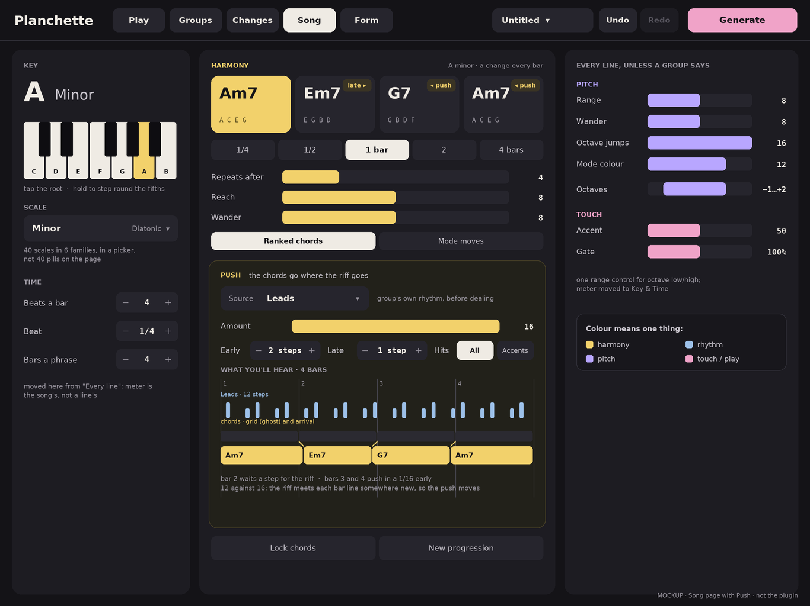

# UI rework: critique and a Song page with Push

Status: proposal. Nothing in the plugin has changed. The screens judged here come from the `screens` artifact
of CI run 45560092531 on `9062c68`. The mockup is `song-mockup.png`, drawn by `tools/mockups/song_page.py`
(Pillow plus the DejaVu fonts that ship with matplotlib), so it isn't a JUCE render.

## What's wrong, across every page

1. **Nothing has more weight than anything else.** The key, the chords and eleven line defaults are the same
   size of panel with the same kind of control. The few decisions that shape a song (key, chords, rhythm) look
   no more important than Octave low.
2. **Colour doesn't mean anything.** Yellow is the chords on Song, Ratchets and Fills on Groups, a B letter in
   the matrix and the gong on Form. Blue is line defaults on Song and rhythm on Groups. Pink is Generate, voice 1
   and Accent. Green is Form's sliders. A colour should tell you what kind of thing you're touching.
3. **Values get cut off.** `2 phra…`, `4 note…` (Form), `ph… go… ke…` (Changes), `When the next voice repe…`
   (Groups). A cut-off value is a value you can't read.
4. **Things live in more than one place, or the wrong place.** There are two Generate buttons (top bar and the
   Song box) and two song names. MIDI out is a setup choice sitting on the Song page. Beats a bar, Beat and Bars
   a phrase are the song's meter, filed under "Every line". The 4-bar matrix is on Play and on Changes.
5. **Empty space where it isn't needed, cramped where it is.** On Song, the middle column has about 140 px of
   nothing above Lock chords, while the key column spends its whole height on 40 scale pills. On Groups, the
   voice cards (where a Chord voice's Stagger and Top live now) are squeezed under the fold behind a scrollbar.
   On Form, there's a large empty gap under + and −.

## Page by page

- **Play** is the best page: a lane per group, notes as bars, the chord as one block. Keep it. Under Push, the
  Chords lane should show when the change actually arrives, not just `held`. There's also room for a slim
  Push/Stagger lane above Chords.
- **Song**: see the mockup. The key column becomes one root picker (the piano; the root row and circle are the
  same choice twice) plus a Scale picker that opens the 40 scales in their 6 families. Meter moves to Key & Time.
  Harmony becomes the main panel, with Push inside it. Line defaults are split into Pitch and Touch. Songs, Save,
  New and MIDI out move into the song-name menu in the top bar, and the Song box goes away.
- **Groups**: three things hold equal weight here (rhythm, who plays which hit, voices), and the voices lose. I'd
  make the voice cards a full-width row that's always visible, give the Chord voice card its own Chord section
  (Voicing, Stagger, Order, Lean, Top, and On the grid and Strike with from Push), and fold Ratchets and Fills
  into a collapsible strip. "This group's shape" works like a song-wide default with a group override. That's
  the right idea, but the grey bar and `song` pill need to say "inherited" more clearly, for example as a
  ghosted bar showing the song value.
- **Changes**: the sentence summary ("Every phrase, on its last bar, vary 4 of the Leads' notes…") is the best
  idea in the whole UI. Lead with it everywhere. The Sources row is an empty band with five add buttons, and
  should collapse to a single "+ Source" until there's a source. The units row (`bars ph… go… ke…`) needs words
  that fit.
- **Form**: two columns of mostly empty panel. Irama and Tihai are per-group settings laid out as grids of
  pills. They'd read better as a table with one row per group and a compact control in each cell. The
  monospace heading "The song as written" is the only monospace heading in the app.

## Colour, proposed

| Colour | Means | Used for |
|---|---|---|
| Yellow | harmony | key root, chords, Push, Stagger/Top |
| Blue | rhythm | steps, density, swing, ratchets, a riff's hits |
| Lilac | pitch | range, wander, octaves, mode colour |
| Pink | touch and the play action | accent, gate, Generate |
| Olive | change over time | matrix, sources, form letters |

Voice identity is then a small dot and the channel label, not a fill colour. That frees the fills to mean the
kind of setting.

## Push on the Song page (the mockup)

- **Source** is a menu of groups, and "Off" is its first item. A group on Resultant appears greyed out, with
  "can't be a source: its hits follow the pitches Push moves", so Push never fails silently.
- **Amount** is a slider (it's also a host parameter). **Early** and **Late** are steppers counted in the
  source's steps, because 0–4 is too short a range for a slider. **Hits** is All or Accents.
- **What you'll hear** draws the source's hits over 4 bars, the grid's chord blocks as ghosts, and the arrived
  chords on top, with a tie from each grid tick to its arrival. With a 12-step riff against 16 you can see the
  push move from bar to bar. This strip does most of the explaining. It reads the engine's arrivals, so it's
  never out of step with what plays.
- Each chord tile gets a small `late ▸` or `◂ push` tag when its change moved.
- A voice's **Harmony: Follows / On the grid** and a Chord voice's **Strike with** go on the voice card (Groups),
  not here.

## Order of work, if this is the direction

1. Theme: the colour roles above, and a value label that never cuts off (it shrinks, or the slider gets narrower).
2. Song page as mocked, Push controls included. That finishes Push.
3. Groups: the voice row and the Chord section (Stagger, Order, Lean, Top, On the grid, Strike with).
4. Play: the arrival-aware Chords lane.
5. Changes and Form clean-up.

Each step is its own PR, and each comes with its CI screens.
